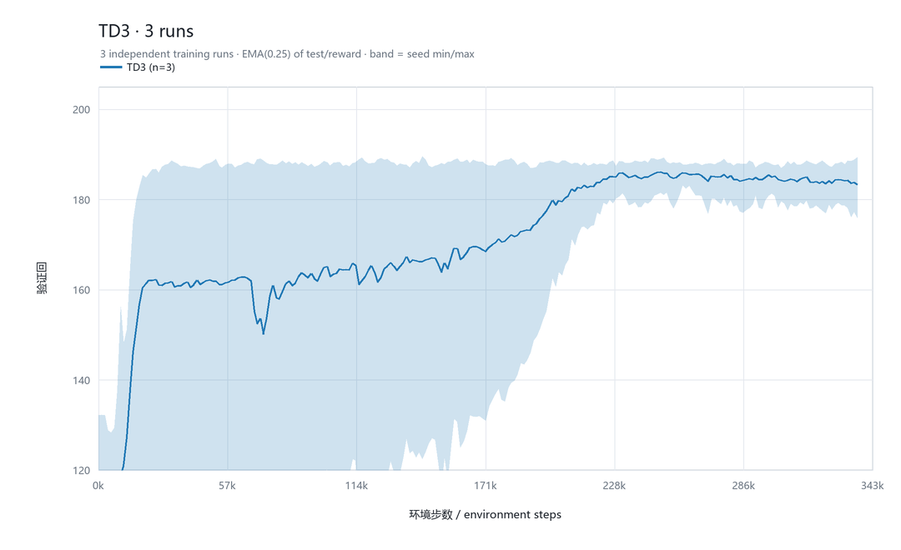

# 03 TD3, 双 critic 压掉过估计，但压不掉方差
# 03 TD3, twin critics kill overestimation, not variance

> 上一章 / previous：[02 DDPG](../02-ddpg/README.md) · 下一章 / next：[04 SAC](../04-sac/README.md)

## 0. 中英摘要 / Abstract

第 02 章留下两个问题：DDPG 的均值 180.4 ± 8.6 被一次 170.44 的运行主导；而它的 critic 只有一个（`trainer/ddpg/trainer.py#L75-L77`），在 Q 值过估计时没有任何纠错手段。
本章只加三个机制：第二个 critic、target policy smoothing、延迟 actor 更新（`update_actor_freq=2`），其余设置一字不动。
三次运行终点 **181.3 ± 8.3**（183.04 / 172.23 / 188.59），最高 **191.1**，最高回报是三条经典 off-policy 臂里最高的，但均值只比 DDPG 高 0.9，方差几乎没动。
参数从 349,704 / 174,852 涨到 524,810 / 262,405，涨的部分正好是一个 critic 的量级。
结论：双 critic 把"最好的一次"抬上去了，没有把"最差的一次"抬上来；`docs/FACTS.md` §7 里 TD3 的 2.44 s / 质量 0.033 说明它和 DDPG 会掉进同一个退化模式。

Chapter 02 left two problems: DDPG's 180.4 ± 8.6 mean is dominated by a single 170.44 run, and its critic is a single network (`trainer/ddpg/trainer.py#L75-L77`) with no defence against Q overestimation.
This chapter adds exactly three mechanisms, a second critic, target policy smoothing, and a delayed actor update (`update_actor_freq=2`), and changes nothing else.
Three runs end at **181.3 ± 8.3** (183.04 / 172.23 / 188.59), best **191.1**: the highest best of the three classic off-policy arms, while the mean is only 0.9 above DDPG and the spread barely moves.
Parameters go from 349,704 / 174,852 to 524,810 / 262,405, roughly one extra critic's worth.
Twin critics lifted the best run, not the worst one, and the 2.44 s / quality 0.033 cell in `docs/FACTS.md` §7 shows TD3 can fall into the same degenerate mode as DDPG.

## 1. 为什么会有这一步 / Why this step

- DDPG 的两个数字直接指向了问题：三次运行里两次在 185 附近，一次掉到 170.44（`docs/FACTS.md` §1）；而它的 critic 只有一个，`DDPGPolicy` 里的 `exploration_noise=0.1` 是唯一的探索来源（`trainer/ddpg/trainer.py#L79-L88`）。
- 这个环境里 reward 有明确的上界行为：`assert reward > 0`（`env/env.py#L519`），质量项 `tanh(steps/30)` 在步数高时饱和（`env/env.py#L503`）。Q 值一旦在某个动作上被高估，确定性 actor 会立刻朝那个方向跑，没有第二个估计能拦住它。
- 代码里对应的改动全在 `code/eat-train/trainer/td3/trainer.py`：多一个 critic（L84-L90），策略换成 `TD3Policy`（L92-L107），超参多出 `policy_noise=0.2`、`noise_clip=0.5`、`update_actor_freq=2`。
- 本章要验证的假设：**如果 DDPG 的方差主要来自 Q 过估计，那么"取两个 critic 的较小值 + 平滑目标动作"应该同时抬高均值并压低标准差。**

## 2. 机制 / Mechanism

| 组件 | 实现 | 代码位置 |
|---|---|---|
| 预处理 | 与 DDPG 完全相同的 `MLPPreprocess`（256×256 ReLU） | `code/eat-train/trainer/td3/trainer.py#L16-L44` |
| actor | `Actor(preprocess_net=actor_pre, max_action=...)`，结构与 DDPG 一致 | `code/eat-train/trainer/td3/trainer.py#L76-L81` |
| critic 1 | `Critic`，输入 (obs, action) 拼接后的 256×256 MLP | `code/eat-train/trainer/td3/trainer.py#L85` |
| critic 2 | 第二个独立 `Critic`，同结构、独立优化器 | `code/eat-train/trainer/td3/trainer.py#L89` |
| policy | `TD3Policy(tau=0.005, gamma=0.99, exploration_noise=0.1, policy_noise=0.2, noise_clip=0.5, update_actor_freq=2)` | `code/eat-train/trainer/td3/trainer.py#L92-L107` |
| 采样 | `Collector` + `VectorReplayBuffer(total_size=step_per_epoch)` | `code/eat-train/trainer/td3/trainer.py#L110-L111` |
| 训练循环 | `OffpolicyTrainer`，step-based，`step_per_collect` 与 DDPG 相同 | `code/eat-train/trainer/td3/trainer.py#L114-L129` |

- **动作怎么产生**：actor 输出确定性动作 + 0.1 高斯噪声（L102），和 DDPG 一样，探索这一层**没有任何新增**。
- **梯度怎么来**：两个 critic 各自回归 TD 目标，但 TD 目标取两者中较小的那个；目标动作先被 `policy_noise=0.2` 扰动、再被 `noise_clip=0.5` 裁掉，即 target policy smoothing（L103、L105）。actor 每 2 步才更新一次（L104），避开 critic 还没稳时的错误梯度。
- **和上一章的差别只有三处**：多一个 critic、TD 目标取 min 且对目标动作加噪、actor 延迟更新。环境、动作空间、reward、种子、步数、收集方式都没变，这是一次干净的单变量对比。
- **和下一章的差别**：TD3 依然是确定性的，依然没有熵项。第 04 章会把 actor 换成分布、把熵加进目标函数，那才是方差真正掉下来的地方。

## 3. 实验设置 / Setup

| 项 | 值 | 出处 |
|---|---|---|
| 环境规模 | 64 节点（`set_global_config(node_num=64, max_visible_tasks=8)`） | `code/eat-train/scripts/td3_train.py#L36`；`docs/FACTS.md` §8 |
| 可见任务数 | 8 | 同上 |
| 到达率 λ | 0.3 | `docs/FACTS.md` §8（代码按 `0.3 * node_num / 32.0` 外推，`config.py#L29-L36`；64 节点下的实际取值 **未记录 / not recorded**） |
| 质量比 quality_ratio | 0.600（由默认权重 q=6, t1=3, t2=1 算出） | `docs/FACTS.md` §8；`code/eat-train/env/config.py#L85-L89`（`run.json` 的 `variant` 为空，没有逐 run 标注） |
| 种子 | 作者笔记记录 42 / 120 / 245，运行目录不保存种子 | `docs/FACTS.md` §1 |
| 训练步数 | 336,000 / 次 | `docs/FACTS.md` §1 |
| 学习率 | 3e-4（与 DDPG 脚本同一个常量） | `code/eat-train/scripts/td3_train.py#L46`；`docs/FACTS.md` §8 |
| 网络宽度 | actor / critic 均为 256×256 | `code/eat-train/scripts/config.py#L57`；`docs/FACTS.md` §8 |
| 参数量（总 / 在线） | 524,810 / 262,405 | `docs/FACTS.md` §1 |
| 扩散头 / η | 不适用（确定性策略，没有扩散动作头） | — |

与第 02 章相比，这张表只有"参数量"一行变了。这正是本章想做的单变量实验。表里的取值凡出现在代码里的都标了行号，`docs/FACTS.md` 覆盖节点数、λ、质量比、种子、步数、宽度与参数量。

## 4. 收敛过程 / Convergence



| 运行目录 | 环境步数 | 终点验证回报 | 备注 |
|---|---:|---:|---|
| `2026-08-15_18-19-43` | 336,000 | 183.04 | 中位 |
| `2026-08-15_23-35-57` | 336,000 | 172.23 | 三次里最低 |
| `2026-08-15_23-36-16` | 336,000 | 188.59 | 三次里最高 |
| **均值 ± 样本标准差** | | **181.3 ± 8.3** | `docs/FACTS.md` §1 |
| 最高回报 | | 191.1 | `docs/FACTS.md` §1 |

"最高回报 191.1"不等于任何一次运行的终点（最高的终点是 188.59），与 [`data/by_algorithm.csv`](../data/by_algorithm.csv) 的 `best_mean` 列一致，推断 / inferred：它是三次运行各自 best 的平均。

- **这张图的灰带是全仓库最宽的**：三条曲线里有一条几乎从早期就一直封在 180 刻度上方，另一条在横轴前半段长期贴着下边界，直到后半段才追上均值。带状区间的宽度就是 8.3 的样本标准差的可视化版本。
- **收敛速度不齐**：均值曲线在最前面一小段就爬到 160 刻度附近并长期徘徊，真正抬到 180 刻度上方是在横轴过半之后（读图 + 推断）。
- **最好的那次很早就到了**：188.59 那次的高位从图上看很早就形成，之后没有再掉，与 DDPG 一样，best ≈ 后期平台，说明 336,000 步预算内已到顶。
- **最差的一次学得会，只是起得晚**：终点 172.23 与最高一次 188.59 的差是 16.36（算术），比 DDPG 的 15.74（186.18 − 170.44，算术）还大一点。

## 5. 结果与对比 / Results

同协议（64 节点、λ=0.3、quality_ratio=0.600、336,000 步、3 个种子）下：

| 臂 | 终点均值 ± 标准差 | 最高回报 | 环境步数 | 参数量（总 / 在线） |
|---|---:|---:|---|---|
| DDPG | 180.4 ± 8.6 | 187.3 | 336,000 | 349,704 / 174,852 |
| **TD3** | **181.3 ± 8.3** | **191.1** | 336,000 | 524,810 / 262,405 |
| SAC | 184.3 ± 2.5 | 189.9 | 336,000 | 437,511 / 262,405 |
| PPO | 185.2 ± 2.0 | 193.0 | 849,149 / 848,668 / 854,041 | 611,336 / 611,336 |

- **最高回报这一列 TD3 赢了三条 off-policy 臂**：191.1 > 189.9（SAC）> 187.3（DDPG）。这与"双 critic 压制过估计 → 找到更高的峰值"的预期一致（推断 / inferred）。
- **均值这一列只赢了 DDPG 0.9**（181.3 − 180.4，算术），而 SAC 比它高 3.0（184.3 − 181.3，算术）。
- **方差这一列几乎没变**：8.3 对 DDPG 的 8.6（算术），比 SAC 的 2.5 高出一大截。
- PPO 那一行步数约 2.5 倍（849,149 / 336,000，算术），不参与同预算比较，见 [05 PPO](../05-ppo/README.md)。

## 6. 简要分析 / Analysis

1. **多出来的参数正好是一个 critic**。在线参数 262,405 − 174,852 = 87,553（算术），这是一个 critic 的量级；总参数 524,810 = 2 × 262,405（算术），说明目标网络依然只有"一份"对称复制（actor_target + 两个 critic 的 target）。第 04 章 SAC 的在线参数与它完全相同（262,405），总参数却只有 437,511，两者的差别不在"几个 critic"，而在目标网络怎么复制（推断 / inferred，依据 `docs/FACTS.md` §1 的三个参数量）。
2. **target smoothing 确实改变了峰值**。最高回报从 DDPG 的 187.3 抬到 191.1（FACTS §1），是三条 off-policy 臂里唯一突破 190 的。这是"抑制过估计"这一机制起作用的正面证据（推断：没有逐 run 的 Q 值日志可以直接验证，`curves.csv` 里只有 `update/loss/critic`）。
3. **但它没有改变尾部**。`docs/FACTS.md` §7 里 TD3 是 2.44 s / 质量 0.033（另一格 0.110），和 DDPG 的 1.28 s / 0.033 是同一个退化模式：只挑最短任务、永远用最低推理步数。双 critic 拦不住"整条策略塌进一个角"，因为这里的塌陷更可能来自探索不足，Q 过估计的解释要排在后面（推断 / inferred）。
4. **曲线形状是最直接的证据**。三条曲线的灰带在图里持续张着，且两条曲线没有围绕均值对称收敛：一条早早封在 180 刻度上方，另一条晚熟。这说明种子决定的是"什么时候找到高步数高奖励的动作模式"，而不是"最终能不能找到"，目标平滑让找到之后的 Q 更准，但没让搜索更快。
5. **和论文排序的关系**。论文把 TD3 排在 DDPG 之前、SAC 之后（`docs/FACTS.md` §1 的论文声明排序 `… > SAC > TD3 > DDPG`）。我们复现到的正是这个局部顺序：181.3 介于 180.4 与 184.3 之间。**没复现到**的是"双 critic 能显著降低方差"，8.3 与 8.6 的差别在 3 个种子下不构成证据（算术：两者只差 0.3）。

## 7. 训练数据导航 / Training data

| 内容 | 路径 |
|---|---|
| 本算法全部运行（3 次） | [`data/fig6-main/td3/`](../data/fig6-main/td3/) |
| 每一次运行的曲线 | `data/fig6-main/td3/<run>/curves.csv`（列：`tag,step,value`；目录名见 §4） |
| 运行的元数据 | `data/fig6-main/td3/<run>/run.json`（含 `env_steps`、`test_reward.last/best`、`curated_tags`） |
| 全部运行索引 | [`data/runs_index.csv`](../data/runs_index.csv)（88 次运行一行一条） |
| 按算法聚合 | [`data/by_algorithm.csv`](../data/by_algorithm.csv)（`campaign=fig6-main, algorithm=td3` 一行） |
| 参数量的取证来源 | `policy_best.pth` + `tools/ckpt_inventory.py`，见 `docs/FACTS.md` 开头说明 |
| 原始 TensorBoard 日志 | `EATlogs/EAT基线对比/**/events.out.tfevents.*`（未入库，见 `docs/DATA.md`） |

`curves.csv` 里可用的 tag 有 `test/reward`、`test/length`、`train/reward`、`update/loss/actor`、`update/loss/critic`、`save/env_step` 等（以 `run.json` 的 `curated_tags` 为准）。**没有**逐 run 的 Q 值或双 critic 差值 tag，所以"过估计被压掉多少"在数据里无法直接核对，未记录 / not recorded。

## 8. 复现命令 / Reproduce

入口在快照里存在，从 `code/eat-train` 目录运行，并把 `scripts` 放进 `PYTHONPATH`。本仓库**没有**重新执行过这条命令（需要原环境的 GPU 与依赖）。

```powershell
cd code\eat-train
$env:PYTHONPATH = ".;scripts"
python scripts\td3_train.py
```

- 日志目录是 `runs/<num_nodes>_<quality_ratio>/td3/<timestamp>`（`td3_train.py#L68-L71`，与 DDPG 脚本同构）；与 `data/fig6-main/td3/<timestamp>` 的对应靠时间戳（推断 / inferred）。
- 产生这三次运行的**精确原始命令未保留 / not preserved**：作者的驱动脚本 `scripts/fig6/train.py` 不在快照里。

---

上一章 / previous：[02 DDPG](../02-ddpg/README.md) · 下一章 / next：[04 SAC](../04-sac/README.md) · 返回目录 / index: [README](../README.md)
