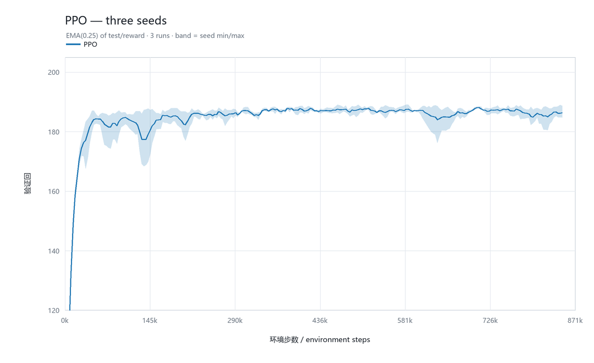

# 05 PPO — on-policy 裁剪目标，以及一个必须先说清的预算差
# 05 PPO — the clipped on-policy objective, and a budget gap that has to come first

> 上一章 / previous：[04 SAC](../04-sac/README.md) · 下一章 / next：[06 D2SAC](../06-d2sac/README.md)

## 0. 中英摘要 / Abstract

第 04 章把方差压到 2.5，靠的是熵正则；但 DDPG、TD3、SAC 三条都是 off-policy，都靠 replay buffer 反复用同一批样本。
本章换成 on-policy：每批数据只用来更新几次就丢掉，用 GAE + 裁剪目标代替 Q 学习，熵项以固定系数 `ent_coef` 出现（`trainer/ppo/trainer.py#L65-L81`）。
三次运行终点 **185.2 ± 2.0**（182.89 / 186.73 / 185.96），最高 **193.0**，参数 611,336（总 = 在线，没有目标网络）。
但三次运行分别用了 **849,149 / 848,668 / 854,041** 环境步，而三条 off-policy 臂都只用了 336,000 —— **约 2.5 倍**（算术）。
所以 185.2 这个均值**不是同等预算下的胜利**；它只说明在 2.5 倍样本下 on-policy 能追到同一个量级，样本效率明显更差。

Chapter 04 pushed the spread down to 2.5 with entropy regularisation, but DDPG, TD3 and SAC are all off-policy and all reuse samples through a replay buffer.
This chapter goes on-policy: each batch is used for a few updates and then discarded, GAE and a clipped objective replace Q-learning, and entropy appears as a fixed `ent_coef` (`trainer/ppo/trainer.py#L65-L81`).
Three runs end at **185.2 ± 2.0** (182.89 / 186.73 / 185.96), best **193.0**, with 611,336 parameters (total = live, no target networks).
But those runs consumed **849,149 / 848,668 / 854,041** env steps while the three off-policy arms used 336,000 — about **2.5×** (arithmetic).
So the 185.2 mean is **not a budget-matched win**: it says that with 2.5× the samples an on-policy method reaches the same order of return, at a clearly worse sample efficiency.

## 1. 为什么会有这一步 / Why this step

- 第 04 章给出的最好均值是 184.3 ± 2.5。它稳，但仍然是 off-policy —— 数据进 replay buffer，同一条 transition 会被反复采样（`trainer/sac/trainer.py#L101` 的 `VectorReplayBuffer`）。
- 很自然的下一个问题：**如果不允许复用旧数据，会掉多少？** 这不是调参问题，而是样本效率问题，也是论文要把 PPO 放进对比的原因。
- 代码对应 `code/eat-train/trainer/ppo/trainer.py`：`OnpolicyTrainer`（L89-L102），策略 `PPOPolicy`（L65-L81），超参是 GAE（`gae_lambda=0.95`）、裁剪（`max_grad_norm=0.5`）、值函数系数 `vf_coef=0.5`、熵系数 `ent_coef=0.01`、`reward_normalization=True`。
- 本章要验证的假设：**在不复用样本的前提下，PPO 应该更难爬到同等回报；如果它爬到了，代价应该体现在环境步数上。** 这个假设在本章被证实的程度，完全取决于你怎么读"步数"那一列（见 §5、§6）。

## 2. 机制 / Mechanism

| 组件 | 实现 | 代码位置 |
|---|---|---|
| 共享主干 | 一个 `Net(state_shape=obs_dim, hidden_sizes=256×256)`，同时喂给 actor 和 critic | `code/eat-train/trainer/ppo/trainer.py#L42-L46` |
| actor | `ActorProb(preprocess_net=net, max_action=..., unbounded=True)`，输出高斯分布 | `code/eat-train/trainer/ppo/trainer.py#L48-L54` |
| critic | `Critic(preprocess_net=net, hidden_sizes=256×256)`，**与 actor 共用同一个预处理网络** | `code/eat-train/trainer/ppo/trainer.py#L56-L60` |
| 优化器 | 一个 Adam，参数表是 actor 参数 + critic 参数拼接 | `code/eat-train/trainer/ppo/trainer.py#L62-L63` |
| policy | `PPOPolicy(discount_factor=0.99, gae_lambda=0.95, max_grad_norm=0.5, vf_coef=0.5, ent_coef=0.01, reward_normalization=True, deterministic_eval=True)` | `code/eat-train/trainer/ppo/trainer.py#L65-L81` |
| 采样 | `Collector` + `VectorReplayBuffer(total_size=step_per_epoch)`，但只装当前这一批 on-policy 数据 | `code/eat-train/trainer/ppo/trainer.py#L86-L87` |
| 训练循环 | `OnpolicyTrainer`，`repeat_per_collect=8`、`episode_per_collect=8` | `code/eat-train/trainer/ppo/trainer.py#L89-L102` |

- **动作怎么产生**：actor 输出高斯分布，评估时 `deterministic_eval=True`（L79）取均值；训练时采样，熵项以 `ent_coef=0.01` 的固定系数进入损失（L76）。
- **梯度怎么来**：用 GAE 算优势，再用裁剪的概率比目标更新 actor，critic 回归价值，两者在同一个优化器里（L62-L63）。没有 target 网络、没有软更新、没有 replay。
- **和上一章的差别**：三处，而且都跟"数据能用几次"有关 —— 数据只用于 `repeat_per_collect=8` 遍更新（L95）然后丢弃；没有 target 网络（总参数 = 在线参数）；actor 与 critic 共享主干（L42-L60），这一点三条 off-policy 臂都没有。
- **必须点破的代价**：on-policy 的每一步数据只贡献几次梯度，所以"同样多的更新"需要"多得多的环境交互"。这就是下面 2.5 倍的来源，不是超参没调好。

## 3. 实验设置 / Setup

| 项 | 值 | 出处 |
|---|---|---|
| 环境规模 | 64 节点（`set_global_config(node_num=64, max_visible_tasks=8)`） | `code/eat-train/scripts/ppo_train.py#L40`；`docs/FACTS.md` §8 |
| 可见任务数 | 8 | 同上 |
| 到达率 λ | 0.3 | `docs/FACTS.md` §8（代码按 `0.3 * node_num / 32.0` 外推，`config.py#L29-L36`；64 节点下实际取值 **未记录 / not recorded**） |
| 质量比 quality_ratio | 0.600（由默认权重 q=6, t1=3, t2=1 算出） | `docs/FACTS.md` §8；`code/eat-train/env/config.py#L85-L89`（`run.json` 的 `variant` 为空，没有逐 run 标注） |
| 种子 | 作者笔记记录 42 / 120 / 245，运行目录不保存种子 | `docs/FACTS.md` §1 |
| 训练步数（**逐次不同**） | 849,149 / 848,668 / 854,041 | `docs/FACTS.md` §1 |
| 学习率 | 3e-4 | `code/eat-train/scripts/ppo_train.py#L50` |
| 网络宽度 | actor / critic 均 256×256（并且共享主干） | `code/eat-train/scripts/config.py#L57`；`docs/FACTS.md` §8 |
| 参数量（总 / 在线） | 611,336 / 611,336 | `docs/FACTS.md` §1 |
| 每 epoch 收集步数 | 10,000（脚本常量） | `code/eat-train/scripts/ppo_train.py#L52` |
| 每批重复更新 | `repeat_per_collect=8` | `code/eat-train/trainer/ppo/trainer.py#L95`；`ppo_train.py#L54` |
| 扩散头 / η | 不适用（高斯策略，没有扩散动作头） | — |

- **总参数 = 在线参数**（611,336 / 611,336）：on-policy 不需要目标网络，这是它参数"便宜"的一面。
- **配置的 epoch 上限远大于实跑**：脚本写的是 `epoch=1500`、`step_per_epoch=10000`（`ppo_train.py#L51-L52`），跑满就是 1,500 万步；实际记录在 85 万步左右，约合 85 个 epoch（算术）。推断 / inferred：训练在中途停下，停的原因 **未记录 / not recorded**。

## 4. 收敛过程 / Convergence



| 运行目录 | 环境步数 | 终点验证回报 | 备注 |
|---|---:|---:|---|
| `2026-08-11_17-42-15` | 849,149 | 182.89 | 终点最低 |
| `2026-08-13_22-05-45` | 848,668 | 186.73 | 三次里最高 |
| `2026-08-13_22-24-54` | 854,041 | 185.96 | 步数最多的那一次 |
| **均值 ± 样本标准差** | | **185.2 ± 2.0** | `docs/FACTS.md` §1 |
| 最高回报 | | 193.0 | `docs/FACTS.md` §1 |

"最高回报 193.0"不等于任何一次运行的终点（最高终点 186.73），与 [`data/by_algorithm.csv`](../data/by_algorithm.csv) 的 `best_mean` 列一致 —— 推断 / inferred：它是三次运行各自 best 的平均。

- **横轴长度就是预算差**：这张图的横轴要覆盖 85 万步，而三条 off-policy 的图只覆盖 33.6 万步。**不要横着比斜率** —— 同一段像素在两张图里代表的步数不一样。
- **爬升极早**：曲线在横轴最前面一小段就冲到 180 附近，之后 80 多万步几乎是水平线，中间只有一次明显的凹陷和下探（读图 + 推断）。
- **方差小**：灰带在平台上很窄，三次运行的终点落在 182.89–186.73（跨度 3.84，算术），这是 2.0 的样本标准差的可视化。
- **后 90% 预算的收益接近零**：曲线在平台期基本不动，说明多出来的那 2.5 倍步数没有换成回报（推断 / inferred，读图）。

## 5. 结果与对比 / Results

同协议（64 节点、λ=0.3、quality_ratio=0.600、3 个种子）下，但要**逐列读**：

| 臂 | 终点均值 ± 标准差 | 最高回报 | 环境步数 | 步数比（算术） | 参数量（总 / 在线） |
|---|---:|---:|---|---:|---|
| DDPG | 180.4 ± 8.6 | 187.3 | 336,000 | 1.0× | 349,704 / 174,852 |
| TD3 | 181.3 ± 8.3 | 191.1 | 336,000 | 1.0× | 524,810 / 262,405 |
| SAC | 184.3 ± 2.5 | 189.9 | 336,000 | 1.0× | 437,511 / 262,405 |
| **PPO** | **185.2 ± 2.0** | **193.0** | 849,149 / 848,668 / 854,041 | **≈2.5×** | 611,336 / 611,336 |


- **预算不可比**：849,149 / 336,000 ≈ 2.53，848,668 / 336,000 ≈ 2.53，854,041 / 336,000 ≈ 2.54（算术）。PPO 的 185.2 是在 2.5 倍样本上取得的，三条 off-policy 臂的 1.0× 才是同一预算。
- **最高的 "最好一次" 也在 PPO 这边**：193.0（`docs/FACTS.md` §1），比 TD3 的 191.1、SAC 的 189.9、DDPG 的 187.3 都高 —— 但它同样是 2.5 倍预算下的数字。
- **柱子高度别当结论**：`fig6_final_bar.png` 的纵轴从 140 起，180.4 与 185.2 的视觉差被放大了，真实差 4.8（算术）。
- **同族的 DPPO 也在同一档预算**：`docs/FACTS.md` §1 里 DPPO 是 185.6 ± 1.0、步数 804,141 / 816,547 / 817,408 —— 两条 on-policy 臂都停在 80 万步一档，这不是某一次的意外。
- **§7 的响应/质量面板**：PPO 是 35.32 s / 质量 0.540（`docs/FACTS.md` §7），与 SAC 的 28.72 s / 0.556 相比更慢、质量略低；这组数字来自另一次早期评估（单种子），不能和上面的回报直接换算。

## 6. 简要分析 / Analysis

1. **2.5 倍不是瑕疵，是 on-policy 的定义**。每条 transition 只被用于 `repeat_per_collect=8` 遍更新（`trainer/ppo/trainer.py#L95`）就丢弃，而 off-policy 的 replay buffer 会把同一条样本用整个训练周期（`trainer/sac/trainer.py#L101`）。要匹配同样的梯度步数，on-policy 必须多采样，量级差 2.5 倍是合理的方向（推断 / inferred）。
2. **多出来的预算基本没换成回报**。曲线在很早的位置就进入平台，之后 80 多万步只是锯齿（§4）。也就是说"PPO 更好"这句话在 2.5 倍预算下都不太成立：它和 SAC 的均值差只有 0.9（185.2 − 184.3，算术），而样本多了 1.5 倍（算术）。
3. **低方差的规律在四条臂上是一致的**。带熵项的臂（SAC 的自动 α、PPO 的 `ent_coef=0.01`，`trainer/ppo/trainer.py#L76`）标准差是 2.5 / 2.0；不带熵项的臂（DDPG、TD3）是 8.6 / 8.3（算术对照，全部来自 `docs/FACTS.md` §1）。这是本章唯一一个"机制 → 结果"的干净对应（推断 / inferred）。
4. **参数量对得上结构**。611,336 总 = 611,336 在线（`docs/FACTS.md` §1）：没有目标网络，所以不存在"复制一份"的开销。同时 actor 与 critic **共享同一个主干**（`trainer/ppo/trainer.py#L42-L60`，同一个 `net` 对象传给了两处），这与三条 off-policy 臂各用独立 `MLPPreprocess` 的做法不同 —— 它对优化动态的影响本仓库没有消融，**未记录 / not recorded**（推断 / inferred：共享主干通常会让 actor 与 critic 的梯度互相牵制）。
5. **公平比较需要什么**（这是本章最重要的一条）。
   - **同环境步数预算**：把 PPO 也截到 336,000 步，或用 336,000、672,000、1,008,000 三档预算把所有臂都跑一遍，看谁的曲线先饱和。
   - **按步数而不是按 epoch 画图**：epoch 在 on-policy 与 off-policy 里含义不同（一次 epoch 里数据被用的次数不一样），只有横轴是"环境步数"时四张图才可比。本仓库的曲线图已经是按环境步数画的，但**预算本身不同**，所以要额外标出预算线。
   - **报样本效率，而不只是终点**：例如"每 10 万环境步换来多少回报"，或者达到某条回报线所需的步数。用终点均值单独排序会把 2.5 倍预算这条信息完全抹掉。
   - **同样 3 个种子、同样物理时间**：三次运行不足以区分 0.9 的均值差（SAC 与 PPO），而墙钟时间又与"谁的样本更贵"直接相关 —— 这两个量本仓库都没有记录（墙钟 **未记录 / not recorded**）。
   - **σ 也要一起报**：PPO 的 2.0 和 SAC 的 2.5 在这个种子数下无法区分。
6. **复现到了什么、没复现到什么**。复现到的是"PPO 的终点点位在四条学习型基线里最高（185.2）且方差很小（2.0）"，以及"on-policy 系统地需要更多样本"（图 6 与 fallback 两组都是 80 万步一档，`docs/FACTS.md` §1、§4）。**没复现到**的是"同预算下 PPO 更强"—— 这个命题在本仓库的数据里无法成立，因为预算根本不同；也**没有**复现到论文排序里 PPO 与 SAC 的接近关系在同等条件下的样子（0.9 的差距被 2.5 倍预算笼罩）。

## 7. 训练数据导航 / Training data

| 内容 | 路径 |
|---|---|
| 本算法全部运行（3 次） | [`data/fig6-main/ppo/`](../data/fig6-main/ppo/) |
| 每一次运行的曲线 | `data/fig6-main/ppo/<run>/curves.csv`（列：`tag,step,value`；目录名与步数见 §4） |
| 运行的元数据 | `data/fig6-main/ppo/<run>/run.json`（注意 `env_steps` 逐次不同） |
| 全部运行索引 | [`data/runs_index.csv`](../data/runs_index.csv)（88 次运行一行一条，含 `env_steps`） |
| 按算法聚合 | [`data/by_algorithm.csv`](../data/by_algorithm.csv)（`campaign=fig6-main, algorithm=ppo` 一行） |
| 参数量取证 | `policy_best.pth` + `tools/ckpt_inventory.py`，见 `docs/FACTS.md` 开头说明 |
| 原始 TensorBoard 日志 | `EATlogs/EAT基线对比/**/events.out.tfevents.*`（未入库，见 `docs/DATA.md`） |

PPO 的 `curated_tags` 里除 `test/*`、`train/*`、`save/*` 外还有 `update/loss`、`update/loss/clip`、`update/loss/ent`、`update/loss/vf` —— 熵损失与裁剪比例都能从 `curves.csv` 画出来（本章没有引用它们的数值，`docs/FACTS.md` 未收录）。

## 8. 复现命令 / Reproduce

入口在快照里存在，从 `code/eat-train` 目录运行，并把 `scripts` 放进 `PYTHONPATH`。本仓库**没有**重新执行过这条命令（需要原环境的 GPU 与依赖）。

```powershell
cd code\eat-train
$env:PYTHONPATH = ".;scripts"
python scripts\ppo_train.py
```

- 日志目录是 `runs/<num_nodes>_<quality_ratio>/ppo/<timestamp>`（`ppo_train.py#L70-L73`）；与 `data/fig6-main/ppo/<timestamp>` 的对应靠时间戳（推断 / inferred）。
- 想复现"同预算对比"，需要把 `ppo_train.py` 的 `epoch` / `step_per_epoch` 调到与 336,000 步相当（`ppo_train.py#L51-L52`），或者把三条 off-policy 臂的预算调高 —— 两种做法本仓库都没有执行过，**未记录 / not recorded**。
- 产生这三次运行的**精确原始命令未保留 / not preserved**：作者的驱动脚本 `scripts/fig6/train.py` 不在快照里。

---

上一章 / previous：[04 SAC](../04-sac/README.md) · 下一章 / next：[06 D2SAC](../06-d2sac/README.md) · 返回目录 / index: [README](../README.md)
