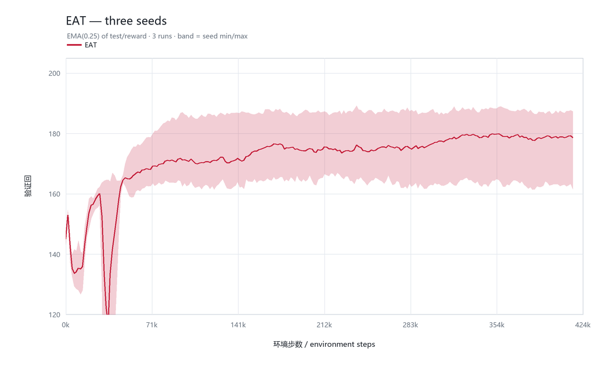

# 08 EAT — 可学习 η 的 DDIM 动作头 + 双注意力
# 08 EAT — a DDIM action head with a learned η, plus dual attention

> 上一章 / previous：[07 DPPO](../07-dppo/README.md) · 下一章 / next：[09 消融](../09-ablation/README.md)

## 0. 中英摘要 / Abstract

EAT 是论文自己的方法，也是这条故事线的高潮：DDIM 采样器 + 一个可学习的标量 η（当熵代理）+ actor 的交叉注意力 + critic 的自注意力。它是最接近"复现成功"的一格，也是最难下结论的一格：两次运行停在 187.17 / 187.38（平均 **187.28**），**高于表里任何算法的 3 次均值**（最高的均值是 DPPO 的 185.62）；但第三次掉到 158.68，把均值拉到 177.7 ± 16.5，种子标准差 16.5 是七个臂里最大的（次大 DDPG 是 8.6），均值只排第 5。同时要说清：**单次**最高终点回报不属于 EAT（是 TD3 的 188.59），**单次**最高过程点也不属于 EAT（是 DPPO 的 193.84；EAT 自己的最高点是 193.54）。学到的 η 落在 0.0940 / 0.0899 / 0.0941 —— 采样器几乎全程都是低随机性的，而 η 最低的那次反而跑得很好，所以 η 解释不了那颗掉队的种子。最后必须直说没复现到的：论文的 `EAT > DPPO ≈ D2SAC > PPO ≈ SAC > TD3 > DDPG` 在我们的数据里完全不成立。

English: EAT is the paper's own method — DDIM sampling with a single learned η used as an entropy proxy, cross-attention in the actor, self-attention in the twin critics. Two seeds end at 187.17 and 187.38 (mean 187.28), above every algorithm's 3-seed mean (DPPO's 185.62 is the best mean); the third collapses to 158.68, pulling the mean to 177.7 ± 16.5 with the largest seed std in the sweep (16.5 vs 8.6 for DDPG). The single highest final return belongs to TD3 (188.59) and the single highest best-of-run point to DPPO (193.84, with EAT's own peak at 193.54) — neither is EAT. Learned η ends at 0.0940 / 0.0899 / 0.0941: the sampler is almost deterministic throughout, yet the lowest-η seed is one of the good ones, so η does not explain the collapse. What was **not** reproduced: the paper's ranking.

## 1. 为什么会有这一步 / Why this step

- 第 06 与第 07 章留下一个矛盾：同一批扩散零件，**当动作分布**用是 159.5（D2SAC，全场最低），**当特征提取器**用是 185.6（DPPO，均值第一，但花了 ≈2.4 倍步数，见第 07 章 §6 第 3 条）。
- 论文对这一格的答案是：仍然把扩散当分布，但换成 DDIM 并只留**一个标量**控制随机性，再把这个标量塞进 SAC 的熵项里 —— 让"探索多少"变成可学的东西。代码在 `trainer/dicasac/trainer.py` 与 `model/diffusion/rl_diffusion_ddim.py`。
- 本章要验证的假设：**把 η 纳入目标函数，能同时拿到扩散的表达力与 SAC 的探索**，从而在主对比里排到第一。

> EN — After D2SAC (diffusion as distribution, worst) and DPPO (diffusion as features, best but over-budget), EAT is the paper's synthesis: DDIM with one learned randomness scalar wired into the SAC entropy term. The hypothesis is that this recovers both expressiveness and exploration.

## 2. 机制 / Mechanism

| 组件 | 实现 | 代码位置 |
|---|---|---|
| actor 条件编码 | `CrossAttentionPreprocessNet`：task 作 Query、node 作 Key/Value | `code/eat-train/trainer/dicasac/trainer.py#L100`；`code/eat-train/model/attention/cross_attention.py#L12` |
| 噪声网络 | `DiffusionMLP`，激活用 **Mish**（06/07 的版本是 ReLU） | `code/eat-train/trainer/dicasac/trainer.py#L23`、`#L111`（`#L36`、`#L44`） |
| actor | `RLDiffusionActor`（DDIM），`beta_schedule='linear'` | `code/eat-train/trainer/dicasac/trainer.py#L118`；`code/eat-train/model/diffusion/rl_diffusion_ddim.py#L17` |
| η 参数 | 一个标量 `eta_param`，`eta = sigmoid(eta_param)` → [0,1] | `code/eat-train/model/diffusion/rl_diffusion_ddim.py#L75`、`#L106` |
| DDIM 采样 | `_ddim_sample`：`sigma = eta × sqrt(variance)`，只有 `eta > 0` 且 `t > 0` 才加噪；`_p_sample_loop` 支持 `n_inference_steps` | `code/eat-train/model/diffusion/rl_diffusion_ddim.py#L101`、`#L128`、`#L149`、`#L168` |
| 熵代理 | `action_entropy()` 直接 `return eta`，不再用 log_sigma | `code/eat-train/model/diffusion/rl_diffusion_ddim.py#L226`–`#L237` |
| critic | 双 Q + `SelfAttentionQPreprocessNet`：node/task/每个动作维度都当 token 做自注意力 | `code/eat-train/trainer/dicasac/trainer.py#L137`、`#L158`；`code/eat-train/model/attention/self_attention.py#L127` |
| policy | `SACDDIMPolicy`，`alpha=1.0` **固定**（不自动调温） | `code/eat-train/trainer/dicasac/trainer.py#L184`–`#L198` |
| 温度签名 | 签名里有 `target_entropy=0.1`（`#L86`），但函数体 `#L179` 用 `-dim(A)` 覆盖 —— 签名值实际没被使用 | `code/eat-train/trainer/dicasac/trainer.py#L86`、`#L179` |

动作怎么来：从初始噪声出发，跑 `n_inference_steps` 步 DDIM；每步先让 `DiffusionMLP` 预测噪声、还原 `x_0` 并 clamp 到 `±max_action`，再按 DDIM 公式算 `x_{t-1}`。整个过程的随机性只从 `sigma = eta × sqrt(variance)` 这一个入口进来，最后 `tanh` 压到动作区间（`#L240`）。

梯度怎么来：`SACDDIMPolicy.learn` 里 actor 项是 `(-q_min - alpha * entropy).mean()`，而 `entropy` 就是 η（`policy/sac_diffusion.py#L393`–`#L394`），α 固定 1.0。所以 η 同时被两路梯度拉扯：熵项希望它变大（多探索），Q 项通过"动作里掺的噪声"希望它变小（更稳的动作）。

**这是本快照里 D2SAC 线与 EAT 线最干净的机制差别**（同一文件的两段代码；`docs/FACTS.md` §9 第 (1) 条把它列为逐行核对过的硬事实，不是推断）：

| policy | 温度 α | 熵项怎么处理 | 结果 |
|---|---|---|---|
| `SACDDPMPolicy`（第 06 章、第 09 章的 D2SAC-SA） | 自动（`alpha_tuple`，`trainer/dcasac/trainer.py#L162`）/ 固定 0.2（`trainer/dsac/trainer.py#L166`） | `#L159` 算出熵，`#L160` 立刻 `entropy = 0` | `#L161` 的 actor loss 退化成纯 `-Q_min`；自动温度那条路（`#L167`–`#L173`）只拿到常数 surrogate，把 α 往 0 推（推断 / inferred） |
| `SACDDIMPolicy`（本章；第 09 章的 EAT-CA） | 固定 1.0（`trainer/dicasac/trainer.py#L194`，因此 `#L412`–`#L418` 的自动调温不生效） | `#L393` 算，`#L394` **真的用** | η 被朝"更大熵"的方向优化，于是 `fig6_eta.png` 那条轨迹值得看 |

注意"保留熵项"在这里的确切含义：DDIM actor 的熵代理就是 η 本身（`model/diffusion/rl_diffusion_ddim.py#L226` 直接 `return eta`），所以这句话等于"可学习的 η 被一个希望它变大的目标函数推着走"。这就是第 06 章与本章的分野：D2SAC 的扩散头**没有被任何熵目标管理**，EAT 的扩散头**有一个（很弱的）熵目标**。

> EN — A scalar `eta_param` maps through sigmoid to [0,1] and serves both as the DDIM noise scale and as the entropy proxy; it is the only thing multiplying a fixed alpha=1.0. Two gradient sources pull on it in opposite directions. The neighbouring `SACDDPMPolicy` zeroes the same quantity out, which is the cleanest mechanism-level difference between the D2SAC line and the EAT line in this snapshot.

## 3. 实验设置 / Setup

| 项 | 值 | 出处 |
|---|---|---|
| 环境规模 / 节点数 | 32 或 64（代码默认 32） | `docs/FACTS.md` §8 |
| 到达率 λ | 0.3 | `docs/FACTS.md` §8 |
| 可见任务数 | 8 | `docs/FACTS.md` §8 |
| 质量比 quality_ratio | 未记录 / not recorded（主扫描 `run.json` 的 `variant` 为空） | — |
| 种子 | 3 次独立训练；作者笔记记 42 / 120 / 245，运行目录不保存种子 | `docs/FACTS.md` §1 |
| 预算 | **416,000** 步 | `docs/FACTS.md` §1 |
| 学习率 | 1e-4（主）；3e-4 为 DatA 对照支路 | `docs/FACTS.md` §8 |
| 扩散步数 | 代码默认 5（`trainer/dicasac/trainer.py#L84`）；主扫描实际取值 未记录 | 代码 / — |
| 温度 α | 固定 1.0（不自动调温） | `trainer/dicasac/trainer.py#L194` |
| 网络宽度 | actor/critic 256×256；UNet 256×256；状态嵌入 8 维 | `docs/FACTS.md` §8 |
| 参数量（总 / 在线） | **709,560 / 397,942** | `docs/FACTS.md` §1 |
| η 终点 | 0.0940 / 0.0899 / 0.0941 | `docs/FACTS.md` §1 |

预算这一行值得单独看：416,000 步比 off-policy 各臂的 336,000 多 80,000 步（算术：1.24×），比 DPPO 的 80 万步少一半以上。它是**中间预算**，所以与两边的比较要各自打折看。

> EN — Three seeds, 416k steps (1.24× the off-policy budget, well under DPPO's 800k), 709,560 parameters (397,942 live), main learning rate 1e-4, fixed alpha of 1.0. The sweep's actual diffusion step count and quality ratio are **not recorded**.

## 4. 收敛过程 / Convergence



| 运行目录 | 终点验证回报 | 逐次峰值 | η 终点 |
|---|---:|---:|---:|
| `2026-08-19_10-42-33` | 187.17 | 193.54 | 0.0940 |
| `2026-08-19_14-43-56` | 187.38 | 189.41 | 0.0899 |
| `2026-08-19_20-25-52` | 158.68 | 172.83 | 0.0941 |
| **均值 ± 样本标准差** | **177.7 ± 16.5** | — | — |
| 最高回报（三次峰值的均值） | 185.3 | — | — |

1. **早期有一个共同的深坑。** 三条曲线都在预算最前面一起掉到图窗下沿，然后在不到前 1/4 的地方爬到 160 以上；之后是缓慢的上漂，不再有第二次深跌。
2. **带宽由那一颗种子决定。** 均值曲线在最后三分之一的预算里几乎是水平的，带状区域的下沿就是 158.68 那一条、上沿是 187.38 那一条 —— "EAT 的典型表现"和"EAT 的最好表现"在这张图上是两件事。
3. **逐次峰值比终点高得多**：三次运行各自的峰值是 193.54 / 189.41 / 172.83（`data/runs_index.csv` 的 `test_reward_best`），它们的均值就是 `docs/FACTS.md` §1 里那个 185.3。也就是说 EAT 在训练过程中摸到过 193.54，但没有守住；掉队那次的过程峰值（172.83）也远低于另外两次。
4. **η 的图是另一张脸。** 三次运行的 `train/ddim_eta` 曲线几乎重叠（下图），说明在"采样随机性"这个维度上三颗种子走得几乎一样 —— 分歧不在 η。


> EN — A shared early dip, a climb past 160 within the first quarter, then a slow drift. The band is set by one collapsed seed. The per-run peaks (193.54 / 189.41 / 172.83) average to the 185.3 "best" in FACTS, so EAT did reach values it did not keep. The three η traces overlap, so the seeds do not diverge in sampler randomness.

## 5. 结果与对比 / Results

| 臂 | 终点均值 ± 标准差 | 最高回报 | 环境步数 | 参数量（总 / 在线） |
|---|---:|---:|---|---|
| DDPG | 180.4 ± 8.6 | 187.3 | 336,000 | 349,704 / 174,852 |
| TD3 | 181.3 ± 8.3 | 191.1 | 336,000 | 524,810 / 262,405 |
| SAC | 184.3 ± 2.5 | 189.9 | 336,000 | 437,511 / 262,405 |
| PPO | 185.2 ± 2.0 | 193.0 | 849,149 / 848,668 / 854,041 | 611,336 / 611,336 |
| D2SAC | 159.5 ± 4.0 | 166.8 | 336,000 | 422,135 / 254,229 |
| DPPO | 185.6 ± 1.0 | 193.0 | 804,141 / 816,547 / 817,408 | 519,238 / 519,238 |
| **EAT** | **177.7 ± 16.5** | 185.3 | 416,000 | 709,560 / 397,942 |

复现排序（终点均值）：`PPO 185.2 ≈ DPPO 185.6 > SAC 184.3 > TD3 181.3 > DDPG 180.4 > EAT 177.7 > D2SAC 159.5`（`docs/FACTS.md` §1）。EAT 排第 5，只有 D2SAC 比它低。


**口径提醒（本章最容易读错的地方）**：

- EAT 的两个好种子（187.17 / 187.38，平均 **187.28**）都高于上表里任何一行的均值 —— 这是"EAT 能赢"的诚实版本（`docs/FACTS.md` §1 第 3 条注）。
- 但 3 次均值只排第 5；方差 16.5 是七个臂里最大的，比次大的 DDPG（8.6）接近翻倍（算术）。
- 单次最高终点回报是 TD3 的 **188.59**，不是 EAT；单次最高过程点是 DPPO 的 **193.84**，也不是 EAT（EAT 自己最高 193.54）。
- 表内"最高回报"一列是逐次峰值的均值（所以 185.3 < 187.17），不是单次最好成绩。
- 预算 416,000 步介于 off-policy（336,000）与 DPPO（80 万+）之间：对下它有"多跑了 8 万步"的成分（算术 1.24×），对上它只跑了 DPPO 的约 1/2（算术 2.4× 的反方向）—— 所以它既不是同预算对照，也不是被预算亏待。
- 参数量 709,560 是七个臂里最大的（次大 PPO 611,336，算术：多 98,224）—— 它是"最贵且最不稳定"的一臂。

> EN — EAT's two good seeds average 187.28, above every 3-seed mean in the table, while its 3-seed mean is 5th and its std (16.5) is the largest. The single highest final return is TD3's 188.59 and the single highest best-of-run point is DPPO's 193.84 — neither is EAT. Its budget sits between the off-policy arms and DPPO, and it has the largest parameter count of the seven.

## 6. 简要分析 / Analysis

1. **"EAT 行不行"这个问题没有单一答案，而这不是修辞。** 187.17 / 187.38 与 DPPO 的 185.6 站在一起时，EAT 是更好的方法（两个种子都在任何均值之上）；158.68 一旦计入，它就是第 5。16.5 的种子标准差（次大的 DDPG 只有 8.6）说明这个方法的**下限不可控**，而在一个只有 3 次运行的对比里，均值几乎完全由"有没有崩一次"决定（`docs/DATA.md` §5 也提醒：3 次运行不足以支撑 1–2 分的结论，只有这种量级的方差差异才值得解释）。所以本章能负责的结论只有一句：EAT 的**上限**在我们这里是全场最好的那一档（平均 187.28 > 任何均值），但它的**下限**比所有基线都低。

2. **η 的轨迹：它一直在低区间，而且是被"学习"成这样的。** `fig6_eta.png` 画的是三条 `train/ddim_eta` 曲线，整段都贴在纵轴底部（该图纵轴画到 0.5），终点是 0.0940 / 0.0899 / 0.0941。η 从很低的起点**单调上升**到终点，方向与"熵项希望它变大"一致 —— **推断 / inferred**：说明 `action_entropy()` 那一路梯度确实接通了（对照 §2 的表：D2SAC 的 policy 里 `entropy = 0`，熵项被硬置零），EAT 是这条故事线上**唯一一个 η 真的被优化**的版本。但它只爬到 0.094 就停住了，说明熵项与 Q 项的拉锯在低位达成平衡：采样器基本是确定性的，"探索"被压缩成一个很小的常数。

3. **但 η 解释不了那颗崩掉的种子 —— 这条必须纠正常见的说法。** 把 §4 的表对齐看：η 最高的一次（0.0941）终点是 158.68；η 最低的一次（0.0899）终点反而是 187.38。三颗种子的 η 终点几乎一样（0.0940 / 0.0899 / 0.0941），终点却一个在 187 以上、一个在 158.68。所以"η 学小了导致探索不足"可以解释**整条腿都处在低探索区间**这个事实，但不能解释具体哪一颗会掉下去；差异来自 η 以外的部分（初始化、数据顺序，或者纯粹的运气）—— 具体是什么，本仓库没有记录（未记录 / not recorded）。

4. **低 η 与高方差的耦合是结构性的（推断 / inferred）。** 当 η 接近 0，采样器在两次评估之间几乎没有随机性：一旦某颗种子走进一个坏盆地，就缺少靠噪声爬出来的机制，也没有 SAC 那种自动调温去补偿（本章的 α 固定为 1.0，`trainer/dicasac/trainer.py#L194`）。这与"两次 187 + 一次 158"的形状一致，也与 D2SAC（熵项被置零、曲线再也抬不起来）形成对照 —— 两者都是"扩散头 + 几乎没有随机性"，只是 EAT 至少把 η 放进了目标函数。

5. **没复现到什么。** 论文的排序是 `EAT > DPPO ≈ D2SAC > PPO ≈ SAC > TD3 > DDPG`；我们的是 `PPO ≈ DPPO > SAC > TD3 > DDPG > EAT > D2SAC`（`docs/FACTS.md` §1）。论文的两根支柱都没立起来：EAT 没有第一（第 5），D2SAC 没有第二（最后）。EAT 保住的只有"单次上限"这一项 —— 而它保不住"平均"。另外，`docs/FACTS.md` §7 那张早期指标表里没有 EAT，所以"EAT 的响应时间/质量是否更好"在本仓库里 **未记录 / not recorded**。

> EN — EAT's ceiling is the best in the sweep (two seeds averaging 187.28, above every 3-seed mean) while its floor is the worst (one seed at 158.68, std 16.5). The η trace rises monotonically to 0.0940 / 0.0899 / 0.0941, so the entropy path is genuinely wired (unlike D2SAC) but settles in a low, almost-deterministic regime. The collapsed seed is not the low-η one, so η explains the regime, not the specific failure. The paper's ranking was not reproduced, and EAT's response time / quality are not recorded anywhere in this repository.

## 7. 训练数据导航 / Training data

| 内容 | 路径 |
|---|---|
| 本算法全部运行（3 次） | [`data/fig6-main/eat/`](../data/fig6-main/eat/) |
| 每一次运行的曲线 | `data/fig6-main/eat/<run>/curves.csv`（列：`tag,step,value`；目录名见 §4） |
| η 曲线 | 同文件内 `tag = train/ddim_eta`；汇总图 `figures/curves/fig6_eta.png` |
| 响应时间 / 质量轨迹 | 同文件内 `tag = train/avg_response_time`、`train/avg_quality`（`docs/DATA.md` §2：只有 EAT 系记录这两个 tag）；**具体数值没有进 `docs/FACTS.md`，本章不引用** |
| 运行的元数据 | `data/fig6-main/eat/<run>/run.json`（含 `env_steps`、`test_reward.last/best`、`ddim_eta_last`、`curated_tags`） |
| 全部运行索引 | [`data/runs_index.csv`](../data/runs_index.csv)（`test_reward_last` 与 `ddim_eta_last` 两列可对齐） |
| 按算法聚合 | [`data/by_algorithm.csv`](../data/by_algorithm.csv)（`campaign=fig6-main, algorithm=eat` 一行） |
| 参数量取证 | `policy_best.pth` + `tools/ckpt_inventory.py`，见 `docs/FACTS.md` 开头说明 |
| 原始 TensorBoard 日志 | `EATlogs/EAT基线对比/A/eat/<run>/events.out.tfevents.*`（未入库，见 `docs/DATA.md` §4） |
| 画图脚本 | `tools/plot_curves.py`（本页的图都由它从 `data/` 重绘） |

> EN — The η trace is the `train/ddim_eta` tag inside each `curves.csv`; `runs_index.csv` lines up `test_reward_last` and `ddim_eta_last` per run, which is what the table in §4 is built from. EAT also carries `train/avg_response_time` and `train/avg_quality`, but those values never entered FACTS, so this chapter quotes none of them.

## 8. 复现命令 / Reproduce

`docs/REPRODUCE.md` §3 把 `code/eat-train/scripts/sac_dica_train.py` 标为 **EAT（DDIM + η）** 的入口，而这个脚本确实 `import trainer.dicasac`（也就是本章这一版）。所以入口存在且能对上：

```powershell
cd code\eat-train
$env:PYTHONPATH = "$PWD;$PWD\scripts"
python scripts\sac_dica_train.py    # 未验证：本仓库没有在干净环境里端到端跑过
```

但有两点必须说清，否则这条命令会被当成"能复现本章的 177.7"：

1. 该脚本默认 `lr = 3e-4`、`set_global_config(node_num=64, max_visible_tasks=8)`；而 `docs/FACTS.md` §8 记的 EAT **主**扫描学习率是 1e-4，3e-4 是另一条支路（`docs/FACTS.md` §3：EAT @3e-4 = 159.9 ± 2.5）。直接跑它更接近 `learning-rate` 那一组，不是本章这一组。
2. 它是"改常量再运行"的风格，没有 argparse；作者当时用的驱动脚本 `scripts/fig6/train.py`（支持 `--algo eat --epoch 500 --device cuda --seed 43`）不在快照里，所以主扫描的确切超参与命令：**未记录 / not recorded**（`docs/REPRODUCE.md` §3、§8）。

> EN — The entry point exists and does import `trainer.dicasac`, but its defaults (`lr = 3e-4`, 64 nodes) match the learning-rate branch rather than the 1e-4 main sweep, and the repo never verified it end to end. The author's `scripts/fig6/train.py` is missing, so the exact main-sweep command is **not recorded**.

---

上一章 / previous：[07 DPPO](../07-dppo/README.md) · 下一章 / next：[09 消融](../09-ablation/README.md) · 返回目录 / index: [README](../README.md)
