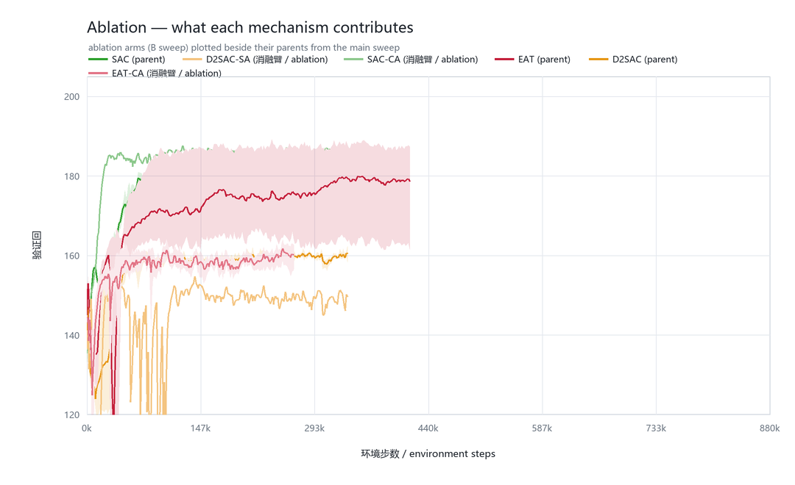

# 09 消融, 每个机制到底贡献了多少
# 09 Ablation, what each mechanism actually contributes

> 上一章 / previous：[08 EAT](../08-eat/README.md) · 下一章 / next：[10 调参](../10-tuning/README.md)

## 0. 中英摘要 / Abstract

第 08 章留下两个问题：EAT 的高上限到底来自哪一部分？它的高方差是不是某个机制的代价？B 组消融给出了三个"每次只拆一个机制"的对照：**SAC-CA**（纯高斯 SAC + 交叉注意力）185.50、**D2SAC-SA**（DDPM + 自注意力 Q）148.75、**EAT-CA**（DDIM + η，但**没有**交叉注意力，actor 直接吃原始观测）162.8 ± 3.6。最锋利的一条是 EAT-CA：拆掉交叉注意力之后，参数量反而从 709,560 **涨到** 775,608，回报从 177.7 **掉到** 162.8，论文"参数更少、结果更好"的说法至少在方向上是站得住的。它同时把方差从 16.5 压到 3.6，说明交叉注意力与"高上限 + 高方差"是同时出现的。但必须大声说明：SAC-CA 与 D2SAC-SA 各只有 **1 次**运行，EAT-CA 也只有 4 次，所以整个消融是**方向性证据，不是测出来的效应**（`docs/DATA.md` §5 也明确写了这个边界）。

English: three arms each remove one mechanism from EAT. SAC-CA (Gaussian SAC + cross-attention) ends at 185.50, D2SAC-SA (DDPM + self-attention critics) at 148.75, and EAT-CA (DDIM + η but no cross-attention) at 162.8 ± 3.6. Removing cross-attention makes the network bigger (775,608 vs 709,560 parameters) and the return worse (162.8 vs 177.7), which matches the paper's "fewer parameters, better result" claim at least in direction, and it also shrinks the seed std from 16.5 to 3.6. Two of the three arms have a single run, so this is directional evidence, not a measured effect.

## 1. 为什么会有这一步 / Why this step

- 第 08 章的结论是"上限最好、下限最差"：187.17 / 187.38 高于任何算法的 3 次均值，但 158.68 把均值拉到第 5。要判断哪个机制负责上限、哪个机制负责下限，只能逐一拆掉再比。
- 代码上有三处可拆的模块：`trainer/casac/trainer.py`（只留注意力）、`trainer/dsac/trainer.py`（DDPM + 自注意力 Q，actor 无注意力条件）、`trainer/dicasac/trainer.py`（EAT 本体）。
- 本章要验证的假设：**如果交叉注意力是主因，去掉它的臂应该掉得最多；如果 DDIM + η 是主因，DDPM 版本应该明显更差。**

> EN: Chapter 08 leaves "best ceiling, worst floor". The ablation removes one module at a time to see which component owns which half of that sentence.

## 2. 机制 / Mechanism

| 臂 | actor | 采样器 | critic 预处理 | 参数量（总 / 在线） | 代码 |
|---|---|---|---|---|---|
| SAC-CA | 高斯 `ActorProb` + `CrossAttentionPreprocessNet` | 无（高斯） | `CrossAttentionQPreprocessNet` | 419,239 / 251,333 | `code/eat-train/trainer/casac/trainer.py#L51`、`#L61`、`#L77`、`#L92` |
| D2SAC-SA | `RLDiffusionActor`(DDPM) + `DiffusionMLP`，条件网是裸 `Net` | DDPM | `SelfAttentionQPreprocessNet` | 709,559 / 397,941 | `code/eat-train/trainer/dsac/trainer.py#L104`、`#L116`、`#L137` |
| EAT-CA | `RLDiffusionActor`(DDIM) + η，**actor 直接吃原始观测** | DDIM + η | 未记录 / not recorded（对应代码不在快照里） | 775,608 / 463,990 | 未记录 |
| **EAT（父）** | DDIM + η + 交叉注意力条件 | DDIM + η | `SelfAttentionQPreprocessNet` | 709,560 / 397,942 | `code/eat-train/trainer/dicasac/trainer.py#L100`、`#L118`、`#L137` |

三个臂各拆掉一个机制：SAC-CA 把扩散整个拿掉、只留注意力（`SACPolicy` 在 `trainer/casac/trainer.py#L111`）；D2SAC-SA 保留扩散但换成 DDPM，而且 actor 的条件通路是一个裸 `Net`（`trainer/dsac/trainer.py#L104`，`hidden_sizes=()`，基本等于一层线性映射），**没有注意力**；EAT-CA 保留 DDIM + η，只把 actor 的条件编码换回原始观测。

熵项这一层也要对齐（细节见第 08 章 §2 的表）：SAC-CA 走 tianshou 的 `SACPolicy`，熵来自高斯 log_prob；D2SAC-SA 走 `SACDDPMPolicy`，其中熵被硬置零（`policy/sac_diffusion.py#L160`，`docs/FACTS.md` §9 第 (1) 条）；EAT-CA 与 EAT 共用 `SACDDIMPolicy`，**两者都真的保留 η 熵项**（`#L393`–`#L394`）。所以按代码看，EAT-CA 掉下去不能归因于"没有熵"，只能归因于"没有交叉注意力"。

三个臂与父本的差别也可以一句话概括：SAC-CA 测的是"注意力单独有没有用"，D2SAC-SA 测的是"扩散单独有没有用"，EAT-CA 测的是"在 EAT 里拿掉注意力会怎样"。这不是一个完整的三因子设计（缺 η 那一格，见 §6 第 5 条）。

> EN: One mechanism removed per arm. SAC-CA drops diffusion entirely, D2SAC-SA swaps in DDPM with a bare linear conditioning path, EAT-CA keeps DDIM + η but feeds raw observations to the actor. EAT-CA shares `SACDDIMPolicy` with EAT, so it keeps the η entropy term: its deficit is the missing cross-attention, not entropy.

## 3. 实验设置 / Setup

| 项 | 值 | 出处 |
|---|---|---|
| 每组运行次数 | SAC-CA 1 / D2SAC-SA 1 / EAT-CA 4（父本各 3） | `docs/FACTS.md` §2、§1 |
| 预算 | 336,000 步（EAT-CA 有一次没跑满，见 `data/runs_index.csv` 的 `env_steps`） | `data/by_algorithm.csv`；与 `docs/FACTS.md` §1 同预算 |
| 环境规模 / 节点数 | 32 或 64（消融目录未保存变体标签） | `docs/FACTS.md` §8 |
| 到达率 λ | 0.3 | `docs/FACTS.md` §8 |
| 可见任务数 | 8 | `docs/FACTS.md` §8 |
| 质量比 quality_ratio | 未记录 / not recorded（消融目录 `run.json` 的 `variant` 为空） | — |
| 种子 | 未记录 / not recorded（单次运行的臂没有种子记录；主对比的 42 / 120 / 245 来自作者笔记） | `docs/FACTS.md` §1 |
| 学习率 | 未记录 / not recorded | — |
| 扩散步数 | 代码默认值各不相同（`dsac #L88` 为 10，`dicasac #L84` 为 5）；实际取值 未记录 | 代码 / `docs/FACTS.md` §8 |
| 参数量（总 / 在线） | SAC-CA 419,239 / 251,333｜D2SAC-SA 709,559 / 397,941｜EAT-CA 775,608 / 463,990｜EAT 709,560 / 397,942 | `docs/FACTS.md` §2、§1 |

> EN: One run for SAC-CA and D2SAC-SA, four for EAT-CA, three for each parent. Seeds, learning rates and quality ratios of the ablation runs are **not recorded**; only the budgets and parameter counts are.

## 4. 收敛过程 / Convergence



| 臂 | 次数 | 终点回报（逐次） | 均值 ± 标准差 | 参数量（总） |
|---|---:|---|---:|---|
| SAC（父） | 3 | 183.04 / 182.66 / 187.25 | 184.3 ± 2.5 | 437,511 |
| **SAC-CA** | 1 | 185.50 | 185.5 | 419,239 |
| D2SAC（父，`dcasac`） | 3 | 158.63 / 156.04 / 163.83 | 159.5 ± 4.0 | 422,135 |
| **D2SAC-SA** | 1 | 148.75 | 148.7 | 709,559 |
| EAT（父） | 3 | 187.17 / 187.38 / 158.68 | 177.7 ± 16.5 | 709,560 |
| **EAT-CA** | 4 | 157.41 / 165.31 / 164.47 / 163.83 | **162.8 ± 3.6** | 775,608 |

1. **EAT-CA 是四条里唯一"平坦"的**：4 次运行全部落在 163.83 附近，std 3.6，而它父本 EAT 的 std 是 16.5（算术：小 4.6 倍）。去掉交叉注意力之后，上限被削平了，下限也被抬稳了。
2. **SAC-CA 很早就爬到自己的终点水平**（185.50 附近），并且只有 1 次运行。它的形状不能和 3 次的父本做"谁收敛快"的比较。
3. **D2SAC-SA 与 D2SAC 是同一条低平线**：一个 148.75、一个 159.5 ± 4.0，都在 160 以下，形状都是"早期抬升后走平"。DDPM 这一支无论怎么换 critic，都没有离开那个低盆地。
4. **图上的横向覆盖不一样**：EAT-CA 的四条曲线在 33.6 万步附近结束，而 EAT 父本的曲线在 41.6 万步处才有最后一个点（`docs/DATA.md` §3 第 1 条：各臂预算不同，曲线在各自预算处结束）。所以"谁后程还在涨"这类观察在跨臂比较里不成立。
5. **D2SAC-SA 是一次"高开低走"**：它 `run.json` 里的 `test_reward.best_step` 极小（最好的时刻出现在训练最开头），之后整体下滑，终点 148.75 明显低于自己的峰值。这是本章唯一一个"越训越差"的臂，也是"DDPM + 自注意力 critic 这一支学不出东西"的直接画面。

> EN: EAT-CA is the only flat arm (all four runs near 163.83, std 3.6), i.e. removing cross-attention removes the ceiling and the variance together. Both DDPM arms stay in the same low plateau. The arms end at different budgets, so late-training comparisons across arms are not meaningful.

## 5. 结果与对比 / Results

| 对比 | 被拆掉的机制 | 参数量变化 | 回报变化 | 方向是否与论文一致 |
|---|---|---|---|---|
| EAT → EAT-CA | 交叉注意力 | 709,560 → **775,608**（变大） | 177.7 → **162.8**（变差） | 是（参数更少、结果更好） |
| EAT → D2SAC-SA | DDIM + η（换成 DDPM）、actor 注意力 | 709,560 → 709,559（差 1） | 177.7 → 148.75（单次） | 是（DDIM + η 更好） |
| SAC → SAC-CA | 加交叉注意力（不是拆） | 437,511 → 419,239（反而变小） | 184.3 → 185.50（单次） | 无明显差别 |
| D2SAC → D2SAC-SA | 交叉注意力 critic（换成自注意力） | 422,135 → 709,559 | 159.5 → 148.75（单次） | 是 |

- **EAT 与 EAT-CA**：参数涨 66,048（算术），均值掉 14.9（算术），方差从 16.5 掉到 3.6（算术）。三项指向同一件事：交叉注意力让 EAT 用更少的参数拿到更高的上限，代价是方差。
- **EAT 与 D2SAC-SA**：参数量只差 1（709,560 vs 709,559），回报差得远（177.7 对单次 148.75，算术 28.9），但样本量一边 3 一边 1。这组对比只能当线索。
- **SAC 与 SAC-CA**：把注意力加到纯高斯 SAC 上，参数反而少了 18,272（算术），回报从 184.3 微升到单次 185.50。用 EAT 的量级看，这属于"没有差别"（`docs/DATA.md` §5：1–2 分都在噪声里）。
- **D2SAC 与 D2SAC-SA**：在 DDPM 这一支里，把交叉注意力 critic 换成自注意力，参数多了 287,424（算术），回报还掉了（单次 148.75）。
- **放进七个主臂里看**：SAC-CA 的 185.5 会排在 DPPO（185.6）之后、SAC（184.3）之前；EAT-CA 的 162.8 会排在 D2SAC（159.5）之前、DDPG（180.4）之后。也就是说三个消融臂里，只有 SAC-CA 进入了主对比的"上方集团"，另外两个都在下半区（`docs/FACTS.md` §1 的排序）。

> EN: In every contrast where the sample size allows a statement, removing cross-attention makes the network bigger and the return worse; adding it to plain SAC changes nothing measurable. Two of the four contrasts rest on a single run each.

## 6. 简要分析 / Analysis

1. **拆掉交叉注意力 = 网络更大、结果更差。** 775,608 vs 709,560，162.8 vs 177.7。这是本仓库里对论文"参数更少、结果更好"这句话最直接的一次数据支持，而且方向是干净的：注意力把 `nodes × 4 + tasks × 3` 的扁平观测压成一个 `max_visible_tasks × embed_dim` 的小特征（`model/attention/cross_attention.py#L66`），没有它，扩散 MLP 的第一层就得直接吃整个扁平观测，**推断 / inferred**，这是参数涨上去的结构原因。注意只能说"方向一致"：EAT-CA 有 4 次、EAT 有 3 次，但两者不是同一次扫描里的配对实验。

2. **两个臂只有 1 次运行，这是本章最重要的免责声明。** SAC-CA 的 185.50 和 D2SAC-SA 的 148.75 都只有一次；主对比里同一算法的种子间差异可以到 16.5（EAT），一次运行就能把均值移动 10 分以上（算术：187.28 与 177.7 的差是 9.6）。所以**单次数字不能读成"这个机制值多少分"**。它们是方向性证据：告诉我们"哪条路大概通、哪条路大概不通"，不告诉我们通多少。`docs/DATA.md` §5 把这条写成了仓库级的边界。

3. **EAT-CA 的亏损不能算在熵项头上。** EAT-CA 与 EAT 共用 `SACDDIMPolicy`，两者的 `actor_loss` 都真的带着 `- alpha × η` 这一项（`policy/sac_diffusion.py#L393`–`#L394`）；它们唯一的机制差别是 actor 的条件编码。所以在"保留 η、去掉注意力"这个受控比较里，掉下去的分数只能归给条件编码。这也正好和第 08 章的解释对上：η 在两只臂上都爬到了低区间，它不是区分项。

4. **单参数之谜：709,559 vs 709,560。** 两个臂的参数量只差 1。**推断 / inferred**：这 1 个参数就是 DDIM actor 独有的标量 `eta_param`（`model/diffusion/rl_diffusion_ddim.py#L75`），而 DDPM 版对应的是 `log_sigma_param`（`model/diffusion/rl_diffusion.py#L89`）。但这个推断有个已知的麻烦：两臂的 actor 条件网并不相同（D2SAC-SA 是裸 `Net`，EAT 是交叉注意力），按理参数量不该只差 1；两个 checkpoint 到底是怎么构造出来的，仓库里没有保存 config（未记录 / not recorded）。所以我们把它当线索，不当结论。

5. **没测到的部分，比测到的更值得说。** 消融里**没有** "EAT 去掉 η" 的臂，也**没有** "交叉注意力 actor + 交叉注意力 critic" 的臂。所以 η 这一项在本仓库里无法单独归因，我们看到的所有关于 η 的证据都是"轨迹"（第 08 章的 `fig6_eta.png`）和"代码路径"（`#L393`–`#L394` 确实接了），没有"去掉它以后掉多少"的对照。同一份缺口也解释了为什么本章不对论文排序表态：机制级证据只有一半。

> EN: The cleanest directional result is EAT-CA: no cross-attention, a larger network (775,608 vs 709,560), a worse mean (162.8 vs 177.7) and a much smaller spread (3.6 vs 16.5). Two arms have a single run each, so the ablation is directional. EAT-CA keeps the η entropy term, so its deficit belongs to the conditioning path. There is no "EAT without η" arm, so η is never isolated.

## 7. 训练数据导航 / Training data

| 内容 | 路径 |
|---|---|
| SAC-CA 全部运行（1 次） | [`data/ablation/sac_ca/`](../data/ablation/sac_ca/) |
| D2SAC-SA 全部运行（1 次） | [`data/ablation/d2sac_sa/`](../data/ablation/d2sac_sa/) |
| EAT-CA 全部运行（4 次） | [`data/ablation/eat_ca/`](../data/ablation/eat_ca/) |
| 每一次运行的曲线 | `data/ablation/<algo>/<run>/curves.csv`（列：`tag,step,value`） |
| 运行的元数据 | `data/ablation/<algo>/<run>/run.json`（含 `env_steps`、`test_reward.last/best`、`curated_tags`） |
| 全部运行索引 | [`data/runs_index.csv`](../data/runs_index.csv)（`campaign = ablation` 的行） |
| 按算法聚合 | [`data/by_algorithm.csv`](../data/by_algorithm.csv)（`campaign = ablation` 的行） |
| 父本数字 | [`docs/FACTS.md`](../docs/FACTS.md) §1 |
| 参数量取证 | `policy_best.pth` + `tools/ckpt_inventory.py`，见 `docs/FACTS.md` 开头说明 |
| 原始 TensorBoard 日志 | `EATlogs/EAT基线对比/B/<algo>/<run>/events.out.tfevents.*`（未入库，见 `docs/DATA.md` §4） |
| η 轨迹 | 未记录 / not recorded：三个消融臂的 `run.json` 里 `ddim_eta_last` 都是 `null`，`curated_tags` 里没有 `train/ddim_eta` |
| 画图脚本 | `tools/plot_curves.py`（本页的图都由它从 `data/` 重绘） |

> EN: Ablation runs live under `data/ablation/`, labelled `campaign = ablation` in both index files; the raw events sit in the `B/` branch of the original log tree. No η trace survives for any of the three arms.

## 8. 复现命令 / Reproduce

快照里能对上两个消融臂的入口确实存在（`docs/REPRODUCE.md` §3 的入口表把它们分别标为 SAC-CA 与 D2SAC）：

```powershell
cd code\eat-train
$env:PYTHONPATH = "$PWD;$PWD\scripts"
python scripts\sac_ca_train.py    # -> trainer.casac  (SAC-CA)
python scripts\sac_d_train.py     # -> trainer.dsac   (D2SAC-SA)
```

- 两条命令都**未验证**：本仓库没有在干净环境里端到端跑过（`docs/REPRODUCE.md` 开头的 未验证 清单）。
- 两个脚本都是"改常量再运行"的风格，没有 argparse；消融当时用的节点数、质量比、种子都 **未记录 / not recorded**（`data/ablation/*/*/run.json` 的 `variant` 为空，`curated_tags` 里也没有种子）。

**EAT-CA 的复现命令：未记录 / not recorded**，快照里没有"DDIM + η 但 actor 不吃注意力特征"的 trainer，也没有任何脚本 import 这样的模块；它的 `run.json` 只留了结果，没有留配置。作者的原始驱动脚本 `scripts/fig6/train.py` 同样不在这份快照里。

> EN: The SAC-CA and D2SAC-SA entry points exist and map to `trainer.casac` / `trainer.dsac`, but are unverified. No entry point exists for EAT-CA, and the author's sweep driver is missing, so its exact configuration is **not recorded**.

---

上一章 / previous：[08 EAT](../08-eat/README.md) · 下一章 / next：[10 调参](../10-tuning/README.md) · 返回目录 / index: [README](../README.md)
