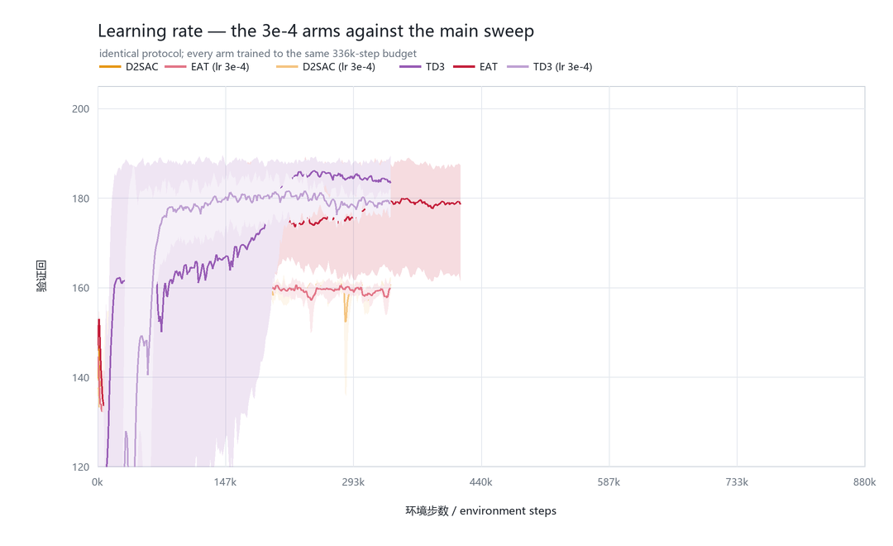
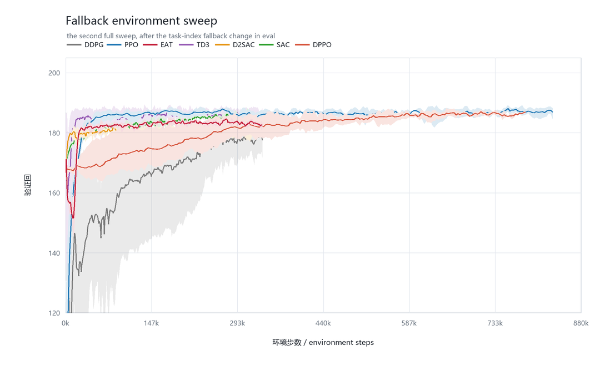

# 10 调参, 学习率与 fallback 重跑能否救回扩散臂
# 10 TUNING, can a learning rate or a fallback rerun rescue the diffusion arms

> 上一章 / previous：[09 消融](../09-ablation/README.md) · 下一章 / next：[11 规模与任务密度](../11-scale-density/README.md)

## 0. 中英摘要 / Abstract

第 09 章把 EAT 拆开看：机制方向成立（去掉交叉注意力的 EAT-CA 只有 162.8 ± 3.6，带交叉注意力的 EAT 是 177.7 ± 16.5），但 EAT 自己的均值被一次 158.68 拖住了，另外两次是 187.17 / 187.38。本章记录作者为此做的两类尝试，两次都是"换条件重跑"而不是"改算法"。

第一类是换学习率：主扫描用 1e-4，三条支路改成 3e-4 重跑。结果是没有救回来，D2SAC@3e-4 158.8 ± 3.2，与 1e-4 的 159.5 ± 4.0 几乎同高；EAT@3e-4 159.9 ± 2.5，四次运行最高的一次是 163.13，离主扫描那两次 187 很远。

第二类是 fallback 重跑：改了评测里任务索引的 fallback 之后重跑七个算法，EAT 变成 182.9 ± 2.1，方差从 16.5 掉到 2.1。但这一版的 EAT 有 841,144 个参数，主扫描是 709,560；D2SAC 也从 422,135 变成 713,431，两次扫描不是同一版网络，所以"稳定性提升"这句话不成立，能说的只有"这一版网络更稳定"。

English: Chapter 09 showed that the mechanism direction holds while EAT's own mean is dragged down by one collapsed seed. This chapter records two follow-up attempts. Raising the learning rate to 3e-4 does not rescue the diffusion arms: D2SAC@3e-4 lands at 158.8 ± 3.2 against 159.5 ± 4.0 at 1e-4, and EAT@3e-4 at 159.9 ± 2.5 never gets near the main sweep's two 187-point seeds. The fallback rerun does lift EAT to 182.9 ± 2.1, but EAT carries 841,144 parameters there versus 709,560 in the main sweep, so the two sweeps are not the same network and the variance drop cannot be attributed to the fallback fix.

## 1. 为什么会有这一步 / Why this step

- 09 章留下的具体问题：EAT 的机制方向对，但 177.7 ± 16.5 里有一次 158.68。如果那一跑只是"运气差"，那么换学习率、或者换掉环境里那处不干净的实现，应该能把它救回来。
- 3e-4 不是随手挑的：代码快照里训练脚本的默认学习率就是 `lr = 3e-4`（`code/eat-train/scripts/sac_train.py#L46`、`code/eat-train/scripts/td3_train.py#L46`、`code/eat-train/scripts/ddpg_train.py#L46`）；主扫描用的 1e-4 是作者手改值（作者笔记，见 `docs/FACTS.md` §8）。所以 3e-4 支路更接近"回到代码默认值"的对照，而不是一次"往上加"的激进尝试。
- fallback 的来源：评测侧任务索引的 fallback 逻辑被改过，改完之后重跑了全部七个算法。图注原文是 "the second full sweep, after the task-index fallback change in eval"（`tools/plot_curves.py#L455-L462`）。
- 本章要验证的假设：如果 EAT 的方差来自学习率偏小、或者来自环境接口的那处 fallback，那么 3e-4 和 fallback 重跑都应该让 EAT 的均值上移、方差变小，**并且参数量不变**。最后那半句是本章真正的判据。

## 2. 机制 / Mechanism

| 组件 | 实现 | 代码位置 |
|---|---|---|
| 学习率旋钮 | 每个训练脚本顶部硬编码 `lr`；默认 3e-4，主扫描的 1e-4 是手改 | `code/eat-train/scripts/sac_train.py#L46`、`code/eat-train/scripts/sac_d_train.py#L59`、`code/eat-train/scripts/td3_train.py#L46` |
| batch size 变体 | 主扫描脚本 512，CA / DICA 变体已是 4096 | `sac_train.py#L49`、`sac_ca_train.py#L47`、`sac_dica_train.py#L48` |
| EAT 的 η（DDIM 可学习噪声） | `eta_param` 初始为 0，`eta = sigmoid(eta_param)`，即从 0.5 开始学 | `code/eat-train/model/diffusion/rl_diffusion_ddim.py#L74-L75`、`#L106` |
| η 的日志 | 只有 actor 带 `eta_param` 时才写 `train/ddim_eta` | `code/eat-train/trainer/metrics.py#L115-L125` |
| 参数量取证 | `policy_best.pth` 张量统计，区分总参数 / 在线参数 | `tools/ckpt_inventory.py` |
| fallback 重跑 | 整套七算法重训，图与数据独立成目录 | `tools/plot_curves.py#L455-L462`、`data/fallback-rerun/` |

3e-4 支路只动了一个常量：网络结构、奖励权重、扩散步数、环境参数都不变（脚本里这些量没有命令行入口，全是文件内常量）。fallback 重跑则动了环境侧的实现，算法代码本身不动。这两种改动的区别很重要：前者只能改"优化轨迹"，后者可能改"任务本身"。

## 3. 实验设置 / Setup

| 项 | 3e-4 支路 | fallback 重跑 | 出处 |
|---|---|---|---|
| 环境规模 | 32 节点、λ=0.3、可见任务 8 | 同左 | `docs/FACTS.md` §8 |
| 奖励权重 | q=6 / t1=3 → quality_ratio 0.600 | 同左 | `docs/FACTS.md` §8 |
| 每次运行的 quality_ratio | 未记录 / not recorded（`run.json` 的 `variant` 为空） | 未记录 / not recorded | `data/learning-rate/*/*/run.json` |
| 种子数 | 3（D2SAC、TD3）/ 4（EAT） | 3（每个算法） | `docs/FACTS.md` §3、§4 |
| 种子编号 | 未记录 / not recorded | 未记录 / not recorded | 运行目录不保存种子；主扫描为 42 / 120 / 245（FACTS §1） |
| 学习率 | 3e-4 | 未记录 / not recorded（作者笔记只给了主扫描 1e-4） | `docs/FACTS.md` §8 |
| 步数上限 | 336,000（三条支路均如此，逐 run 见 `data/runs_index.csv`） | off-policy 336,000；PPO 831,355–841,400；DPPO 784,803–810,293 | `docs/FACTS.md` §4 |
| 网络宽度 | actor / critic 256×256，UNet 256×256 | 同左 | `docs/FACTS.md` §8 |
| 扩散步数 | 4 / 5 / 10（不同 trainer 不同） | 同左 | `docs/FACTS.md` §8 |
| 参数量 | D2SAC **422,135** / EAT **841,144** / TD3 **524,810**（在线 254,229 / 463,734 / 262,405） | 见第 5 节表 | `docs/FACTS.md` §3、§4；`tools/ckpt_inventory.py` |

最后一行是本章证据链上最关键的一格，它把"3e-4 支路只动了一个常量"这句话推翻了一半：**D2SAC 与 TD3 两条支路的参数量与主扫描完全一致（422,135 / 524,810），但 EAT 的 3e-4 支路是 841,144，主扫描的 EAT 是 709,560**。所以 EAT 那条"3e-4 更差"的对比里同时变了两样东西，只有 D2SAC 与 TD3 可以干净地归因于学习率。fallback 组同理：参数量齐全，因此能直接判定它"换了网络"。

## 4. 收敛过程 / Convergence





| 组 | 每次终点回报 | 均值 ± 样本标准差 | 最高回报 |
|---|---|---|---|
| D2SAC 1e-4（主扫描） | 158.63 / 156.04 / 163.83 | 159.5 ± 4.0 | 166.8 |
| D2SAC 3e-4 | 162.00 / 158.89 / 155.62 | 158.8 ± 3.2 | 168.1 |
| EAT 1e-4（主扫描） | 187.17 / 187.38 / 158.68 | 177.7 ± 16.5 | 185.3 |
| EAT 3e-4 | 160.55 / 163.13 / 158.73 / 157.29 | 159.9 ± 2.5 | 166.1 |
| TD3 1e-4（主扫描） | 183.04 / 172.23 / 188.59 | 181.3 ± 8.3 | 191.1 |
| TD3 3e-4 | 176.11 / 176.64 / 182.02 | 178.3 ± 3.3 | 188.7 |

数字全部来自 `docs/FACTS.md` §1 与 §3。

- 两条扩散臂在 3e-4 下从头到尾贴在 150–165 这条窄带上（`learning_rate.png`），图里没有出现主扫描 EAT 那段 170 以上的平台。
- TD3 是 3e-4 下最接近主扫描的臂：均值 178.3 对 181.3、方差 3.3 对 8.3，量级没变但也没变好。学习率给它的是更平滑的曲线，不是更高的终点（后半句是推断 / inferred，依据是同一张图里 3e-4 的 TD3 右端仍低于主扫描 TD3）。
- EAT 在 3e-4 下的四次运行几乎重合（157.29–163.13），而主扫描三次跨越 158.68–187.38。3e-4 让它"稳"，但稳在低处。
- `learning_rate.png` 的图注写 "every arm trained to the same 336k-step budget"，而主扫描的 EAT 实际停在 416,000 步（`docs/FACTS.md` §1）。也就是说 EAT 这一对的预算并不相同：3e-4 那次步数**更少**，却也没学到 187 的水平，这一点让"3e-4 更差"的结论更硬而不是更软。

## 5. 结果与对比 / Results

### 5.1 学习率：3e-4 对 1e-4

| 算法 | 1e-4 主扫描 | 3e-4 支路 | 读法 |
|---|---|---|---|
| D2SAC | 159.5 ± 4.0（158.63 / 156.04 / 163.83） | 158.8 ± 3.2（162.00 / 158.89 / 155.62） | 两个均值几乎重合，3e-4 没有把扩散臂抬出 D2SAC 量级 |
| EAT | 177.7 ± 16.5（187.17 / 187.38 / 158.68） | 159.9 ± 2.5（160.55 / 163.13 / 158.73 / 157.29） | 3e-4 的四次没有一次接近 187；它只覆盖住了主扫描那次 158.68 |
| TD3 | 181.3 ± 8.3（183.04 / 172.23 / 188.59） | 178.3 ± 3.3（176.11 / 176.64 / 182.02） | 均值略降、方差变小，量级不变 |

诚实读法：**3e-4 不救扩散臂**。在三个主扫描种子里，有两个（对应 187.17 / 187.38）在 3e-4 下远远更差；只有第三个（158.68 那次崩溃）的区间与 3e-4 的结果重叠。所以 3e-4 做的事是"把 EAT 压到 D2SAC 水平、同时抹掉方差"，不是"把失败案例变成成功案例"（后一句是推断 / inferred，依据是四条 3e-4 运行全部落在 157.29–163.13 之间，而主扫描三次跨越 158.68–187.38）。

### 5.2 fallback 重跑：第二个完整七算法扫描

| 算法 | 均值 ± 样本标准差 | 最高回报 | 训练步数 | 参数量（总 / 在线） |
|---|---|---|---|---|
| DDPG | 177.2 ± 5.8 | 185.5 | 336,000 | 349,704 / 174,852 |
| TD3 | 185.1 ± 5.3 | 192.2 | 336,000 | 524,810 / 262,405 |
| SAC | 184.0 ± 2.4 | 191.1 | 336,000 | 437,511 / 262,405 |
| PPO | 188.7 ± 2.0 | 191.6 | 831,355–841,400 | 611,336 / 611,336 |
| D2SAC | 180.7 ± 3.4 | 187.0 | 336,000 | 713,431 / 401,813 |
| DPPO | 187.6 ± 2.8 | 190.9 | 784,803–810,293 | 519,238 / 519,238 |
| EAT | 182.9 ± 2.1 | 187.9 | 336,000 | 841,144 / 463,734 |

两个结构性事实必须先说：

1. **两次扫描不是同一版网络。** fallback 的 EAT 是 841,144 总参数 / 463,734 在线参数，主扫描是 709,560 / 397,942；D2SAC 从 422,135 涨到 713,431。也就是说作者在 fallback 那一轮里连模型一起改了，改的不只是评测索引。
2. **fallback 的整体分布更紧。** EAT 的标准差从 16.5 掉到 2.1，而且是七个算法一起紧（最小 2.0，最大 5.8）。所以"EAT 稳定了"更可能是"这一版网络与环境整体稳定了"（推断 / inferred）。

### 5.3 两次尝试并排看

| 维度 | 3e-4 支路 | fallback 重跑 |
|---|---|---|
| 改了什么 | 一个常量（学习率） | 评测侧的任务索引 fallback，以及（实际上）网络结构 |
| 参数量是否变化 | 部分变了：D2SAC 与 TD3 不变（422,135 / 524,810），**EAT 变了 709,560 → 841,144** | 变了：EAT 709,560 → 841,144，D2SAC 422,135 → 713,431 |
| 扩散臂结果 | D2SAC 158.8 ± 3.2 / EAT 159.9 ± 2.5 | D2SAC 180.7 ± 3.4 / EAT 182.9 ± 2.1 |
| 方差 | 3.2 / 2.5（都小） | 3.4 / 2.1（都小） |
| 能否归因于"那一个改动" | D2SAC / TD3 可以（只动了学习率，回报没变好）；**EAT 不能**（网络同时变大） | **不能**（网络同时变了） |

这张表就是本章的结论：一次可控的改动（学习率）证明"改这个没用"；一次不可控的改动（fallback + 网络）证明"改完变好了，但不知道是哪一个改动的功劳"。

## 6. 简要分析 / Analysis

1. **能说的和不能说的。** 能说：换 3e-4 之后扩散臂仍然停在 159 附近；fallback 那一版 EAT 是 182.9 ± 2.1。不能说：fallback 修好了 EAT，因为网络换了（841,144 对 709,560），这是"另一台机器跑得更稳"，不是"同一台机器被修好"。
2. **方差的两条不同来源。** 3e-4 把方差从 16.5 压到 2.5，靠的是把整条曲线按到低位；fallback 把方差压到 2.1，靠的是（可能）更稳的网络与环境。两种"稳"含义完全不同，混在一起看会得出相反结论。
3. **3e-4 支路缺参数量。** `docs/FACTS.md` §3 只记了回报，没有参数列，因此本章无法排除"3e-4 支路也换了网络"这一可能。这是本节结论里最软的一处，也是下一次复现最该先补的一项（一行 `tools/ckpt_inventory.py` 就能补）。
4. **η 的线索。** 主扫描 EAT 学到的 η 终点是 0.0940 / 0.0899 / 0.0941（`docs/FACTS.md` §1，`train/ddim_eta`）。η 从初始 0.5（`rl_diffusion_ddim.py#L74-L75`）压到 0.09 意味着采样几乎退化成了确定性动作，探索基本停止，这与"一次崩溃 + 两次极好"的形态一致（推断 / inferred）。fallback 组的 η 终点没有被写进 `docs/FACTS.md`，此处 未记录 / not recorded；原始字段在 `data/fallback-rerun/eat/<run>/run.json` 的 `ddim_eta_last`。

### 6.1 作者笔记里的五次尝试（不在本仓库里）

作者笔记（`EATlogs/Reading/AAAresult.docx`，不随仓库分发）另外记录了五次尝试：给 η 加 `eta_max` 截断、把 α 换成自动温度、把 batch 提到 4096、让两个 critic 对称、给 D2SAC 的 σ 加截断。这些**都不是本仓库测过的**，本章只能标为"作者笔记"。逐条核对如下：

| 作者笔记里的尝试 | 本仓库能否看到 | 依据 |
|---|---|---|
| 给 η 加 `eta_max` 截断 | 否 | 未记录 / not recorded |
| 把 α 换成自动温度 | 否 | 未记录 / not recorded |
| batch 提到 4096 | 部分可证 | `sac_ca_train.py#L47`、`sac_dica_train.py#L48` 已是 4096，主扫描 `sac_train.py#L49` 是 512 |
| 让两个 critic 对称 | 否 | 未记录 / not recorded |
| 给 D2SAC 的 σ 加截断 | 否 | 未记录 / not recorded |

这一段的作用是划边界：本章的结论只覆盖"3e-4"和"fallback 重跑"两件事，其余五次尝试在仓库里**没有**可核对的运行记录。

### 6.2 复现到了什么、没复现到什么

复现到：3e-4 不改变扩散臂的量级（D2SAC 158.8 / EAT 159.9 仍在 160 附近）、fallback 组 EAT 确实稳定（182.9 ± 2.1）。没复现到：任何一次"通过调超参或重跑环境，让 EAT 稳定在 180 以上**且网络不变**"的证据，目前最好的 fallback 结果（182.9）恰好是换了网络之后拿到的。

## 7. 训练数据导航 / Training data

| 内容 | 路径 |
|---|---|
| 3e-4 三条支路 | [`data/learning-rate/`](../data/learning-rate/)：`d2sac3e` / `eat3e` / `td33e` |
| fallback 七算法 | [`data/fallback-rerun/`](../data/fallback-rerun/)：`ddpg` / `td3` / `sac` / `ppo` / `d2sac` / `dppo` / `eat` |
| 每一次运行的曲线 | `data/<campaign>/<algo>/<run>/curves.csv`（列：tag,step,value） |
| 运行的元数据 | `data/<campaign>/<algo>/<run>/run.json`（`env_steps`、`test_reward`、`ddim_eta_last`） |
| 全部运行索引 | [`data/runs_index.csv`](../data/runs_index.csv) |
| 按算法聚合 | [`data/by_algorithm.csv`](../data/by_algorithm.csv) |
| 本章两张图的重绘脚本 | [`tools/plot_curves.py`](../tools/plot_curves.py)（`learning_rate.png`、`fallback_rerun.png` 两段） |
| 原始 TensorBoard 日志 | `EATlogs/EAT基线对比/learning-rate/**`、`.../fallback/**`（未入库，格式见 `docs/DATA.md`） |

## 8. 复现命令 / Reproduce

训练入口是仓库内真实存在的脚本：3e-4 是脚本里的常量（`code/eat-train/scripts/sac_train.py#L46`、`td3_train.py#L46`），要复现 1e-4 就改这一行。**本仓库没有重跑过这些训练**，完整命令行依赖原工作区的数据路径与 checkpoint，命令行本身 未记录 / not recorded，因此这里不给未经核对的调用方式。

仓库内可执行的只有重绘（README 第 5 节记录过）：

```powershell
python tools\plot_curves.py --data data --out figures\curves
```

---

上一章 / previous：[09 消融](../09-ablation/README.md) · 下一章 / next：[11 规模与任务密度](../11-scale-density/README.md) · 返回目录 / index: [README](../README.md)
