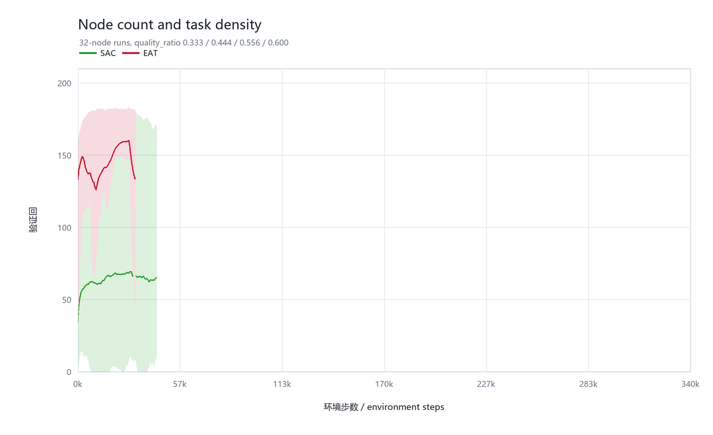

# 11 规模与任务密度, 24 分和 180 分不是同一把尺子
# 11 SCALE AND DENSITY, 24 and 180 are not the same yardstick

> 上一章 / previous：[10 调参](../10-tuning/README.md) · 下一章 / next：[12 EAT-Server](../12-server/README.md)

## 0. 中英摘要 / Abstract

到目前为止所有章节都用同一套环境：32 节点、可见任务 8、奖励权重 q=6 / t1=3，也就是 quality_ratio 0.600。本章换的是这个比例本身：在 32 节点上把 quality_ratio 拉到 0.333 / 0.444 / 0.556 / 0.600 四档，看回报会怎么变。

核心结论只有一句：**quality_ratio 直接改写奖励函数，所以不同比率之间的回报不可比。** 32_0.333 的 SAC 是 23.99 / 23.92 / 24.89，32_0.600 的 SAC 是 177.47 / 166.88 / 101.79，从 24 到 177 不是"学得更好"，是同一件事在四把不同的尺子上量出来的四个读数。本章唯一允许的横比是同一档比率内部。

第二个结论是关于本章证据强度的：这些运行大多只有单种子，步数也远短于主扫描（32_0.600 的 EAT 只跑到 32k 步就停），所以这一章是**规模探针 / scale probe**，不是结果表。它的价值在于把"环境怎么配"这件事写清楚，而不是再给一个排名。

English: every earlier chapter used one environment, 32 nodes, eight visible tasks, reward weights q=6 / t1=3, i.e. quality_ratio 0.600. This chapter moves that ratio itself across four settings. Because quality_ratio rewrites the reward function, returns from different ratios are not comparable: SAC reads 23.99 / 23.92 / 24.89 at 0.333 and 177.47 / 166.88 / 101.79 at 0.600, and the jump from 24 to 177 is a change of yardstick, not of learning. Only comparisons inside one ratio are valid. These runs are also mostly single-seed and short, so the chapter is a scale probe, not a result table.

## 1. 为什么会有这一步 / Why this step

- 前面九章都固定在一档环境里。论文的场景却是"边缘集群按规模变化"，节点数与任务密度是环境定义的一部分，不是超参。要判断一个调度器是否可用，必须知道换了规模之后读数怎么动。
- 对应代码只有两个地方：节点数在 `code/eat-train/scripts/config.py` 的 `GlobalConfig.node_num`（默认 32，`#L24`），可见任务数在同文件 `max_visible_tasks`（默认 8，`#L25`）；任务密度的"档"在实验里是用奖励权重配出来的。
- 本章要验证的假设：在 32 节点不变的前提下，改 quality_ratio 会让回报整体平移，而且平移的幅度应该主要由奖励函数解释，而不是由策略质量解释。如果连"平移方向"都能被奖励函数算出来，那"跨比率比较回报"就是错的。

## 2. 机制 / Mechanism

| 组件 | 实现 | 代码位置 |
|---|---|---|
| 节点数 | `GlobalConfig.node_num`，默认 32（可设 16/32/48/64） | `code/eat-train/scripts/config.py#L24` |
| 可见任务数 | `max_visible_tasks`，默认 8 | `code/eat-train/scripts/config.py#L25` |
| 到达率 λ | `poisson_lambda` 属性：32 节点返回 0.3，其它按 `0.3 × N / 32` | `code/eat-train/scripts/config.py#L28-L36` |
| 奖励权重 | `reward_q_weight=6`、`reward_t1_weight=3`、`reward_t2_weight=1` | `code/eat-train/env/config.py#L84-L90` |
| 奖励函数 | `-t1·tanh(τ1/s1) - t2·tanh(τ2/s2) + q·tanh(steps/s_q) + 偏置` | `code/eat-train/env/env.py#L509-L514` |
| quality_ratio 的算法 | `q / (q + t1 + t2)`，直接进日志目录名 | `code/eat-train/scripts/sac_train.py#L64-L68` |
| 时间成本模型 | 执行时间 = `a × steps + b`，`a`、`b` 在 EnvConfig 里 | `code/eat-train/env/config.py#L67-L70`、`env/env.py#L269` |
| 并行加速权重 | 注释标为"实测值"的 1/2/4/8 权重表 | `code/eat-train/env/config.py#L72-L81` |

quality_ratio 不是独立参数，它是奖励权重的比值：

- `q=6, t1=3, t2=1` → `6 / (6+3+1) = 0.600`（`docs/FACTS.md` §8）
- `q=10, t1=2` → `10 / (10+2+1) = 0.769`（`docs/FACTS.md` §8）

两个分母里那个 `+1` 是队列等待项的权重 `reward_t2_weight`。所以改一档比率，改的是"质量 / 时延"在奖励里的兑换率：0.333 档与 0.600 档之间，同一个动作序列会被算出完全不同的分数，回报的零点、斜率、可达上限全都变了。这就是本章所有警告的来源。

## 3. 实验设置 / Setup

| 项 | 值 | 出处 |
|---|---|---|
| 节点数 | 32（本章全部 run 的 `variant` 都是 `32_*`） | `data/scale-density-z/*/*/run.json` |
| 质量比档位 | 0.333 / 0.444 / 0.556 / 0.600 | `docs/FACTS.md` §6 |
| 0.333 / 0.444 / 0.556 三档的奖励权重 | **未记录 / not recorded**（FACTS 只给了 0.600 与 0.769 两组权重） | `docs/FACTS.md` §8 |
| 可见任务数 / λ | 8 / 0.3 | `docs/FACTS.md` §8 |
| 网络宽度 | actor / critic 256×256，UNet 256×256 | `docs/FACTS.md` §8 |
| 状态嵌入维度 | 8 | `docs/FACTS.md` §8 |
| 扩散步数 | 4 / 5 / 10（不同 trainer 不同） | `docs/FACTS.md` §8 |
| 种子数 | 多数 1 次；32_0.556 的 EAT 有 7 次，32_0.600 的 SAC 有 3 次 | `docs/FACTS.md` §6 |
| 步数 | 32_0.600 SAC = 336,000；32_0.600 EAT = 32k（未跑完）；其余逐 run 见 `data/runs_index.csv` | `docs/FACTS.md` §6 |
| 参数量 | **未记录 / not recorded**（FACTS §6 没有参数列） | `docs/FACTS.md` §6 |

两条与代码有关的旁注，都值得写进复现记录：

1. `config.py` 顶部的注释说到达率按 `N/32` 算（32 节点写 1.0，`#L18-L21`），但 `poisson_lambda` 实际对 32 节点返回 0.3（`#L32-L33`）。生效的是 0.3（`docs/FACTS.md` §8），注释与代码不一致。
2. `set_global_config()` 的默认参数是 `node_num=48`（`#L130`），而数据结构 `GlobalConfig.node_num` 的默认是 32（`#L24`）。批量实验里都是显式传参，所以这个漂移没有造成事故，但它说明"默认值"在代码里并不唯一。

### 3.1 四档比率分别是怎么配出来的

| 档位 | 奖励权重 | 推导 | 记录状态 |
|---|---|---|---|
| 0.600 | q=6 / t1=3 / t2=1 | `6 / (6+3+1)` | `docs/FACTS.md` §8 明确记录 |
| 0.769 | q=10 / t1=2 / t2=1 | `10 / (10+2+1)` | `docs/FACTS.md` §8 明确记录（本章数据里没有这一档的运行） |
| 0.333 | 未记录 / not recorded | — | 目录名只有比率，权重没有入库 |
| 0.444 | 未记录 / not recorded | — | 同上 |
| 0.556 | 未记录 / not recorded | — | 同上 |

所以"本章四档"里只有 0.600 这一档可以被独立复算到具体权重；其余三档只能用目录名里的比率当标签。这直接影响可复现性：知道 0.556 这个数，并不能推出作者当时设的 q / t1 / t2。

### 3.2 规模轴只有 32 节点

`GlobalConfig.node_num` 注释里列了 16 / 32 / 48 / 64 四档（`#L24`），`set_global_config()` 的签名默认 48（`#L130`）。但本章数据里**所有** run 的变体名都以 `32_` 开头，也就是说这批扫描只动了任务密度、没有动节点数。16 / 48 / 64 节点下的回报在本仓库 未记录 / not recorded。

## 4. 收敛过程 / Convergence



| 配置 | 算法 | 终点回报（每次） | 说明 |
|---|---|---|---|
| 32_0.333 | SAC | 23.99 / 23.92 / 24.89 | 质量权重极低，回报量级完全不同 |
| 32_0.444 | SAC | 21.84 / −8.53 / 28.47 | 同上；出现了负回报 |
| 32_0.444 | PPO | 40.63 | 43k–167k 步 |
| 32_0.556 | EAT | 155.32 / 161.65 / 154.85 / 0.00 / 144.82 / 186.32 / 162.69 | 7 次；0.00 是中途中断的 run |
| 32_0.600 | SAC | 177.47 / 166.88 / 101.79 | 3 次，336k 步 |
| 32_0.600 | EAT | 181.25 | 只跑到 32k 步 |

数字全部来自 `docs/FACTS.md` §6。

- 同一张图里，SAC 的均值线停在 60 附近，EAT 的均值线在 130 到 165 之间，两条阴影带的宽度都很大。这张图能说明的东西有限，四档比率被画进了同一个坐标系。
- `scale_density.png` 是 `tools/plot_curves.py#L464-L471` 画的：它按算法分组，把 `scale-density-z` 目录下**所有** ratio 的 run 汇成一条均值线和一条 min/max 阴影带。所以那条阴影带本身就是"跨尺子混画"的产物（推断 / inferred，依据是同一段代码只按 `sac` / `eat` 取数，没有任何按 ratio 拆分的分支）。
- 32_0.556 的 EAT 是唯一有 7 次的格子，里面 186.32 是最高的终点回报。它出现在一档比率与主扫描不同的环境里，因此**不能**和主扫描 EAT 的 187.17 / 187.38 相加或平均。
- 32_0.444 的 SAC 出现 −8.53。`env.py#L516-L519` 对单步奖励有 `assert reward > 0`，所以负值不可能来自单步奖励本身，更可能来自评估聚合（推断 / inferred）。

## 5. 结果与对比 / Results

跨比率不可比，但"同一比率内部"仍然可以做一次像样的对照：32_0.600 这一格与主扫描用的是同一档奖励权重。

| 对照组 | 值 | 可比性 |
|---|---|---|
| 32_0.600 SAC（本章） | 177.47 / 166.88 / 101.79，336k 步 | 与主扫描 SAC 同档、同步数 |
| 主扫描 SAC（第 04 章） | 184.3 ± 2.5，336k 步 | 同上 |
| 32_0.600 EAT（本章） | 181.25，只到 32k 步 | **不可比**：预算只有主扫描 EAT 的零头 |
| 主扫描 EAT（第 08 章） | 177.7 ± 16.5，416,000 步 | 同上 |
| 32_0.556 EAT（本章） | 155.32 … 186.32，7 次 | **不可比**：比率不同 |
| 32_0.333 / 32_0.444（本章） | 23.99 / 24.89 与 21.84 / 28.47 等 | **不可比**：比率不同，量级也不同 |

主扫描的 quality_ratio 在 `run.json` 里没有逐 run 记录（`variant` 是空串），"主扫描 = 0.600" 是按默认权重推出来的（推断 / inferred，依据 `docs/FACTS.md` §8 与 `env/config.py#L84-L90`）。

### 5.1 每一档能回答什么问题

| 档位 | 能回答 | 不能回答 |
|---|---|---|
| 32_0.600 | 与主扫描同档时的量级、单种子波动 | 与其它档比大小 |
| 32_0.556 | 同一算法在这一档的多次运行形态（7 次里有一次 186.32、一次中断） | 与 0.600 的 181.25 比较谁更好 |
| 32_0.444 | 低质量权重下 PPO 能否维持（40.63） | 与 177 量级的任何比较 |
| 32_0.333 | 极低质量权重下的奖励量级（23–25） | 任何"算法强弱"的结论 |

唯一真正干净的对照是 SAC 那一对：同档、同步数、都是 336,000 步，本章 101.79 那次说明 0.600 档下单种子波动可以很大，而主扫描三次是 183.04 / 182.66 / 187.25（`docs/FACTS.md` §1），同样的比率，主扫描没有一个种子掉到 100 附近。这说明本章那三次运行的种子/预算条件更差，而不是"0.600 档本身不稳"（推断 / inferred）。

## 6. 简要分析 / Analysis

1. **尺子变了，不是学生变强了。** 24 与 177 的差别来自奖励权重：0.333 档下质量项的兑换率极低，回报整体被压到二三十的量级；0.600 档下同一个环境能给出 170+ 的读数。任何"某算法在本章拿到 24 分"的读法都是错的，正确读法是"这一档的分数上限本来就在 30 附近"（后半句是推断 / inferred，依据是 32_0.333 的三次全部落在 23.92–24.89 这个极窄区间）。
2. **本章最该记住的是"不能做什么"**：不能跨档求平均、不能跨档排名、不能把 32_0.556 的 186.32 拿去和主扫描 187 并列。这三件事在 README 与 13 章里都被明确排除。
3. **证据强度有限。** 多数格子是单种子，`docs/FACTS.md` §6 甚至没有给出 0.556 的均值和标准差；32_0.600 的 EAT 只跑到 32k 步。所以这一章不能用来支持"规模越大/密度越高越好"这一类的结论，只能说"在 32 节点上，比率一改，读数怎么动"。
4. **时间成本模型是参数化的，不是实测的。** 仿真里执行时间是 `a × steps + b`（`env.py#L269`），并行加速权重是一张注释标为"实测值"的固定表（`env/config.py#L72-L81`）。所以本章讨论的"密度"是奖励与队列意义上的密度，不是真实 GPU 上的吞吐，真实侧见第 12 章。
5. **复现到了什么、没复现到什么。** 复现到：四档比率下回报的量级差异，以及"同一算法在不同比率下读数完全不同"这一现象。没复现到：任何一档比率下的稳定排名（每格种子太少），也没有复现论文里跨规模的排名结论。

## 7. 训练数据导航 / Training data

| 内容 | 路径 |
|---|---|
| 本章全部运行 | [`data/scale-density-z/`](../data/scale-density-z/)：`sac` / `ppo` / `eat` |
| 逐 run 的变体名 | 目录名前缀即比率：`32_0.333__…`、`32_0.444__…`、`32_0.556__…`、`32_0.600__…` |
| 每一次运行的曲线 | `data/scale-density-z/<algo>/<variant>__<run>/curves.csv`（列：tag,step,value） |
| 运行的元数据 | 同目录 `run.json`（`variant` 字段记录比率，`env_steps` 记录实际步数） |
| 全部运行索引 | [`data/runs_index.csv`](../data/runs_index.csv)（`variant` 列可直接筛出四档） |
| 按算法聚合 | [`data/by_algorithm.csv`](../data/by_algorithm.csv)（注意：它把不同比率合在一起聚合，跨档不可用） |
| 本章图的重绘脚本 | [`tools/plot_curves.py`](../tools/plot_curves.py#L464-L471) |
| 另一批 0.556 试探 | `data/scale-density/`（不带 `-z`）：两次极短的运行，步数见 `data/runs_index.csv`，本章不引用其回报 |
| 原始 TensorBoard 日志 | `EATlogs/EAT基线对比/scale-density/**`（未入库，格式见 `docs/DATA.md`） |

## 8. 复现命令 / Reproduce

节点数与可见任务数在 `code/eat-train/scripts/config.py` 里改，比率在 `code/eat-train/env/config.py` 的三个 `reward_*_weight` 上改，两者都没有命令行入口。**本仓库没有重跑过这四档**，完整训练命令行 未记录 / not recorded，此处不编造调用方式。

仓库内可执行的是重绘（README 第 5 节记录过）：

```powershell
python tools\plot_curves.py --data data --out figures\curves
```

---

上一章 / previous：[10 调参](../10-tuning/README.md) · 下一章 / next：[12 EAT-Server](../12-server/README.md) · 返回目录 / index: [README](../README.md)
