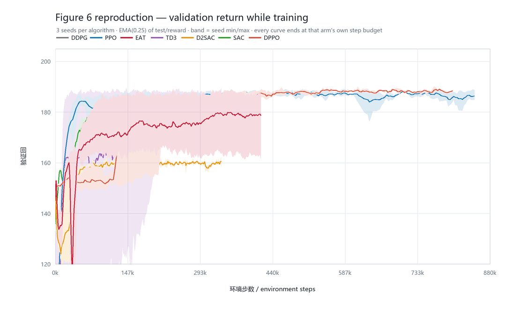

# 13 全部结果 — 复现到的是机制，没复现到的是名次
# 13 RESULTS — the mechanisms reproduce, the ranking does not

> 上一章 / previous：[12 EAT-Server 与物理侧](../12-server/README.md) · 下一章 / next：[返回目录 / index](../README.md)

## 0. 中英摘要 / Abstract

这一章把前十章的读数并到一张表上，然后回答一个问题：论文声称的排名 `EAT > DPPO ≈ D2SAC > PPO ≈ SAC > TD3 > DDPG`，在这批运行里成立吗？

答案是不成立。复现排序是 `PPO 185.2 ≈ DPPO 185.6 > SAC 184.3 > TD3 181.3 > DDPG 180.4 > EAT 177.7 > D2SAC 159.5`。EAT 掉到第六不是因为它学不到高分 —— 三次里两次是 187.17 / 187.38，两次均值 187.28，比全场最好的三种子均值 DPPO 185.6 还高 —— 而是因为第三个种子塌到 158.68，17.7 的均值与 16.5 的标准差一起把它拖了下去。

还有两个必须同时说的限定：一是步数不齐（PPO / DPPO 跑到 80 万步以上，EAT 416,000，其余 336,000），二是最强证据来自方向而不是名次 —— 消融里 EAT-CA 少了交叉注意力、参数反而涨到 775,608、回报掉到 162.8，这个方向与论文一致。

English: this chapter merges the readings of chapters 01–12 into one table and asks whether the paper's claimed ranking reproduces. It does not: the reproduced order is PPO ≈ DPPO > SAC > TD3 > DDPG > EAT > D2SAC. EAT falls to sixth not because it cannot reach high returns — two of three seeds are 187.17 / 187.38, averaging 187.28, above the best three-seed mean in the sweep (DPPO 185.6) — but because the third seed collapses to 158.68, and a 177.7 mean with a 16.5 standard deviation cannot survive that. Two caveats travel with the table: step budgets are not matched (PPO / DPPO above 800k, EAT 416,000, the rest 336,000), and the strongest evidence is directional, from the ablation, not a ranking. What reproduces is the mechanism; what does not is the order.

## 1. 主对比 / The main comparison




| 算法 | 角色 | 终点回报（每次运行） | 均值 ± 样本标准差 | 最高回报 | 训练步数 | 参数量（总 / 在线） |
|---|---|---|---:|---:|---:|---|
| DDPG | 经典 off-policy 基线 | 186.18 / 184.51 / 170.44 | 180.4 ± 8.6 | 187.3 | 336,000 | 349,704 / 174,852 |
| TD3 | DDPG + 双 critic | 183.04 / 172.23 / 188.59 | 181.3 ± 8.3 | 191.1 | 336,000 | 524,810 / 262,405 |
| SAC | 最大熵 off-policy | 183.04 / 182.66 / 187.25 | 184.3 ± 2.5 | 189.9 | 336,000 | 437,511 / 262,405 |
| PPO | on-policy 基线 | 182.89 / 186.73 / 185.96 | 185.2 ± 2.0 | 193.0 | 849,149 / 848,668 / 854,041 | 611,336 / 611,336 |
| D2SAC | 扩散动作头 + SAC | 158.63 / 156.04 / 163.83 | 159.5 ± 4.0 | 166.8 | 336,000 | 422,135 / 254,229 |
| DPPO | 扩散特征 + PPO | 186.13 / 184.45 / 186.28 | 185.6 ± 1.0 | 193.0 | 804,141 / 816,547 / 817,408 | 519,238 / 519,238 |
| **EAT** | **论文方法** | **187.17 / 187.38 / 158.68** | **177.7 ± 16.5** | 185.3 | 416,000 | 709,560 / 397,942 |

全部数字来自 `docs/FACTS.md` §1。三个种子按作者笔记是 42 / 120 / 245，运行目录本身不保存种子。

## 2. 论文的排序 对 这批运行的排序 / Claimed vs reproduced

| 名次 | 这批运行（按终点均值） | 论文声称（作者笔记 `复现.docx`） |
|---|---|---|
| 1 | PPO 185.2 | EAT |
| 2 | DPPO 185.6 | DPPO ≈ D2SAC |
| 3 | SAC 184.3 | PPO ≈ SAC |
| 4 | TD3 181.3 | TD3 |
| 5 | DDPG 180.4 | DDPG |
| 6 | **EAT 177.7** | — |
| 7 | D2SAC 159.5 | — |

（第 1、2 名的差别很小：DPPO 的样本标准差只有 1.0，PPO 是 2.0，两者的均值差远小于种子噪声，所以正文与 `docs/FACTS.md` §1 都写作 `PPO ≈ DPPO`，不把 0.4 分当成真实名次。）

两处偏差最值得看：

1. **EAT 从第 1 掉到第 6。** 差距不在单次上限：全场单次终点最高的是 TD3 的 188.59，EAT 自己两次 187.17 / 187.38 都高于任何算法的三种子均值（最高是 DPPO 185.6，两次均值 187.28 高于它）。差距在稳定性 —— 一次 158.68 把均值拉到 177.7。
2. **D2SAC 从第 2/3 掉到最后。** 论文把 D2SAC 与 DPPO 并列第二，这里它是唯一低于 160 的臂（159.5 ± 4.0），比 DDPG 还低 20 分以上。也就是说，这批运行不支持"扩散动作头单独就能带来收益"这一读法；扩散要起作用，得有 PPO 的训练方式（DPPO 185.6）或 EAT 的注意力 + DDIM（两次 187+）。

用一句话概括偏差的性质：**方向上 EAT 仍然是"扩散家族里能拿最高单点"的那一个，但名次上它拿不到第一，因为第一名要求三次都不塌。**

## 3. 步数不齐 / The budget caveat

| 算法 | 步数上限 | 相对基准 |
|---|---|---|
| PPO | 849,149 / 848,668 / 854,041 | 2.5 倍以上 |
| DPPO | 804,141 / 816,547 / 817,408 | 2.4 倍以上 |
| EAT | 416,000 | 1.24 倍 |
| DDPG / TD3 / SAC / D2SAC | 336,000 | 1 倍 |

这是 on-policy 与 off-policy 的差别导致的：脚本里 PPO 的 `step_per_epoch` 是 10000、其它算法是 1000（`code/eat-train/scripts/ppo_train.py#L52`、`sac_train.py#L48`）。同一个 epoch 预算落到两种训练器上就是不同步数。这里还有一处对不上的地方要说清楚：作者笔记记录图 6 的预算按 epoch 计是 500（`docs/FACTS.md` §8），而脚本默认 `epoch = 1500`（`sac_train.py#L47`）—— 实际调用时用的是哪个值 未记录 / not recorded，能确认的只有"停在 336,000 / 416,000 / 80 万步"这个结果。

后果很直接：PPO 的 185.2 与 DPPO 的 185.6 是在两倍多预算下取得的，**不能**直接读成"on-policy 比 off-policy 更好"。EAT 的 416,000 也不等于 336,000，它在预算上比 DDPG / SAC 宽松、比 PPO / DPPO 紧。

`fig6_convergence.png` 的图注写了 "every curve ends at that arm's own step budget"，就是为了提醒这件事：横轴不是同一条起跑线。

## 4. EAT 的方差 / The EAT variance story

| 事实 | 证据 |
|---|---|
| 三次里两次极高 | 187.17 / 187.38（`docs/FACTS.md` §1） |
| 三次里一次塌陷 | 158.68，与 D2SAC 的区间重叠 |
| 两次均值 | 187.28，高于全场最好的三种子均值 DPPO 185.6 |
| 三种子均值 | 177.7，排第六 |
| 标准差 | 16.5，全场最大；第二名是 DDPG 的 8.6 |
| 单点最高值 | 193.54 / 189.41 / 172.83（`data/runs_index.csv` 的 `test_reward_best`；三者均值 185.3，正是 `docs/FACTS.md` §1 的「最高回报」列） |
| 学到的 η 终点 | 0.0940 / 0.0899 / 0.0941（`train/ddim_eta`） |

关于单点最高值要补一句：`docs/FACTS.md` §1 那一列的统计口径是"每次运行最高点的种子均值"（EAT 的 185.3 就是 193.54 / 189.41 / 172.83 的均值），所以它不等于"全场单点最高"。按单点算，最高的是 DPPO 193.84，EAT 的 193.54 排第二 —— 仍然不是 EAT。这个区别在引用时必须说清楚，否则很容易变成"EAT 单点最高"这种错误说法。

η 是三次数值上最一致的东西（0.0899–0.0941），而回报差了 28 分以上。η 从初始 0.5（`code/eat-train/model/diffusion/rl_diffusion_ddim.py#L74-L75`）压到 0.09 意味着 DDIM 采样几乎退化成确定性动作、探索基本停止；三个种子都走到同一个 η 却只有两个拿到 187，说明**问题不在 η 的收敛值本身**，而在收敛之前走了哪条路（推断 / inferred，依据是 η 终点差异极小、回报差异极大）。

## 5. 消融的方向 / The ablation direction

| 消融臂 | 运行次数 | 终点回报 | 参数量（总 / 在线） | 对照 | 方向 |
|---|---:|---|---|---|---|
| EAT-CA（去掉交叉注意力） | 4 | 162.8 ± 3.6 | 775,608 / 463,990 | EAT 177.7 / 709,560 | 参数更多、回报更低，支持论文 |
| SAC-CA（高斯 SAC + 交叉注意力） | 1 | 185.5 | 419,239 / 251,333 | SAC 184.3 / 437,511 | 参数更少、回报基本不变，接近中性 |
| D2SAC-SA（DDPM + 自注意力 Q） | 1 | 148.7 | 709,559 / 397,941 | D2SAC 159.5 / 422,135 | 参数更多、回报更低，支持论文 |

数字来自 `docs/FACTS.md` §2。这条证据线的强度要打折：SAC-CA 与 D2SAC-SA 各只有 **1 次**运行；EAT-CA 有 4 次，但 `data/runs_index.csv` 不记录种子编号，无法确认这 4 次与主扫描的 3 个种子是否配对。单次运行 + 8 分以上的方差（主扫描里 DDPG 是 8.6、TD3 是 8.3）意味着一次跑出来的差值不足以定论。

即便如此，三臂合起来的方向是自洽的：**少参数 + 更好的回报**在 EAT 对 EAT-CA 这一对上成立（709,560 对 775,608，177.7 对 162.8），在 SAC 对 SAC-CA 上勉强成立（参数更少、回报持平），在 D2SAC 对 D2SAC-SA 上不成立（参数更多、回报更低，两败）。所以论文那句"参数更少、效果更好"只能算"部分被支持"。

## 6. 什么是硬的、什么是软的、下一步做什么 / Solid, weak, next

| 结论 | 强度 | 为什么 |
|---|---|---|
| 七个算法在同一协议下都训到了 336k 以上，曲线齐全可重绘 | 硬 | `data/runs_index.csv` 的 88 行全部解析进 `data/`，可逐点重算 |
| 主扫描排序 `PPO ≈ DPPO > SAC > TD3 > DDPG > EAT > D2SAC` | 硬（有预算限定） | 三次运行 + 同一个评估口径 |
| 论文排序未复现 | 硬 | 两个关键错位（EAT 第 1→第 6、D2SAC 第 2/3→第 7）都远超方差 |
| EAT 单点能力可达全场第二（193.54） | 中 | 单点值受评估噪声影响，且不同臂的峰值不可直接比 |
| 交叉注意力是 EAT 收益的主因 | 中 | 方向自洽，但消融臂只有 1–4 次运行 |
| 物理侧（真实 SD 推理）的表现 | **无** | 本仓库没有任何物理执行日志，见第 12 章 |
| 调超参 / 换 fallback 能修好 EAT | **否** | 3e-4 不救；fallback 那次换了网络（841,144 对 709,560） |

下一轮训练要做三件事，每件都对应上面一条"软"：

1. **对齐步数预算。** 把 PPO / DPPO 的 `step_per_epoch` 调到与 off-policy 同量级（或反过来把 off-policy 拉到 80 万步），再比一次 —— 现在这张表里第一梯队的两名都有两倍以上的预算优势。
2. **每个消融臂至少 3 个种子。** SAC-CA 与 D2SAC-SA 各 1 次，这两行的结论现在只能当假设看；EAT-CA 的 4 次也要确认种子编号是否与主扫描一致（主扫描是 42 / 120 / 245）。
3. **固定种子的评估面板。** 现在 `test/*` 的种子沿用训练种子，评估点与训练点耦合。应该在训练之外固定一组评估种子，让"同一次运行"在多个世界里被重测，才能把"策略好"与"这一局运气好"分开。

## 7. 复现清单 / Reproduction checklist

| 章 | 内容 | 数据目录 |
|---|---|---|
| [00](../00-problem/README.md) | 问题与舞台 | 无训练数据；环境与奖励定义在 `code/eat-train/env/` |
| [01](../01-heuristics/README.md) | FIFO / Random / Greedy | 无训练数据；评估表是作者手工抄录（`docs/FACTS.md` §7） |
| [02](../02-ddpg/README.md) | DDPG | [`data/fig6-main/ddpg/`](../data/fig6-main/ddpg/) |
| [03](../03-td3/README.md) | TD3 | [`data/fig6-main/td3/`](../data/fig6-main/td3/) |
| [04](../04-sac/README.md) | SAC | [`data/fig6-main/sac/`](../data/fig6-main/sac/) |
| [05](../05-ppo/README.md) | PPO | [`data/fig6-main/ppo/`](../data/fig6-main/ppo/) |
| [06](../06-d2sac/README.md) | D2SAC | [`data/fig6-main/d2sac/`](../data/fig6-main/d2sac/) |
| [07](../07-dppo/README.md) | DPPO | [`data/fig6-main/dppo/`](../data/fig6-main/dppo/) |
| [08](../08-eat/README.md) | EAT | [`data/fig6-main/eat/`](../data/fig6-main/eat/) |
| [09](../09-ablation/README.md) | 消融 | [`data/ablation/`](../data/ablation/)（`sac_ca` / `d2sac_sa` / `eat_ca`） |
| [10](../10-tuning/README.md) | 调参 | [`data/learning-rate/`](../data/learning-rate/) + [`data/fallback-rerun/`](../data/fallback-rerun/) |
| [11](../11-scale-density/README.md) | 规模与密度 | [`data/scale-density-z/`](../data/scale-density-z/) |
| [12](../12-server/README.md) | EAT-Server | 无（物理日志 未记录 / not recorded） |
| [13](README.md) | 全部结果 | [`data/by_algorithm.csv`](../data/by_algorithm.csv) + [`data/runs_index.csv`](../data/runs_index.csv) |

还有四个目录没有归到上面任何一章，读者若在原工作区见到对应日志，请注意它们不在本章的统计范围内：[`data/trials/`](../data/trials/)（早期探索，每次只有 67,200 步，`docs/FACTS.md` §5）、[`data/scale-density/`](../data/scale-density/)、[`data/misc/`](../data/misc/)、[`data/model-copy/`](../data/model-copy/)。

## 8. 复现命令 / Reproduce

本章的两张图由仓库内脚本从 `data/` 重绘，命令在 README 第 5 节记录过：

```powershell
python tools\plot_curves.py --data data --out figures\curves
```

重新训练七个算法需要原工作区的日志路径与 GPU，本仓库没有重跑过，完整命令行 未记录 / not recorded。所有逐次运行的元数据都在 `data/*/*/*/run.json`，可以用它核对任何一张表里的数字。

---

上一章 / previous：[12 EAT-Server 与物理侧](../12-server/README.md) · 返回目录 / index: [README](../README.md)
