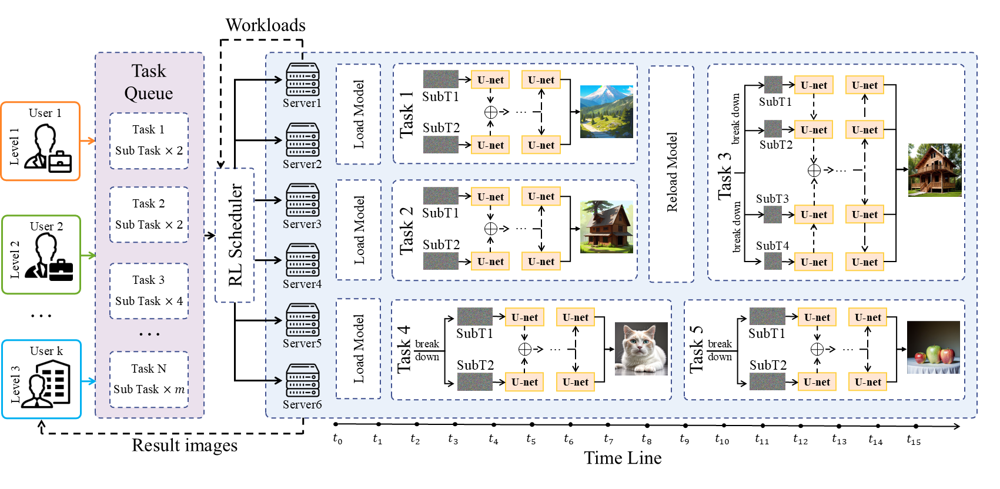

# EAT 复现手记 — 从四个基线到注意力引导的扩散调度
# EAT Reproduction Notes — from four baselines to an attention-guided diffusion scheduler

> 论文：**EAT: QoS-Aware Edge-Collaborative AIGC Task Scheduling via Attention-Guided Diffusion Reinforcement Learning**（投稿 IEEE TMC）
> 本仓库内容：把 EAT 论文里的对比实验，按算法拆成 14 个按顺序推进的小项目，每个项目都带训练收敛曲线、结果、简要分析和可下载的训练数据。

> Paper: **EAT — QoS-Aware Edge-Collaborative AIGC Task Scheduling via Attention-Guided Diffusion Reinforcement Learning** (submitted to IEEE TMC).
> This repository re-organises the paper's comparison experiments into 14 ordered, self-contained mini-projects. Every chapter ships its own convergence curves, results, a short analysis, and the training data behind it.



---

## 1. 一句话概括 / In one sentence

我们复现了论文的 Figure 6：七个算法在同一个三集群边缘调度环境里训练、用同一套评估面板打分。
**EAT 的两个好种子（187.17 / 187.38）平均 187.28，高于任何算法三种子的均值；但第三个种子掉到 158.68，于是均值 177.7 只排第六**。排序没有复现成论文的 `EAT > DPPO ≈ D2SAC > PPO ≈ SAC > TD3 > DDPG`。
这个故事的价值不在于"我们超过了论文"，而在于把"为什么没复现出来"拆成了可以逐个检查的 14 章。

We reproduced Figure 6: seven algorithms trained in the same three-cluster edge-scheduling environment and scored on one shared evaluation panel.
**EAT's two good seeds (187.17 / 187.38) average 187.28, which is above every algorithm's 3-seed mean — but the third seed collapses to 158.68, so the mean of 177.7 ranks sixth.** The paper's ranking (`EAT > DPPO ≈ D2SAC > PPO ≈ SAC > TD3 > DDPG`) did not reproduce.
The point of this repository is not to claim a win: it is to break "why it did not reproduce" into 14 chapters that can be checked one by one.

---

## 2. 主结果 / Headline result


| 算法 / algorithm | 角色 / role | 终点验证回报 / final return (3 seeds) | 最高 / best | 环境步数 / env steps | 参数量（总/在线） |
|---|---|---:|---:|---:|---|
| DDPG | 经典 off-policy 基线 | 180.4 ± 8.6 | 187.3 | 336k | 349,704 / 174,852 |
| TD3 | DDPG 的双 critic 修正 | 181.3 ± 8.3 | 191.1 | 336k | 524,810 / 262,405 |
| SAC | 最大熵 off-policy | 184.3 ± 2.5 | 189.9 | 336k | 437,511 / 262,405 |
| PPO | on-policy 基线 | 185.2 ± 2.0 | 193.0 | 849k | 611,336 / 611,336 |
| D2SAC | 扩散动作头的 SAC | 159.5 ± 4.0 | 166.8 | 336k | 422,135 / 254,229 |
| DPPO | 扩散特征 + PPO | 185.6 ± 1.0 | 193.0 | 810k | 519,238 / 519,238 |
| **EAT** | **论文方法** | **177.7 ± 16.5** | 185.3 | 416k | 709,560 / 397,942 |

数字全部来自本仓库 `data/` 中重新解析的 TensorBoard 曲线，逐条可查：见 [docs/FACTS.md](docs/FACTS.md)。
All numbers are re-derived from the TensorBoard scalars stored under `data/`; every row is traceable in [docs/FACTS.md](docs/FACTS.md).

**两个必须同时看的限定条件 / two caveats that must be read together with the table**

1. **步数不同**：PPO/DPPO 是 on-policy，跑到 810k–854k 环境步才用完同样的 epoch 预算；其余算法是 336k。所以 PPO 的 185.2 不是"同等预算下的胜利"。
2. **EAT 的方差**：三个种子里两个（187.17 / 187.38）的平均 187.28 高于任何算法，一个（158.68）接近 D2SAC。均值掩盖了它。学到的 DDIM η 收敛到 ≈0.09，采样几乎变成确定性，探索基本停了 —— 这是我们对崩溃种子最主要的怀疑。
3. **谁拿过最高点**：单次终点最高是 TD3 的 188.59，单点最高是 DPPO 的 193.84。EAT 不是逐点最强，它是"两个种子很强、第三个崩"。

1. **Different budgets**: PPO and DPPO are on-policy and needed 810k–854k environment steps to consume the same epoch budget; everything else stopped at 336k. PPO's 185.2 is therefore not a budget-matched win.
2. **EAT's variance**: two seeds (187.17 / 187.38) average 187.28, above every algorithm's 3-seed mean; the third (158.68) lands near D2SAC. The mean hides this. The learned DDIM η converges to ≈0.09, i.e. sampling becomes almost deterministic and exploration stops — our main suspect for the collapsed seed.
3. **Who actually topped what**: the single highest final return is TD3 at 188.59, and the single highest best-of-run point is DPPO at 193.84. EAT's story is two strong seeds and one collapse, not pointwise dominance.

---

## 3. 故事线 / The story line

四个部分、14 个顺序项目。每一章都是一个可以独立打开的小项目：有代码、有曲线、有数据。

Four parts, 14 ordered projects. Each chapter is a self-contained mini-project with code, curves and data.

### 第一部分｜先把舞台搭好 / Part I — set the stage

| 章 | 内容 | 这一章回答的问题 |
|---|---|---|
| [00](00-problem/README.md) | **问题与舞台** / problem & stage | 三集群 AIGC 调度到底在决策什么？奖励怎么算？扩散策略为什么适合？ |
| [01](01-heuristics/README.md) | **非学习基线** FIFO / Random / Greedy | 不学习能做到什么程度？为什么"最快"往往意味着"质量崩了"？ |

### 第二部分｜算法谱系，一步只加一个机制 / Part II — one mechanism per chapter

| 章 | 算法 | 相比上一章多了什么 | 结果 |
|---|---|---|---|
| [02](02-ddpg/README.md) | DDPG | 起点：确定性 actor-critic | 180.4 ± 8.6 |
| [03](03-td3/README.md) | TD3 | 双 critic + 延迟更新 | 181.3 ± 8.3 |
| [04](04-sac/README.md) | SAC | 熵正则（随机策略） | 184.3 ± 2.5 |
| [05](05-ppo/README.md) | PPO | on-policy 裁剪目标 | 185.2 ± 2.0（2.5× 步数） |
| [06](06-d2sac/README.md) | D2SAC | 动作头换成 DDPM 去噪 | 159.5 ± 4.0 |
| [07](07-dppo/README.md) | DPPO | 扩散特征 + PPO | 185.6 ± 1.0（2.4× 步数） |
| [08](08-eat/README.md) | **EAT** | 交叉注意力 + DDIM + 可学习 η | 177.7 ± 16.5 |

### 第三部分｜把机制拆开看 / Part III — take the mechanisms apart

| 章 | 内容 | 结论一句话 |
|---|---|---|
| [09](09-ablation/README.md) | 消融：SAC-CA / D2SAC-SA / **EAT-CA** | 去掉交叉注意力后参数从 709,560 涨到 775,608，回报从 177.7 掉到 162.8 —— 方向上支持论文"参数更少、效果更好"的说法，但两个消融臂只有 1 次运行 |
| [10](10-tuning/README.md) | 调参：学习率 3e-4、fallback 重跑 | 3e-4 救不了 D2SAC/TD3；fallback 重跑把 EAT 的方差从 16.5 压到 2.1，但那一次换的是网络结构（3e-4 支路的 EAT 也换了：709,560 → 841,144） |
| [11](11-scale-density/README.md) | 规模与密度：32 节点 × 4 档质量比 | 跨 quality_ratio 的回报不可比 —— 24 和 180 的差别是奖励函数变了，不是学得更好 |

### 第四部分｜物理侧与结论 / Part IV — the physical side and the verdict

| 章 | 内容 | 结论一句话 |
|---|---|---|
| [12](12-server/README.md) | EAT-Server + Stable Diffusion 物理执行 | 仿真里"任务 = 固定执行时间"，物理侧才是真正的 SD 推理；本仓库没有物理日志，只记录实现路径 |
| [13](13-results/README.md) | 汇总、论文排序 vs 复现排序、下一步 | 复现到的是"机制方向"，没复现到的是"名次" |

---

## 4. 怎么读这个仓库 / How to read it

```
00-problem/ … 13-results/     14 个按顺序读的章节（每章一个 README，中英双语）
code/eat-train/               训练侧源码快照（原 EAT-master/EAT-Train，含 14 个 trainer）
code/eat-server/              推理服务侧源码快照（原 EAT-master/EAT-Server）
data/<campaign>/<algo>/<run>/ 每次训练一条：curves.csv（曲线）+ run.json（元数据）
data/runs_index.csv           88 次运行一行一条，含终点/最高回报与目录
data/by_algorithm.csv         按「实验 × 算法」聚合的均值±标准差
figures/curves/               全部从 data/ 重绘的图（Pillow，无 matplotlib 依赖）
figures/original/             作者当时自己画的图（保留原样，便于对照）
docs/STORY.md                 按时间顺序的复现过程（先跑歪了、发现哪歪了、再修）
docs/FACTS.md                 所有被引用的数字及其出处
docs/DATA.md                  训练数据格式、字段、如何自己解析 tfevents
docs/REPRODUCE.md             环境安装与复现步骤
docs/GLOSSARY.md              命名对照（d2sac / dsac / EAT / EAT-CA / η …）
tools/                        解析、清洗、绘图、checkpoint 取证、链接检查脚本
```

三句话导航：
1. **只想看结论** → 本文件第 2 节 + [13-results](13-results/README.md)。
2. **想学机制** → 从 [00-problem](00-problem/README.md) 按编号读到 [09](09-ablation/README.md)。
3. **想知道这段复现真实发生了什么** → [docs/STORY.md](docs/STORY.md)（按时间线，含跑歪的部分）；**想核数字** → [docs/FACTS.md](docs/FACTS.md) 每行都有出处路径，数据本体在 `data/`。

1. **Just the verdict** → section 2 above + [13-results](13-results/README.md).
2. **Learn the mechanisms** → read [00](00-problem/README.md) through [09](09-ablation/README.md) in order.
3. **Check a number** → [docs/FACTS.md](docs/FACTS.md) lists the source path of every figure quoted anywhere; the raw data lives in `data/`.

---

## 5. 数据从哪来 / Where the data comes from

原始 TensorBoard 日志（`events.out.tfevents.*`，共 88 次运行，7.4 GB）留在原工作区，没有入库。
本仓库把它们解析成 `data/` 下的小 CSV：

- `tools/safe_tfreader.py`：不依赖 tensorboard / protobuf 的最小 TFRecord + Event 解析器
- `tools/extract_runs.py`：遍历日志树 → 每次运行一份 `curves.csv` + `run.json`
- `tools/curate.py`：丢掉每次参数都记一条的 `actor_norm/*`、`*_sparsity/*`（EAT 那几次 log 有 1 GB），保留 `test/*`、`train/*`、`update/*`、`save/*`
- `tools/plot_curves.py`：只靠 Pillow 重绘全部图

The original TensorBoard logs (88 runs, 7.4 GB) stay in the source workspace and are not committed. They are converted into the small CSVs under `data/` by the four scripts above, all of which ship in `tools/`.

```powershell
python tools\extract_runs.py --log-root <原EATlogs目录> --out tmp\extracted
python tools\curate.py        --in-root tmp\extracted --out data --max-points 600
python tools\plot_curves.py   --data data --out figures\curves
```

---

## 6. 复现状态 / Reproduction status

| 维度 | 状态 |
|---|---|
| 代码快照 | 完整可读（97 个源文件），但**不是**原始运行时的精确版本：作者当时用的 `scripts/fig6/train.py` 驱动脚本不在快照里 |
| 超参数 | 以代码里的默认值为准（见 `code/eat-train/scripts/config.py`）；作者笔记里另有一批手改值（lr、batch、eta_max…），两者不完全一致 |
| 曲线 | 88 次运行全部重算，可直接重绘 |
| 评估指标（响应时间/质量） | 只有作者手工抄录的 64 节点单种子表（`docs/FACTS.md` §7），**没有**可重算的原始评估日志 |
| 物理 SD 验证 | 代码在，日志与结果缺失（`12-server`） |
| 论文名次 | **未复现**（见第 2 节、[13](13-results/README.md)） |

| dimension | status |
|---|---|
| code snapshot | complete and readable (97 files), but **not** the exact revision that produced the runs: the `scripts/fig6/train.py` driver the author used is absent |
| hyper-parameters | code defaults are authoritative (`code/eat-train/scripts/config.py`); the author's notes record extra hand-set values (lr, batch, eta_max…) that do not always match |
| curves | all 88 runs re-derived and re-plottable |
| evaluation metrics (latency / quality) | only the author's hand-transcribed 64-node single-seed table (`docs/FACTS.md` §7); no replayable evaluation logs |
| physical SD validation | code present, logs and results missing (`12-server`) |
| the paper's ranking | **not reproduced** (section 2, [13](13-results/README.md)) |

---

## 7. 出处与致谢 / Provenance

- 代码来源：作者工作区 `EAT-master/EAT-Train`、`EAT-master/EAT-Server`，原样拷入 `code/`，未改逻辑。
- 训练日志：作者工作区 `EAT-master/EATlogs/EAT基线对比/**`（TensorBoard event 文件）。
- 结果图：`figures/curves/` 为本仓库重绘；`figures/original/` 保留作者原图。
- 论文与阅读笔记：`EATlogs/Reading/`（`复现.docx`、`AAAresult.docx`、`coding.docx`、`AlgoAndData.xlsx` 等）仅作为事实核对来源被引用，不随仓库分发。

- Code: the author's `EAT-master/EAT-Train` and `EAT-master/EAT-Server`, copied verbatim into `code/`; no logic was changed.
- Training logs: `EAT-master/EATlogs/EAT基线对比/**` (TensorBoard event files).
- Figures: `figures/curves/` is redrawn here; `figures/original/` keeps the author's own renders.
- Paper and reading notes: `EATlogs/Reading/` (`复现.docx`, `AAAresult.docx`, `coding.docx`, `AlgoAndData.xlsx`, …) are cited as the source of cross-checks and are not redistributed.

---

## 8. 上传到 GitHub / Pushing to GitHub

本目录已经是一个独立 git 仓库，并已有一笔初始提交（361 个文件，约 20 MB）：

```powershell
cd EAT-Story
git remote add origin https://github.com/<你的账号>/<仓库名>.git
git branch -M main
git push -u origin main
```

几点提醒：

- 仓库里**没有** `.pth` 权重、`events.out.tfevents.*` 原始日志、`runs/` 输出（见 `.gitignore`）。要给出完整可复现包，把这批文件作为 GitHub Release 附件，并在 `docs/DATA.md` 里补一条下载链接。
- 原始 TensorBoard 日志合计 7.4 GB，如需公开请走 Release 或 Git LFS，不要直接 `git add`。
- `data/` 是最大的一块（14 MB），全是文本 CSV，压缩率很高，正常 push 不会有问题。

This directory is already its own git repository with one initial commit (361 files, ~20 MB). Weights, raw event files and `runs/` output are intentionally excluded; publish those as Release assets if you want a fully reproducible bundle.

---

## 9. 一句话结论 / One-line verdict

**机制方向复现出来了，名次没有。** 交叉注意力 + DDIM + 可学习 η 的组合在两个种子上拿到 187.28 的平均终点回报（高于任何算法的三种子均值），但它对随机种子极其敏感 —— 第三个种子掉到 158.68；论文的排序需要更多种子和同预算训练才能验证。

**The mechanisms reproduce; the ranking does not.** The cross-attention + DDIM + learnable-η combination reaches an average of 187.28 on its two good seeds — above every algorithm's 3-seed mean — but it is highly seed-sensitive: the third seed lands at 158.68. The paper's ordering needs more seeds and budget-matched training before it can be called verified.

---

<sub>本仓库是学习与复现记录，不是官方实现。论文方法的所有功劳属于原作者。/ This repository is a reproduction log, not an official implementation. Credit for the method belongs to the original authors.</sub>
