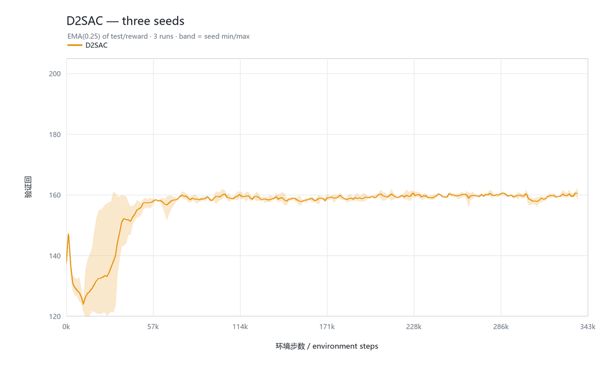

# 06 D2SAC, 用扩散动作头替换高斯 actor
# 06 D2SAC, a diffusion action head instead of a Gaussian actor

> 上一章 / previous：[05 PPO](PPO-README.md) · 下一章 / next：[07 DPPO](DPPO-README.md)

## 0. 中英摘要 / Abstract

D2SAC 是这条故事线上第一次把**策略分布本身**换成扩散模型：actor 输出的不再是高斯均值与方差，改为从纯噪声起步跑一段 DDPM 反向采样，把最后一个 `x_0` 当动作。论文把它与 DPPO 并列为第二档（`EAT > DPPO ≈ D2SAC > PPO ≈ SAC > TD3 > DDPG`），所以我们预期它至少不比 SAC 的 184.3 ± 2.5 差。实际 3 次训练的终点是 158.63 / 156.04 / 163.83，均值 159.5 ± 4.0，最高 166.8，七个臂里最低，比最弱的基线 DDPG（180.4）还低 20.9（算术）。这一章真正的收获落在**它为什么差**上：本快照的 `SACDDPMPolicy` 把熵项硬置零（`policy/sac_diffusion.py#L159`–`#L160`，见 `docs/FACTS.md` §9），扩散头的随机性完全没有进入目标函数，自动温度因此只会往下滑（推断 / inferred）。另外，主扫描的 `d2sac` 目录对应的是 `trainer/dcasac` 这一版，不是 `trainer/dsac`（**推断 / inferred**，依据是 checkpoint 的 tensor 名与 422,135 这个参数量）。

Chapter 06 is the first arm where the policy distribution itself is a diffusion model: a DDPM reverse loop produces the action instead of a Gaussian head. Final return over three runs is 159.5 ± 4.0 (158.63 / 156.04 / 163.83, best 166.8), the lowest of the seven arms, below even the weakest baseline DDPG (180.4) by 20.9 points (arithmetic). The interesting part is the reason: in this snapshot the SAC policy zeroes out the entropy term (`policy/sac_diffusion.py#L159`–`#L160`, `docs/FACTS.md` §9), so the diffusion head's stochasticity never enters the objective. The mapping of the main-sweep `d2sac` folder to `trainer/dcasac` is **inferred** from checkpoint tensor names and the reported parameter count, not from a saved config.

## 1. 为什么会有这一步 / Why this step

- 上一章 PPO 拿到 **185.2 ± 2.0**，最高 193.0（`docs/FACTS.md` §1），对角高斯 + on-policy 在这个环境里已经很够用。要继续往上走，只剩下"改策略分布的形状"这条路。
- 论文把 D2SAC 放在第二档：如果那句排序成立，D2SAC 应该明显高于 PPO 与 SAC。这是我们最该复现出来的一格，也是最容易翻车的一格。
- 代码对应两处：`code/eat-train/trainer/dcasac/trainer.py`（怎么把网络拼起来）与 `code/eat-train/model/diffusion/rl_diffusion.py`（DDPM 采样怎么跑）。
- 本章要验证的假设：**同样的 336,000 步预算下，扩散动作头能把回报抬到 SAC（184.3 ± 2.5）之上。**

> EN: PPO ended at 185.2 ± 2.0, so the only lever left is the shape of the policy distribution. The paper ranks D2SAC second; the hypothesis is that a diffusion head beats SAC at the same 336k-step budget.

## 2. 机制 / Mechanism

| 组件 | 实现 | 代码位置 |
|---|---|---|
| 条件特征（actor） | `CrossAttentionPreprocessNet`：task 作 Query、node 作 Key/Value，输出 `(B, max_visible_tasks × embed_dim)` | `code/eat-train/trainer/dcasac/trainer.py#L93`；`code/eat-train/model/attention/cross_attention.py#L12` |
| 噪声网络 | `DiffusionMLP`：输入 `[x_t, cond, time_embed]`，MLP 256×256 | `code/eat-train/trainer/dcasac/trainer.py#L21`、`#L104` |
| actor | `RLDiffusionActor`（DDPM），`sigma_init=0.1`，`beta_schedule='linear'` | `code/eat-train/trainer/dcasac/trainer.py#L111`；`code/eat-train/model/diffusion/rl_diffusion.py#L17` |
| 采样 | `_p_sample`（单步）/ `_p_sample_loop`（T 步，最后 `tanh` 压到动作区间） | `code/eat-train/model/diffusion/rl_diffusion.py#L132`、`#L139`、`#L180` |
| critic | 双 Q；`CrossAttentionQPreprocessNet`：状态过注意力、动作过独立 `action_embed`，再拼接 | `code/eat-train/trainer/dcasac/trainer.py#L131`、`#L145`；`code/eat-train/model/attention/cross_attention.py#L330` |
| policy | `SACDDPMPolicy`，`tau=0.005`、`gamma=0.99`、自动温度（`target_entropy = -dim(A)`） | `code/eat-train/trainer/dcasac/trainer.py#L159`–`#L164` |

动作怎么来：观测先过交叉注意力拿到条件特征，条件特征 + 时间嵌入 + 当前噪声动作拼起来喂给 `DiffusionMLP`；`RLDiffusionActor` 从 `N(0, I)` 出发做 `diffusion_timesteps` 步反向采样，每步预测噪声、还原 `x_0`、再加后验方差噪声，最后 `tanh` 压缩到动作上下界。

梯度怎么来：critic 是标准 twin-Q TD；actor 项名义上是 `-Q_min` **减去 `alpha × 熵`**，但这里的"熵"在本版本的 policy 里被硬置零（`policy/sac_diffusion.py#L160`，`docs/FACTS.md` §9 把它列为逐行核对过的硬事实），所以实际只有 `-Q_min`。

和上一章的差别只有三处：on-policy → off-policy；对角高斯 → DDPM 动作头；critic 侧也换了（state/action 先各自编码再拼）。注意 `RLDiffusionActor.forward` 只返回确定性动作、不返回分布参数（`model/diffusion/rl_diffusion.py#L168`），所以"策略分布"的信息只能靠 `action_entropy()` 这条路传出去（`#L171`），而它被丢掉了。

> EN: The actor is a DDPM sampler conditioned on a cross-attention encoding of the observation; the twin critics pre-process state with the same attention block and the action with a small `action_embed`. The actor loss in this policy version reduces to `-Q_min`, because the entropy term is zeroed out.

## 3. 实验设置 / Setup

| 项 | 值 | 出处 |
|---|---|---|
| 环境规模 / 节点数 | 32 或 64（代码默认 32） | `docs/FACTS.md` §8 |
| 到达率 λ | 0.3 | `docs/FACTS.md` §8 |
| 可见任务数 | 8 | `docs/FACTS.md` §8 |
| 质量比 quality_ratio | 未记录 / not recorded（主扫描 `run.json` 的 `variant` 为空，未标注质量比） | — |
| 种子 | 3 次独立训练；作者笔记记 42 / 120 / 245，**运行目录本身不保存种子** | `docs/FACTS.md` §1 |
| 预算 | 336,000 步 | `docs/FACTS.md` §1 |
| 学习率 | 未记录 / not recorded（3e-4 对照支路见 `docs/FACTS.md` §3：D2SAC @3e-4 = 158.8 ± 3.2） | — |
| 扩散步数 | 代码默认 5（`trainer/dcasac/trainer.py#L81`）；主扫描实际取值 未记录 | 代码 / — |
| 网络宽度 | actor/critic 256×256；UNet 256×256；状态嵌入 8 维 | `docs/FACTS.md` §8 |
| 参数量（总 / 在线） | **422,135 / 254,229** | `docs/FACTS.md` §1 |

> EN: Three seeds, 336k steps, 422,135 parameters (254,229 live). Node count, arrival rate and visible tasks come from FACTS §8; the actual learning rate, diffusion step count and quality ratio of the main sweep are **not recorded** in this snapshot.

## 4. 收敛过程 / Convergence



| 运行目录 | 环境步数 | 终点验证回报 | 备注 |
|---|---:|---:|---|
| `2026-08-15_06-50-53` | 336,000 | 158.63 | 三次里居中 |
| `2026-08-15_09-33-44` | 336,000 | 156.04 | 三次里最低 |
| `2026-08-15_17-49-42` | 336,000 | 163.83 | 三次里最高 |
| **均值 ± 样本标准差** | | **159.5 ± 4.0** | `docs/FACTS.md` §1 |
| 最高回报 | | 166.8 | `docs/FACTS.md` §1 |

1. 三条曲线在预算最前面的一小段里一起掉到图窗下沿，然后在不到前 1/5 的地方抬到 160 附近，此后**几乎是一条水平线**。它不是"还没学完"，是"学到一个稳定但次优的解就停住了"。
2. 种子间差异很小（159.5 ± 4.0），而且三条曲线的形状几乎重合：这不是运气问题，是方法本身把解按在了这个高度。
3. 三次运行的终点（158.63 / 156.04 / 163.83）都低于"最高回报"一列的 166.8：说明回落发生在训练后段，而不是简单的"还没学完"。整个预算里没有出现 SAC / PPO 那种"越训越稳"的上漂。
4. 与 SAC 那张图（[`sac_convergence.png`](../figures/curves/sac_convergence.png)）对照最直接：SAC 的带状区域在整个横轴上都只有几个回报点宽、且一路平滑上到 180 附近；D2SAC 在 160 处就封顶，带宽也很窄，**它同样的"稳"，只是稳在低处**。

> EN: All three seeds dip together, climb to roughly 160 within the first fifth of the budget, then stay flat for the remaining four fifths. The spread across seeds is small, so the ceiling looks structural rather than a seed accident. Compared with SAC, the band is just as narrow but sits much lower.

## 5. 结果与对比 / Results

同协议（`fig6-main`，各 3 次训练）下的横向位置：

| 臂 | 终点均值 ± 标准差 | 最高回报 | 环境步数 | 参数量（总 / 在线） |
|---|---:|---:|---|---|
| DDPG | 180.4 ± 8.6 | 187.3 | 336,000 | 349,704 / 174,852 |
| TD3 | 181.3 ± 8.3 | 191.1 | 336,000 | 524,810 / 262,405 |
| SAC | 184.3 ± 2.5 | 189.9 | 336,000 | 437,511 / 262,405 |
| PPO | 185.2 ± 2.0 | 193.0 | 849,149 / 848,668 / 854,041 | 611,336 / 611,336 |
| **D2SAC** | **159.5 ± 4.0** | 166.8 | 336,000 | 422,135 / 254,229 |
| DPPO | 185.6 ± 1.0 | 193.0 | 804,141 / 816,547 / 817,408 | 519,238 / 519,238 |
| EAT | 177.7 ± 16.5 | 185.3 | 416,000 | 709,560 / 397,942 |

复现排序（按终点均值）：`PPO 185.2 ≈ DPPO 185.6 > SAC 184.3 > TD3 181.3 > DDPG 180.4 > EAT 177.7 > D2SAC 159.5`（`docs/FACTS.md` §1）。


- **均值**：159.5 是七个臂里最低的，比第六名 EAT（177.7）低 18.2、比第三低的 DDPG（180.4）低 20.9（算术）。它没有进入任何基线所在的区间。
- **预算**：336,000 步，与 DDPG / TD3 / SAC 完全相同。这张比较是同预算的，没有"步数不够"的借口。
- **参数**：422,135 比 EAT 的 709,560 少 287,425（算术），比 SAC 的 437,511 还少 15,376（算术）。它是这一族里最轻的，却是最差的。
- **和 §7 面板的关系**：`docs/FACTS.md` §7 里 D2SAC 是 29.45 / 32.94 s、质量 0.638 / 0.670（64 节点、单种子 42），SAC 是 28.72 s / 0.556。在这个早期面板上 D2SAC 的**质量更高但更慢**，与"主对比回报最低"并不矛盾：回报是质量与工期的加权（`docs/FACTS.md` §8 的 quality_ratio），不是质量本身（推断 / inferred）。

> EN: D2SAC is the only arm outside the baseline range: 159.5 against 180.4 for the weakest baseline, on exactly the same 336k-step budget, with fewer parameters than SAC. On the early §7 panel it is actually slower but higher-quality than SAC, which is consistent with the reward being a quality/deadline trade-off rather than a quality score.

## 6. 简要分析 / Analysis

1. **不是被容量卡住。** 422,135 总参数 / 254,229 在线，比 SAC 的 437,511 还小，比 PPO 的 611,336 小得多；它甚至比 TD3 少。也就是说"扩散头太贵所以学不动"在这里不成立，D2SAC 用更少的参数拿到了最差的分数，说明问题在**目标函数怎么用它**，不在网络大小。

2. **曲线形状说明它收敛了，只是收敛到低处。** 前 1/5 预算就抬到 160 然后彻底水平，这是典型的"梯度把参数推到一个平坦的次优盆地"。如果是优化不充分，我们应该看到缓慢上漂；如果是发散，应该看到抖动或崩溃。两者都不是。

3. **熵项被硬置零。这是最直接的代码级解释。** `policy/sac_diffusion.py#L159` 先算了 `entropy = actor.action_entropy(...)`，`#L160` 紧接着 `entropy = 0`，于是 `#L161` 的 `actor_loss = (-q_min - alpha * entropy)` 退化成纯 `-Q_min`（`docs/FACTS.md` §9 第 (1) 条把这段列为逐行核对的硬事实）。**推断 / inferred**：自动温度那条路（`#L166`–`#L173`）用 `log_prob_surrogate = (-entropy).detach() + target_entropy`，`entropy` 已是常数 0，于是 surrogate 恒等于 `target_entropy`，`alpha_loss` 只与 `log_alpha` 线性相关，梯度方向只会把 α 往 0 推。结果就是：扩散头提供的随机性既没有被奖励，也没有被调节，它退化成一个**没有探索机制的确定性采样器**，在 off-policy 里等于把数据分布锁死在当前策略附近。这与"最差臂"的现象一致，但 α 的轨迹没有进 `curves.csv`（未记录 / not recorded），所以这只是解释，不是已证实的因果。

4. **映射是推断，不是配置。** 主扫描 `d2sac` 的 checkpoint 里含有 `preprocess.obs_net.*` 与 `preprocess.action_embed` 这两组张量，正是 `CrossAttentionQPreprocessNet` 的命名（`model/attention/cross_attention.py#L330`、`#L369`），而 `trainer/dsac` 用的是自注意力版的 `SelfAttentionQPreprocessNet`（`model/attention/self_attention.py#L127`，字段名 `act_embed`）。加上 422,135 与 `trainer/dcasac` 的结构相符、而 `dsac` 不含交叉注意力的额外参数，我们**推断**主扫描的 `d2sac` = `trainer/dcasac`。仓库里没有保存当时的 config。反向证据也在：`trainer/dcasac/trainer.py#L116` 传给 actor 的是 `schedule_timesteps=`，而快照里 `RLDiffusionActor` 的签名只有 `n_timesteps`（`model/diffusion/rl_diffusion.py#L34`），这份文件按现在的代码会直接 `TypeError`（`docs/FACTS.md` §9 第 (2) 条），说明快照代码与被训练的版本不是同一份。

5. **没复现到什么。** 论文的 `DPPO ≈ D2SAC` 这一档在我们的数据里不成立：DPPO 185.6 vs D2SAC 159.5（算术差 26.1），两者根本不在同一层。我们复现到的是"D2SAC 的机制"（交叉注意力 + DDPM 头 + 双 Q 都在代码里），没复现到的是"它的收益"。

> EN: D2SAC is not capacity-limited (fewer parameters than SAC), it converges early to a flat, low plateau, and the policy version in this snapshot zeroes the entropy term, leaving a deterministic diffusion sampler with no exploration bonus. The `dcasac` mapping is inferred from tensor names and the parameter count, and the `schedule_timesteps=` keyword shows the snapshot code is not exactly the version that trained the checkpoint.

## 7. 训练数据导航 / Training data

| 内容 | 路径 |
|---|---|
| 本算法全部运行（3 次） | [`data/fig6-main/d2sac/`](../data/fig6-main/d2sac/) |
| 每一次运行的曲线 | `data/fig6-main/d2sac/<run>/curves.csv`（列：`tag,step,value`；目录名见 §4） |
| 运行的元数据 | `data/fig6-main/d2sac/<run>/run.json`（含 `env_steps`、`test_reward.last/best`、`curated_tags`） |
| 全部运行索引 | [`data/runs_index.csv`](../data/runs_index.csv) |
| 按算法聚合 | [`data/by_algorithm.csv`](../data/by_algorithm.csv)（`campaign=fig6-main, algorithm=d2sac` 一行） |
| 参数量取证 | `policy_best.pth` + `tools/ckpt_inventory.py`，见 `docs/FACTS.md` 开头说明 |
| 原始 TensorBoard 日志 | `EATlogs/EAT基线对比/A/d2sac/<run>/events.out.tfevents.*`（未入库，见 `docs/DATA.md`） |
| η / 熵轨迹 | 不适用：`run.json` 的 `ddim_eta_last` 为 `null`，`curated_tags` 里没有 `train/ddim_eta` |
| 响应时间 / 质量轨迹 | 未记录 / not recorded：`curated_tags` 里没有 `train/avg_quality`、`train/avg_response_time`（`docs/DATA.md` §2：这两个 tag 只有部分算法记录） |
| 画图脚本 | `tools/plot_curves.py`（本页的图都由它从 `data/` 重绘） |

> EN: Everything on this page is redrawn from `data/` by `tools/plot_curves.py`; the raw TensorBoard events are not in the repository, and there is no η tag for this arm.

## 8. 复现命令 / Reproduce

先看矛盾：`docs/REPRODUCE.md` §3 把 `code/eat-train/scripts/sac_d_train.py` 标为 **D2SAC（DDPM）** 的入口，但该脚本 `import` 的是 `trainer.dsac`（自注意力 Q、没有交叉注意力），与本章 §6 第 4 条根据 checkpoint 张量名推断出的 `trainer/dcasac` **不是同一个**。快照里**没有任何脚本 `import trainer.dcasac`**，作者的原始驱动脚本 `scripts/fig6/train.py` 也不在快照里（`docs/REPRODUCE.md` §3、§8）。

所以：**本章（主扫描 `d2sac` = `trainer/dcasac`）的复现命令：未记录 / not recorded。** 下面只列出文档里标注的那个入口，并明确它未经端到端验证、且与本章推断的 trainer 不一致：

```powershell
cd code\eat-train
$env:PYTHONPATH = "$PWD;$PWD\scripts"
python scripts\sac_d_train.py     # 文档标注为 D2SAC（DDPM）入口；实际 import trainer.dsac
```

- 本仓库**没有**重新执行过这条命令（`docs/REPRODUCE.md` 开头的 未验证 清单）。
- 该脚本是"改常量再运行"的风格，没有 argparse；节点数、质量比、种子都写在文件顶部。
- 它能复现的是第 09 章的 **D2SAC-SA**（`trainer.dsac`，单次 148.75），不是本章的 159.5 ± 4.0。

> EN: No command is recorded for this chapter: `docs/REPRODUCE.md` lists `sac_d_train.py` as the D2SAC entry, but that script imports `trainer.dsac`, not the `trainer.dcasac` inferred here from checkpoint tensors. The author's `scripts/fig6/train.py` is missing, and the repo never re-ran training end to end.

---

上一章 / previous：[05 PPO](PPO-README.md) · 下一章 / next：[07 DPPO](DPPO-README.md) · 返回目录 / index: [README](../README.md) · 算法目录：[algorithms/](README.md)
