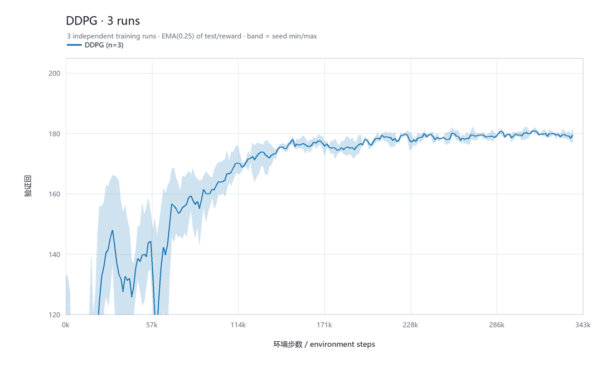
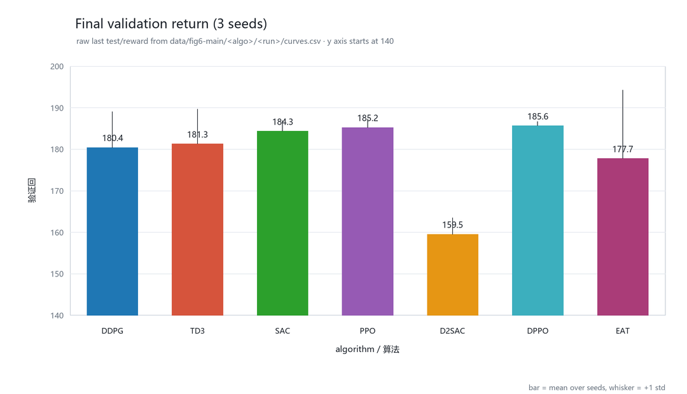

# 02 DDPG, 把"选哪个任务、用几步"交给一个确定性 actor-critic
# 02 DDPG, handing "which task, how many steps" to a deterministic actor-critic

> 上一章 / previous：[01 非学习基线](../01-heuristics/README.md) · 下一章 / next：[03 TD3](TD3-README.md)

## 0. 中英摘要 / Abstract

第 01 章把舞台的两个极端钉死了：Random 最快（25.02 s）但质量只有 0.403，Greedy 最慢（39.61 s）但质量最高（0.752），中间的规则没有一个同时在管"选哪个任务"和"用多少推理步"。
本章是算法谱系的第一步：用一个确定性 actor 直接输出三维动作 `[exec_flag, step, task]`，让 reward 去决定这个权衡。
三次独立训练终点 **180.4 ± 8.6**（186.18 / 184.51 / 170.44），最高 187.3，预算 336,000 环境步，参数 349,704 总 / 174,852 在线。
它没有熵项，探索只有收集时那 0.1 的固定高斯噪声；一次运行掉到 170.44，就足以把样本标准差撑到 8.6。
在三条 off-policy 基线里 DDPG 最弱（180.4 < 181.3 < 184.3）；而 `docs/FACTS.md` §7 的早期评估里，一个 DDPG 策略崩到平均响应 1.28 s / 质量 0.033。这里的"快"是症状，不是胜利。

Chapter 01 pinned the two extremes of the stage: random actions are fastest (25.02 s) but score 0.403 quality, greedy is slowest (39.61 s) but tops quality at 0.752, and no rule steers "which task" and "how many inference steps" at the same time.
This chapter is the first learning step: a deterministic actor emits the 3D action `[exec_flag, step, task]` and the reward decides the trade-off.
Three independent runs end at **180.4 ± 8.6** (186.18 / 184.51 / 170.44), best 187.3, over 336,000 env steps, with 349,704 total / 174,852 live parameters.
There is no entropy term, exploration is only the fixed 0.1 Gaussian noise added while collecting, and one run landing on 170.44 is enough to inflate the sample std to 8.6.
DDPG is the weakest of the three off-policy arms (180.4 < 181.3 < 184.3), and in the early evaluation panel (`docs/FACTS.md` §7) a DDPG policy collapses to 1.28 s / quality 0.033: here "fast" is a symptom, not a win.

## 1. 为什么会有这一步 / Why this step

- 第 01 章留下的空档很具体：Random 25.02 s / 0.403、Greedy 39.61 s / 0.752、FIFO 35.54 s / 0.707 各占一个角，中间的连续地带没有规则去占。规则策略没有参数可调，也没有任何机制能把"这一步的时延代价"和"这一步的质量收益"合成一个决策。
- 代码里对应的就是 `code/eat-train/trainer/ddpg/trainer.py`：一个 `get_trainer()` 把 actor、critic、policy、collector、trainer 全部拼好（L42–L111）；驱动脚本是 `code/eat-train/scripts/ddpg_train.py`。
- 环境侧早就准备好了：动作空间是三维连续向量 `[exec_flag, step, task]`，`a_exec > 0` 才执行，`step` 映射到 `1..max_step`，`task` 映射到可见队列（`code/eat-train/env/env.py#L158-L196`）。所以"动作连续化"不缺条件，缺的是一个能拟合它的策略。
- 本章要验证的假设：**reward 里质量权重占 0.600（`docs/FACTS.md` §8 的 q=6, t1=3，t2 权重为 1 → 6/(6+3+1)，算术），那么一个学出来的确定性策略应该落在 Random 和 Greedy 之间，而不是贴着任何一端。**

## 2. 机制 / Mechanism

| 组件 | 实现 | 代码位置 |
|---|---|---|
| 预处理 | `MLPPreprocess`：flatten → 256×256 ReLU MLP，对外暴露 `output_dim` | `code/eat-train/trainer/ddpg/trainer.py#L16-L39` |
| actor | `Actor(preprocess_net=actor_pre, max_action=...)`，tanh 压缩后按动作上界缩放 | `code/eat-train/trainer/ddpg/trainer.py#L67-L72` |
| critic | **单个** `Critic`，输入是 (obs, action) 拼接后的 256×256 MLP | `code/eat-train/trainer/ddpg/trainer.py#L75-L77` |
| policy | `DDPGPolicy(tau=0.005, gamma=0.99, exploration_noise=0.1)` | `code/eat-train/trainer/ddpg/trainer.py#L79-L88` |
| 采样 | `Collector` + `VectorReplayBuffer(total_size=step_per_epoch)`，step-based 收集 | `code/eat-train/trainer/ddpg/trainer.py#L91-L92` |
| 训练循环 | `OffpolicyTrainer`，`step_per_collect` / `update_per_step` 由脚本传入 | `code/eat-train/trainer/ddpg/trainer.py#L95-L111` |
| 优化器 | actor / critic 各一个 Adam，学习率由脚本传入 | `code/eat-train/trainer/ddpg/trainer.py#L73`、`#L77` |

- **动作怎么产生**：actor 输出一个确定性动作，收集时再叠加 `exploration_noise=0.1` 的高斯扰动（L87）。评估时噪声关掉，策略是纯确定性的。
- **梯度怎么来**：critic 用 target critic 的 TD 误差回归；actor 沿 critic 对动作的梯度上升；target 网络按 `tau=0.005` 软更新。整个结构只有一对目标网络，所以总参数正好是在线参数的两倍（349,704 = 2 × 174,852，算术）。
- **和上一章的差别只有一处**：动作从"常量 / 随机数 / 网格 argmax"变成"网络输出"，其余全是同一套环境、同一套 reward、同一个 64 节点面板。
- **和下一章的差别也只有一处**：这里只有一个 critic，没有 target policy smoothing，actor 每步都更新。第 03 章就是在这三点上做加法。

## 3. 实验设置 / Setup

| 项 | 值 | 出处 |
|---|---|---|
| 环境规模 | 64 节点（`set_global_config(node_num=64, max_visible_tasks=8)`） | `code/eat-train/scripts/ddpg_train.py#L36`；`docs/FACTS.md` §8 |
| 可见任务数 | 8 | 同上 |
| 到达率 λ | 0.3 | `docs/FACTS.md` §8（代码按 `0.3 * node_num / 32.0` 线性外推，`config.py#L29-L36`；64 节点下的实际取值 **未记录 / not recorded**） |
| 质量比 quality_ratio | 0.600（由默认权重 q=6, t1=3, t2=1 算出） | `docs/FACTS.md` §8；`code/eat-train/env/config.py#L85-L89`（`run.json` 的 `variant` 为空，没有逐 run 标注） |
| 种子 | 作者笔记记录 42 / 120 / 245，运行目录本身不保存种子 | `docs/FACTS.md` §1 |
| 训练步数 | 336,000 / 次 | `docs/FACTS.md` §1 |
| 学习率 | 3e-4 | `code/eat-train/scripts/ddpg_train.py#L46` |
| 网络宽度 | actor / critic 均为 256×256 | `code/eat-train/scripts/config.py#L57`；`docs/FACTS.md` §8 |
| 参数量（总 / 在线） | 349,704 / 174,852 | `docs/FACTS.md` §1 |
| 扩散头 / η | 不适用（确定性高斯策略，没有扩散动作头） | — |

表里的取值凡出现在代码里的都标了行号；`docs/FACTS.md` 只覆盖节点数、λ、质量比、种子、步数、宽度与参数量这几项。

**配置与实跑不一致的地方**：脚本里写的是 `epoch = 1500`、`step_per_epoch = 1000`（`ddpg_train.py#L47-L48`），但记录到的环境步数是 336,000（`docs/FACTS.md` §1）。`curves.csv` 里 `save/env_step` 每次正好递增 672，而 336,000 = 500 × 672（算术），500 又正好是作者笔记里的 epoch 预算（`docs/FACTS.md` §8，500 epochs）。推断 / inferred：实跑大约是 500 个 epoch、每 epoch 672 环境步，而不是脚本里那 1500 × 1000。这只是数字上的拟合，日志里没有 epoch 号可以直接证。原始驱动脚本 `scripts/fig6/train.py` 不在快照里，实跑配置只能这样反推。

## 4. 收敛过程 / Convergence



| 运行目录 | 环境步数 | 终点验证回报 | 备注 |
|---|---:|---:|---|
| `2026-08-12_02-10-23` | 336,000 | 186.18 | 三次里最高 |
| `2026-08-14_14-03-12` | 336,000 | 184.51 | 与上一次只差 1.7（算术） |
| `2026-08-14_15-30-34` | 336,000 | 170.44 | 拉低均值的那次 |
| **均值 ± 样本标准差** | | **180.4 ± 8.6** | `docs/FACTS.md` §1 |
| 最高回报 | | 187.3 | 见下方说明 |

"最高回报 187.3"来自 `docs/FACTS.md` §1；它不等于任何一次运行的终点（186.18 是终点里最高的），与 [`data/by_algorithm.csv`](../data/by_algorithm.csv) 的 `best_mean` 列一致，推断 / inferred：它是三次运行各自 best 的平均，而不是单次运行的最好成绩。

- **早期摆动大**：曲线最前面一小段横轴里，灰带（三次运行的 min/max）几乎从图的纵轴下界一直张到 180 刻度下方，说明最早那些步里"哪个种子先起来"几乎是随机的（读图 + 推断）。
- **中期收敛**：曲线中位数在横轴过半之前就贴到 180 刻度附近，之后到 336,000 步基本是一条窄带（读图 + 推断）。
- **末段分化**：分歧不在早期而在末端，两次落在 186.18 / 184.51 附近，一次落到 170.44。也就是说，方差差别更可能来自最后一次评估落在哪个位置，训练不稳这个解释站不住。
- **best ≈ last**：187.3 只比最好的终点 186.18 高一点，说明这条曲线在后半程基本没有继续变好，DDPG 在 336,000 步预算内已经到顶（推断）。

## 5. 结果与对比 / Results

同协议（64 节点、λ=0.3、quality_ratio=0.600、336,000 步、3 个种子）下的横向位置：

| 臂 | 终点均值 ± 标准差 | 最高回报 | 环境步数 | 参数量（总 / 在线） |
|---|---:|---:|---|---|
| **DDPG** | **180.4 ± 8.6** | 187.3 | 336,000 | 349,704 / 174,852 |
| TD3 | 181.3 ± 8.3 | 191.1 | 336,000 | 524,810 / 262,405 |
| SAC | 184.3 ± 2.5 | 189.9 | 336,000 | 437,511 / 262,405 |
| PPO | 185.2 ± 2.0 | 193.0 | 849,149 / 848,668 / 854,041 | 611,336 / 611,336 |



- DDPG 是四条学习型基线里最低的一条，而且和 SAC 差 3.9（184.3 − 180.4，算术）、和 PPO 差 4.8（185.2 − 180.4，算术）。
- **PPO 那一行不能直接比**：它的环境步数是 336,000 的约 2.5 倍（849,149 / 336,000，算术），详见 [05 PPO](PPO-README.md)。DDPG 与 TD3、SAC 才是同预算的三条。
- 柱状图的纵轴从 140 起，视觉上 180.4 和 185.2 的差距被放大了；真实差距就是个位数（算术），不要按图形高度理解。

## 6. 简要分析 / Analysis

1. **无熵项是结构性事实，不是调参问题**。`DDPGPolicy` 这里只接受 `exploration_noise=0.1`（`trainer/ddpg/trainer.py#L87`），没有 α、没有 `log_std`、没有 target entropy；对比 SAC 的 `target_entropy`（`trainer/sac/trainer.py#L82`）和 PPO 的 `ent_coef`（`trainer/ppo/trainer.py#L76`），DDPG 是三条基线里唯一连"探索强度"这个概念都没有的（推断 / inferred：这是它方差最大、也最容易卡在某个动作模式上的结构性原因）。
2. **8.6 的样本标准差可以被一次运行解释**。186.18 与 184.51 只差 1.7，而 170.44 是另外两次的 15.7 / 14.1 之下（算术）。把这三次放在一起，8.6 这个样本标准差几乎全部来自那一次偏离，三个种子的统计在这里信息量很低，均值被一次运行主导。
3. **FACTS §7 里的 DDPG 是崩塌，不是快**。1.28 s / 质量 0.033（同一格里还有 20.26 s / 0.400）。按第 01 章的解读方式，0.033 反解就是 1 步，即永远用最低推理步数；响应 1.28 s 是因为任务占机时间被压到最短。策略学到的是"把任务赶紧做完"，把 reward 里那 0.600 的质量权重整个丢掉了。这类策略在回报曲线上不会立刻显形，只在（响应时间, 质量）这块面板上显形，所以"快"必须和"质量"一起读。
4. **参数量对得上结构**。349,704 总 / 174,852 在线，总参数正好是在线参数的两倍（算术）：一对目标网络（actor_target + critic_target），没有第二个 critic。这个数在第 03 章会变成 524,810 / 262,405，正好多出一个 critic 的量级。
5. **复现到了什么、没复现到什么**。复现到的是"地位"：DDPG 是三条同预算 off-policy 里终点均值最低的一条（180.4 < 181.3 < 184.3），方向上和论文把 DDPG 排在最后的说法一致。**没复现到**的是一个稳定的估计：三次运行的样本标准差 8.6 大于它与 SAC 的均值差 3.9（算术），也就是说在 3 个种子下"DDPG 不如 SAC"和"两者持平"都还没被排除。要判断差距，需要更多种子，或改用 §7 那种（响应时间, 质量）双指标面板，而后者没有可重算的日志（`docs/FACTS.md` §7）。

## 7. 训练数据导航 / Training data

| 内容 | 路径 |
|---|---|
| 本算法全部运行（3 次） | [`data/fig6-main/ddpg/`](../data/fig6-main/ddpg/) |
| 每一次运行的曲线 | `data/fig6-main/ddpg/<run>/curves.csv`（列：`tag,step,value`；本次三个目录名见 §4） |
| 运行的元数据 | `data/fig6-main/ddpg/<run>/run.json`（含 `env_steps`、`test_reward.first/last/best`、`curated_tags`） |
| 全部运行索引 | [`data/runs_index.csv`](../data/runs_index.csv)（88 次运行一行一条） |
| 按算法聚合 | [`data/by_algorithm.csv`](../data/by_algorithm.csv)（`campaign=fig6-main, algorithm=ddpg` 一行） |
| 参数量的取证来源 | `policy_best.pth` + `tools/ckpt_inventory.py`，见 `docs/FACTS.md` 开头的说明 |
| 原始 TensorBoard 日志 | `EATlogs/EAT基线对比/**/events.out.tfevents.*`（未入库，见 `docs/DATA.md`） |

`curves.csv` 里可用的 tag 有 `test/reward`、`test/length`、`test/length_std`、`train/reward`、`update/loss/actor`、`update/loss/critic`、`save/env_step` 等（以 `run.json` 的 `curated_tags` 为准）；`ddim_eta_last` 对 DDPG 是 `null`，本章没有 η 轨迹可看。

## 8. 复现命令 / Reproduce

训练入口在快照里存在，但从 `code/eat-train` 目录运行、并把 `scripts` 放进 `PYTHONPATH`（`env/` 在上一级，`config.py` / `utils.py` 在 `scripts/` 下）。本仓库**没有**重新执行过这条命令（需要原环境的 GPU 与依赖）。

```powershell
cd code\eat-train
$env:PYTHONPATH = ".;scripts"
python scripts\ddpg_train.py
```

- 日志目录是 `runs/<num_nodes>_<quality_ratio>/ddpg/<timestamp>`（`ddpg_train.py#L68-L72`），与仓库里 `data/fig6-main/ddpg/<timestamp>` 的目录名不同，推断 / inferred：两边的对应关系靠时间戳建立。
- 产生本节那三次运行的**精确原始命令未保留 / not preserved**：作者当时用的驱动脚本 `scripts/fig6/train.py` 不在这个快照里，脚本里的 `epoch=1500 / step_per_epoch=1000` 也与实跑的 336,000 步对不上（见 §3）。

---

上一章 / previous：[01 非学习基线](../01-heuristics/README.md) · 下一章 / next：[03 TD3](TD3-README.md) · 返回目录 / index: [README](../README.md) · 算法目录：[algorithms/](README.md)
