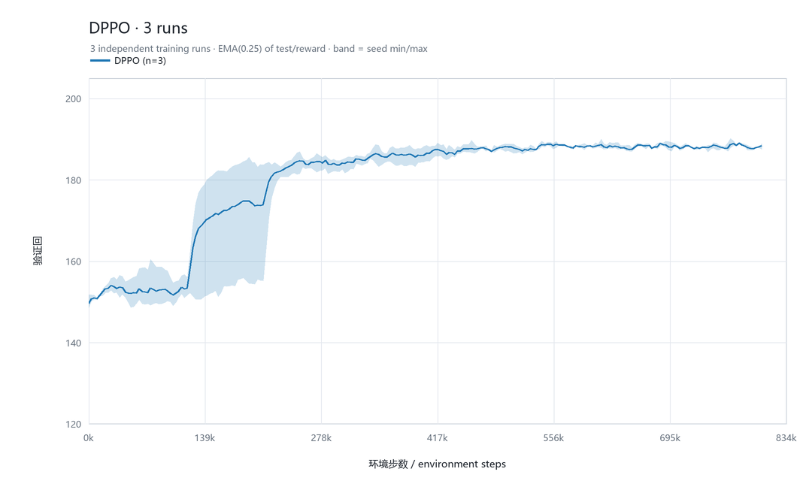

# 07 DPPO, 把扩散去噪网络接到 PPO 的 actor 与 critic 前面
# 07 DPPO, a denoising backbone behind a PPO actor/critic

> 上一章 / previous：[06 D2SAC](D2SAC-README.md) · 下一章 / next：[08 EAT](EAT-README.md)

## 0. 中英摘要 / Abstract

第 06 章把扩散模型直接当策略分布，结果掉到 159.5，是七个臂里最低的；DPPO 换了个接法：`Diffusion` 整个塞进 tianshou 的 `preprocess_net` 槽位，actor 和 critic 都建在这个去噪骨干上，**真正的动作分布仍是对角高斯**。3 次训练的终点是 186.13 / 184.45 / 186.28，均值 185.6 ± 1.0，七个臂里最稳的一个，最高回报 193.0 也与 PPO 并列最高。它的参数量 519,238，比 EAT 的 709,560 少得多、比 PPO 的 611,336 也少，因为这个骨干实例被 actor 和 critic **共用**。必须说清的诚实点：这三次训练用了 804,141 / 816,547 / 817,408 步，是 off-policy 各臂（336,000 步）的两倍多（算术：817,408 ÷ 336,000 ≈ 2.4），所以 185.6 **不能**直接和 D2SAC / EAT 放在同一预算上说事。它也没能把 PPO 顶上去：均值差在噪声量级，买到的是稳定性而不是更高的天花板。

English: chapter 07 keeps the Gaussian policy but puts a `Diffusion` denoiser in front of both the actor and the critic as their shared `preprocess_net`. It ends at 185.6 ± 1.0 (186.13 / 184.45 / 186.28, best 193.0) with 519,238 parameters, because actor and critic share one backbone instance. The honest caveat: it consumed 804,141 / 816,547 / 817,408 env steps, roughly 2.4× the 336,000-step off-policy budget (arithmetic), so its score is not budget-matched against D2SAC or EAT. Against plain PPO the gain is inside the noise: what it buys is stability (std 1.0 vs 2.0), not a higher ceiling.

## 1. 为什么会有这一步 / Why this step

- 上一章 D2SAC 只用 336,000 步就停在 159.5 ± 4.0，且曲线在前 1/5 预算后就水平，"扩散当动作分布"这条设计在本复现里没有走通。
- 但论文把 DPPO 和 D2SAC 放在同一档（`EAT > DPPO ≈ D2SAC > PPO ≈ SAC > TD3 > DDPG`）。如果两个都用扩散、结果却一好一坏，差别就只能出在**接法**上，而不是"扩散"这三个字。
- 代码对应四处：`trainer/dppo/trainer.py#L82`（建骨干）、`#L91`（用 `ActorProb` 包起来）、`#L100`（把同一个骨干交给 critic）、`#L106`（`PPOPolicy`）。
- 本章要验证的假设：**把扩散网络当成"共享的观测编码器 / 梯度通路"而不是"动作分布"，能否在 PPO 上带来增益。**

> EN: Same ingredient as D2SAC, different wiring: the diffusion module becomes a shared feature extractor instead of the policy distribution. The hypothesis is that the wiring, not the diffusion, decides the outcome.

## 2. 机制 / Mechanism

| 组件 | 实现 | 代码位置 |
|---|---|---|
| 去噪骨干 | `Diffusion(state_dim=obs_dim, action_dim, model=DiffusionMLP, n_timesteps=diffusion_timesteps)` | `code/eat-train/trainer/dppo/trainer.py#L82`；`code/eat-train/model/diffusion/diffusion.py#L16` |
| 噪声网络 | `DiffusionMLP`：输入 `[x_t, obs, SinusoidalPosEmb(32)]`，MLP 256×256 | `code/eat-train/trainer/dppo/trainer.py#L19`、`#L75` |
| actor | `ActorProb(preprocess_net=扩散骨干, unbounded=True)`，输出均值/标准差 | `code/eat-train/trainer/dppo/trainer.py#L91` |
| critic | `Critic(preprocess_net=**同一个**骨干对象)` | `code/eat-train/trainer/dppo/trainer.py#L100` |
| policy | `PPOPolicy`：`gae_lambda=0.95`、`max_grad_norm=0.5`、`ent_coef=0.01`、`reward_normalization=True`、`deterministic_eval=True` | `code/eat-train/trainer/dppo/trainer.py#L106`–`#L121` |
| 优化器 | 单个 Adam，同时持有 actor 与 critic 的参数 | `code/eat-train/trainer/dppo/trainer.py#L103` |

动作怎么来：骨干的 `forward`（`model/diffusion/diffusion.py#L142`）先调 `sample`（`#L128`），后者跑满 `p_sample_loop`（`#L106`）的 T 步去噪，把最后的 `x_0` 当作 `[B, action_dim]` 的特征返回（`#L136`–`#L140` 的注释明确要求不要 softmax）。`ActorProb` 拿这组特征再映射成对角高斯的均值与标准差，**最后做决策的是一个高斯头，采样出来的扩散样本没有直接用上**。

梯度怎么来：标准 PPO 的 clipped surrogate + GAE + value loss，全部梯度穿过整条去噪链回到 `DiffusionMLP`。快照里没有任何一处调用 `Diffusion.loss` / `p_losses`（`model/diffusion/diffusion.py#L190`、`#L176`），**推断 / inferred**：去噪网络没有接受过任何去噪监督，它只被 policy gradient 训练，所以它学到的是"对决策有用的编码"，而不是"能重建动作的生成模型"。

和上一章的差别只有两处：同一套扩散零件从"动作分布"降级成"特征提取器"；actor 与 critic 共享同一个骨干实例（这就是 519,238 这个参数量偏小的来源）。critic 也因此不再是独立网络，这一点在 §6 第 1 条展开。

> EN: The denoiser runs a full reverse loop and hands a `[B, action_dim]` feature vector to a Gaussian head; actor and critic share the same backbone object, which is where the small parameter count comes from. No denoising loss is ever applied, so the backbone is trained purely by policy gradient (inferred).

## 3. 实验设置 / Setup

| 项 | 值 | 出处 |
|---|---|---|
| 环境规模 / 节点数 | 32 或 64（代码默认 32） | `docs/FACTS.md` §8 |
| 到达率 λ | 0.3 | `docs/FACTS.md` §8 |
| 可见任务数 | 8 | `docs/FACTS.md` §8 |
| 质量比 quality_ratio | 未记录 / not recorded（主扫描 `run.json` 的 `variant` 为空） | — |
| 种子 | 3 次独立训练；作者笔记记 42 / 120 / 245，运行目录不保存种子 | `docs/FACTS.md` §1 |
| 预算 | **804,141 / 816,547 / 817,408** 步（on-policy，逐次不同） | `docs/FACTS.md` §1 |
| 学习率 | 未记录 / not recorded | — |
| 扩散步数 | 代码默认 10（`trainer/dppo/trainer.py#L64`）；主扫描实际取值 未记录 | 代码 / — |
| 网络宽度 | actor/critic 256×256；状态嵌入 8 维 | `docs/FACTS.md` §8 |
| 参数量（总 / 在线） | **519,238 / 519,238**（无目标网络） | `docs/FACTS.md` §1 |

预算这一行值得单独记住：off-policy 各臂都是 336,000 步，DPPO 跑到了 80 万步以上。≈2.4× 这个倍数不是新数据，就是 817,408 ÷ 336,000（算术）。

> EN: On-policy budget, three runs of 804k–817k steps each, 519,238 parameters with no target network. The step count is what makes any cross-arm comparison with the off-policy arms unfair.

## 4. 收敛过程 / Convergence



| 运行目录 | 环境步数 | 终点验证回报 | 备注 |
|---|---:|---:|---|
| `2026-08-14_15-32-08` | 804,141 | 186.13 | 三次里居中 |
| `2026-08-14_16-17-08` | 816,547 | 184.45 | 三次里最低 |
| `2026-08-14_16-33-03` | 817,408 | 186.28 | 三次里最高 |
| **均值 ± 样本标准差** | | **185.6 ± 1.0** | `docs/FACTS.md` §1 |
| 最高回报 | | 193.0 | `docs/FACTS.md` §1 |

1. **三段式**：前 1/5 预算左右贴着一个低位平台，然后一次性台阶抬升，再线性爬升，最后在终点区（185.6 附近）走平。两次明显的"换策略"痕迹，不像 D2SAC 那样一次到位就冻住。
2. **band 极窄**：三条曲线几乎重合，std 只有 1.0，是整个主对比里最可重复的一个臂。EAT 的 std 是 16.5（算术：相差 16.5 倍），两者不在一个量级。
3. **右半段没有可比对象**：DPPO 大部分"变好"发生在 33.6 万步之后，而那正是其他 off-policy 臂已经停下的位置。所以它的曲线右半段在这个仓库里找不到同预算的对照曲线（`docs/DATA.md` §3 第 1 条也提醒：各臂预算不同，曲线在各自预算处结束）。
4. **没有崩溃段**：三条曲线在中后段都保持单调微升，没有 EAT 那种"一条掉到 158.68"的分层。峰值 193.0 也高于任何一次的终点，说明最好的时刻出现在训练中段（推断 / inferred：与 `run.json` 的 `test_reward.best` 一致）。

> EN: A clear three-phase curve (plateau, step, slow climb) with an extremely narrow seed band. Most of its improvement happens after the 336k-step mark where every off-policy arm has already stopped, so the right half of the curve has no budget-matched companion in this repository.

## 5. 结果与对比 / Results

同协议（`fig6-main`）下的横向位置：

| 臂 | 终点均值 ± 标准差 | 最高回报 | 环境步数 | 参数量（总 / 在线） |
|---|---:|---:|---|---|
| DDPG | 180.4 ± 8.6 | 187.3 | 336,000 | 349,704 / 174,852 |
| TD3 | 181.3 ± 8.3 | 191.1 | 336,000 | 524,810 / 262,405 |
| SAC | 184.3 ± 2.5 | 189.9 | 336,000 | 437,511 / 262,405 |
| PPO | 185.2 ± 2.0 | 193.0 | 849,149 / 848,668 / 854,041 | 611,336 / 611,336 |
| D2SAC | 159.5 ± 4.0 | 166.8 | 336,000 | 422,135 / 254,229 |
| **DPPO** | **185.6 ± 1.0** | 193.0 | 804,141 / 816,547 / 817,408 | 519,238 / 519,238 |
| EAT | 177.7 ± 16.5 | 185.3 | 416,000 | 709,560 / 397,942 |

复现排序（按终点均值）：`PPO 185.2 ≈ DPPO 185.6 > SAC 184.3 > TD3 181.3 > DDPG 180.4 > EAT 177.7 > D2SAC 159.5`（`docs/FACTS.md` §1）。


- **均值**：185.6 是七个臂里最高的，但与 PPO 的 185.2 只差 0.4（算术），在 3 个种子的尺度上这不构成"档差"（`docs/DATA.md` §5：1–2 分的差距都在噪声里）。
- **方差**：1.0 是七个臂里最小的，PPO 的 2.0、SAC 的 2.5 都比它大一倍以上（算术），DDPG 是 8.6。这是本章最硬的一格。
- **参数量**：519,238 比 EAT 少 190,322、比 PPO 少 92,098（算术），但比 SAC 多 81,727（算术）。
- **口径提醒**：`docs/FACTS.md` §1 的「最高回报」是每次运行各自峰值的平均（DPPO 193.0）。**单次**最高终点回报属于 TD3 的 188.59，**单次**最高过程点属于 DPPO 的 193.84（FACTS §1 同页两条注），两者不是同一个量。
- **和 §7 面板的关系**：DPPO 不在 `docs/FACTS.md` §7 那张早期指标表里，所以它的响应时间与质量 **未记录 / not recorded**。

> EN: DPPO has the highest 3-seed mean (185.6), only 0.4 above PPO, and the smallest spread (1.0 vs 2.0). Its parameter count is smaller than both EAT's and PPO's. The single highest final return in the sweep belongs to TD3 (188.59); the single highest best-of-run point belongs to DPPO (193.84). Response time and quality are not recorded for DPPO.

## 6. 简要分析 / Analysis

1. **扩散在这里买到的不是"表达力"，是"共享编码器"。** 519,238 参数比 EAT（709,560）与 PPO（611,336）都少，但比 D2SAC（422,135）多；节省来自 `#L100` 把**同一个**骨干对象交给了 critic，actor 与 critic 共享一份前向特征。收益也就来自这里：一个被两个目标同时推动的观测编码器，比两个各自独立的 MLP 更好训（**推断 / inferred**，依据是 `#L91` / `#L100` / `#L103` 的结构与 519,238 这个数）。代价同样来自这里：critic 不再独立，Q 的偏差会和策略的特征纠缠在一起。

2. **稳定性是它最硬的优点。** std 1.0，三条曲线几乎重合；对比 EAT 的 16.5 与 DDPG 的 8.6，"能不能重复"这件事上 DPPO 明显赢了。三段式的形状说明它先学会"不崩"（低位平台），再学会"变好"（台阶），没有出现早期崩溃。

3. **预算不对等，这是本章最重要的诚实点。** 804,141 / 816,547 / 817,408 步 vs off-policy 的 336,000 步（算术：≈2.4×）。所以"DPPO 185.6 > D2SAC 159.5"这句话在**同预算**意义上不成立，我们只是让 DPPO 多跑了一倍多的步数。我们没有做把 DPPO 截断到 33.6 万步的对照实验（未记录 / not recorded），所以"扩散骨干本身值不值这个分"无法从现有数据里分离出来。

4. **它没能把 PPO 顶上去。** PPO 185.2 ± 2.0、DPPO 185.6 ± 1.0，均值差 0.4 在噪声内，方差更小。**推断 / inferred**：在这套基准上，PPO 的策略梯度已经吃到了观测里几乎全部可用信息，再加一个去噪骨干主要是把曲线压平，而不是把上限抬高。换句话说，扩散在这条谱系里的作用更像正则化，而不是表达力升级。

5. **没复现到什么。** 论文的排序把 DPPO 放在 EAT 之下、D2SAC 之上；我们的数据里 DPPO 是均值第一，D2SAC 是最后（算术：185.6 vs 159.5，差 26.1）。也就是说 `D2SAC ≈ DPPO` 这个等价关系在复现里完全不成立，两者的均值差了一个档还多，而它们的共同点只有"都用了扩散零件"。

> EN: The diffusion backbone buys a shared encoder, not extra expressiveness: one instance serves both actor and critic, which is where the smaller parameter count comes from, at the cost of an entangled Q. Its stability is real (std 1.0), it does not raise the ceiling over plain PPO, and its budget is ~2.4× the off-policy arms, so no budget-matched claim is made.

## 7. 训练数据导航 / Training data

| 内容 | 路径 |
|---|---|
| 本算法全部运行（3 次） | [`data/fig6-main/dppo/`](../data/fig6-main/dppo/) |
| 每一次运行的曲线 | `data/fig6-main/dppo/<run>/curves.csv`（列：`tag,step,value`；目录名见 §4） |
| 运行的元数据 | `data/fig6-main/dppo/<run>/run.json`（含 `env_steps`、`test_reward.last/best`、`curated_tags`） |
| 全部运行索引 | [`data/runs_index.csv`](../data/runs_index.csv)（`test_reward_best` 列可复核 193.84） |
| 按算法聚合 | [`data/by_algorithm.csv`](../data/by_algorithm.csv)（`campaign=fig6-main, algorithm=dppo` 一行） |
| 参数量取证 | `policy_best.pth` + `tools/ckpt_inventory.py`，见 `docs/FACTS.md` 开头说明 |
| 原始 TensorBoard 日志 | `EATlogs/EAT基线对比/A/dppo/<run>/events.out.tfevents.*`（未入库，见 `docs/DATA.md` §4） |
| η / 熵轨迹 | 不适用：`run.json` 的 `ddim_eta_last` 为 `null`，`curated_tags` 里只有 `update/loss/ent`（PPO 的熵系数项），没有 `train/ddim_eta` |
| 响应时间 / 质量轨迹 | 未记录 / not recorded：`curated_tags` 里没有 `train/avg_quality`、`train/avg_response_time` |

> EN: No `train/ddim_eta` tag for DPPO: there is no learnable sampler randomness on this arm, only PPO's `update/loss/ent`. All figures are redrawn from `data/` by `tools/plot_curves.py`.

## 8. 复现命令 / Reproduce

**本章的复现命令：未记录 / not recorded。**

原因：`docs/REPRODUCE.md` §3 的入口表里**没有 DPPO 这一行**；快照里的 `code/eat-train/scripts/ppo_train.py` 导入的是 `trainer.ppo`（普通 PPO，没有扩散骨干），没有任何脚本 import `trainer.dppo`。作者的原始驱动脚本 `scripts/fig6/train.py` 不在这份快照里（`docs/REPRODUCE.md` §3、§8 的 未验证 清单里也点名"原始启动命令丢失"）。

```powershell
# 本快照里不存在能复现本章结果的入口脚本，故此处不贴命令。
# 最接近但不等价的入口（从 code\eat-train 目录运行）：
#   python scripts\ppo_train.py   -> trainer.ppo   （普通 PPO，没有扩散骨干）
```

- 想要 DPPO 的曲线形状（三段式）与 std 1.0，必须找到当时的 `trainer/dppo` 启动方式；本仓库只能给出机制与数字，给不出命令。
- 若你有原始 TensorBoard 日志，重绘本章的图不需要训练：`python tools\plot_curves.py --data data --out figures\curves`（`docs/REPRODUCE.md` §5）。

> EN: No command is recorded: the entry table in `docs/REPRODUCE.md` has no DPPO row, `ppo_train.py` imports `trainer.ppo`, and nothing imports `trainer.dppo`. The author's sweep driver is missing from the snapshot.

---

上一章 / previous：[06 D2SAC](D2SAC-README.md) · 下一章 / next：[08 EAT](EAT-README.md) · 返回目录 / index: [README](../README.md) · 算法目录：[algorithms/](README.md)
