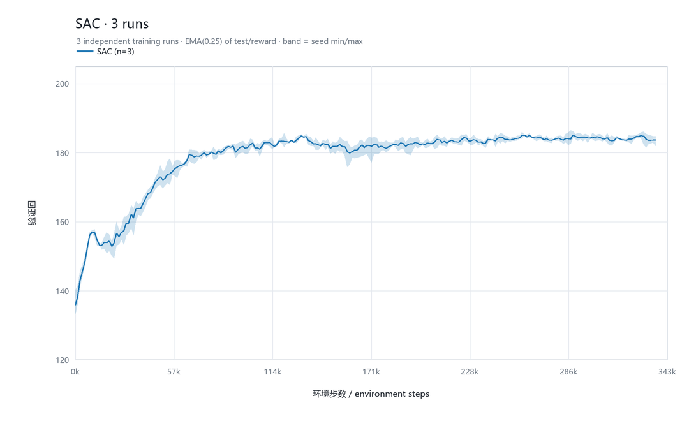

# 04 SAC, 熵正则把三条 off-policy 的方差压下来
# 04 SAC, entropy regularisation is what finally shrinks the spread

> 上一章 / previous：[03 TD3](TD3-README.md) · 下一章 / next：[05 PPO](PPO-README.md)

## 0. 中英摘要 / Abstract

第 03 章把"最好的一次"抬到了 191.1，但方差还是 8.3：双 critic 修的是 Q 的偏差，不是探索。
本章换的是另一件事，actor 输出的不再是一个确定性动作，改成一个分布，目标函数里多一项熵奖励，温度 α 自动调（`trainer/sac/trainer.py#L82-L84`）。
三次运行终点 **184.3 ± 2.5**（183.04 / 182.66 / 187.25），最高 189.9，预算同样是 336,000 步，参数 437,511 总 / 262,405 在线。
结果是三条 off-policy 臂里均值最高、方差最小的一条：标准差 2.5，而 DDPG 8.6、TD3 8.3。
代价是峰值略低（189.9 < 191.1）；也就是说熵项买到的是稳定性，不是更高的天花板。温度的轨迹虽然记在 `update/alpha` 里，却只覆盖训练最前面一小段，完整的调节过程 **未记录 / not recorded**；去掉熵项的消融也没有跑。

Chapter 03 lifted the best run to 191.1 but left the spread at 8.3: twin critics fix bias in Q, not exploration.
This chapter changes something else, the actor emits a distribution instead of a deterministic action, the objective gains an entropy bonus, and the temperature α is tuned automatically (`trainer/sac/trainer.py#L82-L84`).
Three runs end at **184.3 ± 2.5** (183.04 / 182.66 / 187.25), best 189.9, on the same 336,000-step budget, with 437,511 total / 262,405 live parameters.
It is the best mean and the tightest spread of the three off-policy arms: std 2.5 against DDPG's 8.6 and TD3's 8.3.
The peak is slightly lower (189.9 < 191.1), so entropy buys stability rather than a higher ceiling, and the temperature trace exists under `update/alpha` but covers only the very beginning of training, leaving the full schedule **not recorded**; no no-entropy ablation was run.

## 1. 为什么会有这一步 / Why this step

- 第 03 章的数字留下一个很具体的缺口：最高回报 191.1 是三条 off-policy 臂里最高的，但三次运行的样本标准差还有 8.3，最差的一次只到 172.23（`docs/FACTS.md` §1）。双 critic 和 target smoothing 让 Q 更准，却没有让策略更愿意去试别的动作。
- TD3 里"探索"的全部内容仍然是那一行：`exploration_noise=0.1`（`trainer/td3/trainer.py#L102`）。这是一个与状态无关、与训练进度无关的固定量，DDPG 也是这样（`trainer/ddpg/trainer.py#L87`）。
- 代码里对应的改动全在 `code/eat-train/trainer/sac/trainer.py`：actor 换成 `ActorProb`（L65-L71），策略换成 `SACPolicy`（L86-L98），新增 `target_entropy` 与 `log_alpha`（L82-L84）。
- 本章要验证的假设：**如果 DDPG/TD3 的方差主要来自"探索强度不可调"，那么把熵写进目标函数、让 α 自己调，应该把标准差从 8 量级压到 2 量级，而均值不掉。**

## 2. 机制 / Mechanism

| 组件 | 实现 | 代码位置 |
|---|---|---|
| 预处理 | 与 DDPG/TD3 相同的 `MLPPreprocess`（256×256 ReLU） | `code/eat-train/trainer/sac/trainer.py#L15-L38` |
| actor | `ActorProb(... unbounded=True)`：输出高斯分布（均值 + `log_std`），再经 tanh 压缩 | `code/eat-train/trainer/sac/trainer.py#L65-L71` |
| critic 1 | `Critic`，输入 (obs, action) 拼接后的 256×256 MLP | `code/eat-train/trainer/sac/trainer.py#L75` |
| critic 2 | 第二个独立 `Critic`，TD 目标取两者较小值 | `code/eat-train/trainer/sac/trainer.py#L79` |
| 熵温度 | `target_entropy = -动作维度`，`log_alpha` 可学习，单独一个 Adam | `code/eat-train/trainer/sac/trainer.py#L82-L84` |
| policy | `SACPolicy(tau=0.005, gamma=0.99, alpha=(target_entropy, log_alpha, alpha_optim))` | `code/eat-train/trainer/sac/trainer.py#L86-L98` |
| 采样 | `Collector` + `VectorReplayBuffer(total_size=step_per_epoch)`，与 TD3 相同的收集方式 | `code/eat-train/trainer/sac/trainer.py#L101-L102` |
| 训练循环 | `OffpolicyTrainer`，step-based，参数与 DDPG/TD3 对齐 | `code/eat-train/trainer/sac/trainer.py#L105-L121` |

- **动作怎么产生**：actor 输出均值与 `log_std`，采样后经 tanh 压缩到动作界内（L70 的 `unbounded=True` 表示不做额外的有界变换，压缩交给 tanh）。`SACPolicy` 没有显式传 `deterministic_eval`（L86-L98），用的是 Tianshou 的默认值；评估时究竟取均值还是采样，本仓库没有记录，未记录 / not recorded（推断 / inferred：默认值下评估是确定性的）。
- **梯度怎么来**：critic 同 TD3 的双 Q 取 min；actor 的方向是"提高 Q 的同时提高熵"，权重就是 α。α 自己不靠调参：`target_entropy` 设成 −动作维度（L82），`log_alpha` 用梯度下降追这个目标（L83-L84）。
- **和上一章的差别只有两处**：actor 从确定性变成分布（多出 `log_std` 输出），目标函数多出熵项与可学习的 α。critic 仍然是两个，target 与 τ 都没变。
- **和下一章的差别**：SAC 还是 off-policy，样本在 replay buffer 里复用；PPO 会把这份便宜全部丢掉，这正是第 05 章预算不一样的原因。

## 3. 实验设置 / Setup

| 项 | 值 | 出处 |
|---|---|---|
| 环境规模 | 64 节点（`set_global_config(node_num=64, max_visible_tasks=8)`） | `code/eat-train/scripts/sac_train.py#L36`；`docs/FACTS.md` §8 |
| 可见任务数 | 8 | 同上 |
| 到达率 λ | 0.3 | `docs/FACTS.md` §8（代码按 `0.3 * node_num / 32.0` 外推，`config.py#L29-L36`；64 节点下实际取值 **未记录 / not recorded**） |
| 质量比 quality_ratio | 0.600（由默认权重 q=6, t1=3, t2=1 算出） | `docs/FACTS.md` §8；`code/eat-train/env/config.py#L85-L89`（`run.json` 的 `variant` 为空，没有逐 run 标注） |
| 种子 | 作者笔记记录 42 / 120 / 245，运行目录不保存种子 | `docs/FACTS.md` §1 |
| 训练步数 | 336,000 / 次 | `docs/FACTS.md` §1 |
| 学习率 | 3e-4（actor / 两个 critic / α 共用同一个 lr 常量） | `code/eat-train/scripts/sac_train.py#L46`；`trainer/sac/trainer.py#L72`、`#L76`、`#L80`、`#L84` |
| 网络宽度 | actor / critic 均为 256×256 | `code/eat-train/scripts/config.py#L57`；`docs/FACTS.md` §8 |
| 参数量（总 / 在线） | 437,511 / 262,405 | `docs/FACTS.md` §1 |
| 熵目标 | `target_entropy = -float(np.prod(action_space.shape))`，即 −动作维度 | `code/eat-train/trainer/sac/trainer.py#L82` |
| 扩散头 / η | 不适用（高斯策略，没有扩散动作头） | — |

与第 03 章相比，这张表只多了"熵目标"一行、改了一行"参数量"，又一次单变量对比。表里的取值凡出现在代码里的都标了行号。

## 4. 收敛过程 / Convergence



| 运行目录 | 环境步数 | 终点验证回报 | 备注 |
|---|---:|---:|---|
| `2026-08-11_18-51-52` | 336,000 | 183.04 | 终点值与 TD3 的一行相同（`docs/FACTS.md` §1），但是两个不同的运行目录 |
| `2026-08-13_20-27-26` | 336,000 | 182.66 | 三次里最低 |
| `2026-08-13_21-17-39` | 336,000 | 187.25 | 三次里最高 |
| **均值 ± 样本标准差** | | **184.3 ± 2.5** | `docs/FACTS.md` §1 |
| 最高回报 | | 189.9 | `docs/FACTS.md` §1 |

"最高回报 189.9"不等于任何一次运行的终点（最高终点是 187.25），与 [`data/by_algorithm.csv`](../data/by_algorithm.csv) 的 `best_mean` 列一致，推断 / inferred：它是三次运行各自 best 的平均。

- **灰带最窄**：三条曲线几乎贴在一起，min/max 带宽在大部分横轴上只有几个回报点宽。这是 2.5 的样本标准差的可视化，与 TD3 那张图形成直接对照。
- **爬升段很平滑**：从图的左下角一路上到 180 附近，中间没有 TD3 那种"一条早就封顶、一条还在底部"的分层（读图 + 推断）。
- **平台期早**：横轴过三分之一后基本水平，之后到 336,000 步只是小幅锯齿，与 DDPG/TD3 一样，336,000 步预算内已经到顶（推断）。
- **没有一次崩溃**：三次终点落在 182.66–187.25 之间，跨度 4.59（算术），比 DDPG 的 15.74（186.18 − 170.44，算术）和 TD3 的 16.36（188.59 − 172.23，算术）小一个量级。

## 5. 结果与对比 / Results

同协议（64 节点、λ=0.3、quality_ratio=0.600、336,000 步、3 个种子）下：

| 臂 | 终点均值 ± 标准差 | 最高回报 | 环境步数 | 参数量（总 / 在线） |
|---|---:|---:|---|---|
| DDPG | 180.4 ± 8.6 | 187.3 | 336,000 | 349,704 / 174,852 |
| TD3 | 181.3 ± 8.3 | 191.1 | 336,000 | 524,810 / 262,405 |
| **SAC** | **184.3 ± 2.5** | 189.9 | 336,000 | 437,511 / 262,405 |
| PPO | 185.2 ± 2.0 | 193.0 | 849,149 / 848,668 / 854,041 | 611,336 / 611,336 |

- **均值**：SAC 是三条同预算 off-policy 臂里最高的（184.3），比 TD3 高 3.0、比 DDPG 高 3.9（算术）。
- **方差**：2.5 对 8.3 / 8.6（算术）。这是本章唯一一个"结构性差别对应结构性结果"的地方。
- **峰值**：189.9 低于 TD3 的 191.1（算术：差 1.2），说明熵项并没有把最好的那次推得更高。
- PPO 那一行步数约 2.5 倍（849,149 / 336,000，算术），不参与同预算比较，见 [05 PPO](PPO-README.md)。
- **和 §7 面板的关系**：`docs/FACTS.md` §7 里 SAC 是 28.72 s / 质量 0.556。比 FIFO（35.54 s / 0.707）快 6.8 s 但质量低 0.151（算术）。也就是说学习型策略在这里是"用更少推理步换更短队列"，不是"两列都赢"（推断 / inferred：与 reward 里 0.600 的质量权重一致，策略停在质量与工期的折中点）。

## 6. 简要分析 / Analysis

1. **方差掉下来的那个变量只有一个**。SAC 与 TD3 的 critic 数量、τ、γ、收集方式、步数、种子都一样，差别是 actor 输出分布 + 熵项 + 可学习 α（`trainer/sac/trainer.py#L65-L98` 对比 `trainer/td3/trainer.py#L76-L107`）。方差从 8.3 掉到 2.5，只能归到这三项上（推断 / inferred）。这与第 03 章的结论互补：双 critic 改峰值，熵改方差。
2. **α 的轨迹只记了开头一段**。`run.json` 的 `curated_tags` 里**有** `update/alpha`（还有 `update/loss/alpha`），所以 `curves.csv` 里能画出温度 α 随步数的变化。但这三个 run 的 α 序列都只覆盖最前面一小段横轴就停了，后面到 336,000 步再无记录。从已有的点看，α 在训练早期单调下降（从接近 1 的量级降到百分之一量级），即熵权重迅速退火、策略越来越敢用接近确定的动作。这与"方差小、峰值也略低"的图景一致（推断 / inferred）。具体数值没有收进 `docs/FACTS.md`，所以本章不引用数字；tag 名留在这里供复核。
3. **参数量的结构值得记一笔**。在线参数 262,405，与 TD3 完全相同；总参数 437,511 比 TD3 的 524,810 少 87,299（算术），约等于一个 critic 的量级。两个算法的在线部分一样重，差别在目标网络复制了什么（推断 / inferred），这说明"多一个 critic 更贵"在这条谱系里并不成立，贵的是目标网络。
4. **峰值略低与稳定性同源**。熵项让策略不那么愿意贴到一个极端的动作上，这既压低了最好的一次（189.9 < 191.1），也压掉了崩掉的一次（最差 182.66，而 TD3 最差 172.23）。这是同一个机制的两个方向，不是两个发现（推断 / inferred）。
5. **复现到了什么、没复现到什么**。复现到的是"SAC 是三条 off-policy 里最稳的一条"（2.5 对 8.3 / 8.6），也复现到论文把 SAC 排在 TD3 之前的局部顺序（论文声明排序见 `docs/FACTS.md` §1）。**没复现到**的是一个完整的熵调节过程：α 有 tag 但只覆盖训练最早那一小段（见第 2 条），也没法验证"熵项单独贡献了多少"，那需要一个去掉熵项的 SAC 消融，本仓库没有跑（未记录 / not recorded）。

## 7. 训练数据导航 / Training data

| 内容 | 路径 |
|---|---|
| 本算法全部运行（3 次） | [`data/fig6-main/sac/`](../data/fig6-main/sac/) |
| 每一次运行的曲线 | `data/fig6-main/sac/<run>/curves.csv`（列：`tag,step,value`；目录名见 §4） |
| 运行的元数据 | `data/fig6-main/sac/<run>/run.json`（含 `env_steps`、`test_reward.last/best`、`curated_tags`） |
| 全部运行索引 | [`data/runs_index.csv`](../data/runs_index.csv)（88 次运行一行一条） |
| 按算法聚合 | [`data/by_algorithm.csv`](../data/by_algorithm.csv)（`campaign=fig6-main, algorithm=sac` 一行） |
| 参数量取证 | `policy_best.pth` + `tools/ckpt_inventory.py`，见 `docs/FACTS.md` 开头说明 |
| 原始 TensorBoard 日志 | `EATlogs/EAT基线对比/**/events.out.tfevents.*`（未入库，见 `docs/DATA.md`） |
| α / 熵轨迹 | **部分**：`update/alpha`、`update/loss/alpha` 有 tag，但只覆盖训练最前面一小段横轴（见 §6 第 2 条）；完整曲线需回原始 TensorBoard 日志 |

## 8. 复现命令 / Reproduce

入口在快照里存在，从 `code/eat-train` 目录运行，并把 `scripts` 放进 `PYTHONPATH`。本仓库**没有**重新执行过这条命令（需要原环境的 GPU 与依赖）。

```powershell
cd code\eat-train
$env:PYTHONPATH = ".;scripts"
python scripts\sac_train.py
```

- 日志目录是 `runs/<num_nodes>_<quality_ratio>/sac/<timestamp>`（`sac_train.py#L68-L71`）；与 `data/fig6-main/sac/<timestamp>` 的对应靠时间戳（推断 / inferred）。
- 重跑时要看 α，直接取 `update/alpha` 这个 tag（logger 已经记了，见 §6 第 2 条）；但当前记录只覆盖训练开头一段，想要完整轨迹得改采集频率。
- 产生这三次运行的**精确原始命令未保留 / not preserved**：作者的驱动脚本 `scripts/fig6/train.py` 不在快照里。

---

上一章 / previous：[03 TD3](TD3-README.md) · 下一章 / next：[05 PPO](PPO-README.md) · 返回目录 / index: [README](../README.md) · 算法目录：[algorithms/](README.md)
